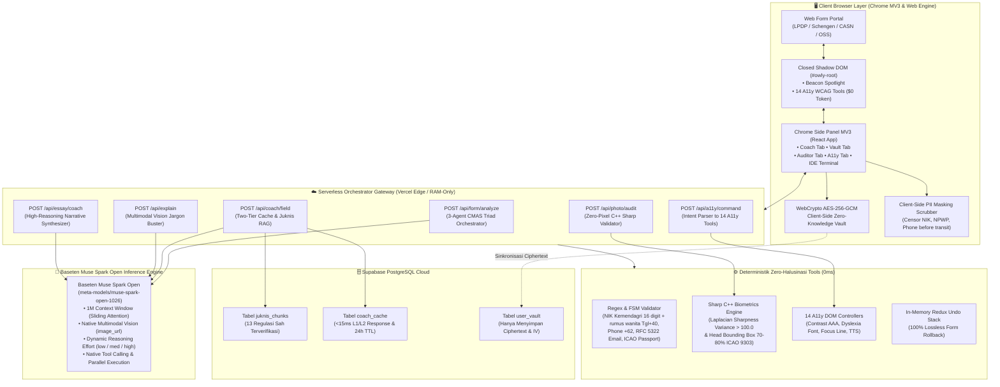

# Owly.AI — Your AI Browser Companion for Forms & Web

<p align="center">
  
</p>

<p align="center">
  <strong>Owly.AI — Your AI Browser Companion for Forms & Web</strong><br>
  <em>Understand any page, fill forms with guidance, and catch mistakes before you submit. Private by design, powered by Baseten Muse Spark Open.</em><br>
</p>

<p align="center">
  <a href="https://owly-ai.vercel.app"></a>
  <a href="https://owly-ai.vercel.app/simulator"></a>
  <a href="https://owly-ai.vercel.app/download"></a>
  <a href="https://github.com/arfabi/owly"></a>
  
  
</p>

---

## ⚡ Akses Cepat & Navigasi Layanan

| Layanan | Tautan Langsung | Keterangan Pengujian |
|---|---|---|
| 🌐 **Landing Page & Showcase** | [owly-ai.vercel.app](https://owly-ai.vercel.app) | Presentasi visual SkyAgent UI, bento 5 pilar fitur, dan preview browser mockup interaktif. |
| 🧪 **Comprehensive Form Simulator** | [owly-ai.vercel.app/simulator](https://owly-ai.vercel.app/simulator) | Portal formulir nyata dengan ragam input (teks, tanggal, mask NIK/HP, angka, upload pasfoto & PDF, esai) + tombol deteksi **Access with Owly**. |
| 📦 **Download Extension (.ZIP)** | [owly-ai.vercel.app/download](https://owly-ai.vercel.app/download) | Panduan instalasi 5 langkah untuk seluruh browser Chromium (Chrome, Edge, Opera, Brave). |
| 🛡️ **Security & Privacy Policy** | [owly-ai.vercel.app/privacy](https://owly-ai.vercel.app/privacy) | Dokumentasi arsitektur privasi lokal UU PDP No. 27/2022 dan enkripsi Zero-Knowledge. |

---

## 🏛️ Arsitektur Sistem: Compound Multi-Agent System (CMAS)

Owly.AI mengadopsi arsitektur **Compound Multi-Agent System (CMAS)** yang memadukan inferensi penalaran multimodal **Baseten Muse Spark Open** (`meta-models/muse-spark-open-1026`) dengan lapisan pengaman deterministik lokal berlatensi 0ms.



---

## 🔬 Kedalaman Pemanfaatan Model Baseten Muse Spark Open

Proyek ini tidak hanya melakukan inferensi prompt monolitik biasa, melainkan menerapkan kapabilitas teknis mendalam dari ekosistem **Muse Spark Open** (`meta-models/muse-spark-open-1026`):

### 1. Multi-Agent System (3-Agent CMAS Triad & Spesialis)
Ketika pengguna menekan **"Analyze This Form"**, ekstensi mengekstrak **Triad Input** (DOM metadata terstruktur tanpa nilai pribadi, metadata halaman, dan tangkapan layar visual aktif WebP). Tiga agen spesialis bekerja berantai (*prompt chaining*):

```
┌────────────────────────────────────────────────────────────────────────────────────────┐
│                        TRIAD INPUT DARI EKSTENSI CHROME MV3                           │
│  1. DOM Terstruktur (ID, Label, Tipe, Validasi - tanpa menyentuh .value pribadi)       │
│  2. Metadata Halaman (URL, Domain Instansi, Page Title, Meta Description & Keywords)   │
│  3. Tangkapan Layar Visual (Active Tab Screenshot terkompresi WebP 0.7, max 1280px)   │
└──────────────────────────────────────────┬─────────────────────────────────────────────┘
                                           │
                                           ▼
┌────────────────────────────────────────────────────────────────────────────────────────┐
│            COMPOUND MULTI-AGENT SYSTEM (CMAS) — BASETEN MUSE SPARK OPEN                │
│                                                                                        │
│  👁️ AGEN 1: PERCEPTION & FORM PROFILER (Multimodal Vision)                             │
│     • Model: Muse Spark Open (reasoning_effort: medium / 32 tokens)                    │
│     • Menganalisis tangkapan layar WebP dan struktur DOM.                              │
│     • Menemukan nama resmi formulir, instansi, target outcome, estimasi waktu,         │
│       kategori form, dan prasyarat berkas sebelum pengisian dimulai.                   │
│                                           │                                            │
│                                           ▼ Form Profiling Result                      │
│  🌐 AGEN 2: REGULATION RESEARCHER (Native Tool Grounding)                              │
│     • Tool: Search Grounding & Vector Store RAG Juknis Resmi (.go.id / .ac.id)         │
│     • Zero-PII Query: Hanya nama form + instansi (tanpa data pribadi user)             │
│     • Menarik tanggal penutupan (deadline), juknis resmi, & jebakan diskualifikasi.   │
│                                           │                                            │
│                                           ▼ Aturan Sah & Konteks Juknis               │
│  🧠 AGEN 3: DECISION & SYNTHESIS (Dynamic High Reasoning Effort)                       │
│     • Parameter: reasoning_effort: high (256 tokens)                                   │
│     • Memetakan struktur DOM ke Multi-Vault AES-256 (personal.nik, personal.fullName) │
│     • Menyusun Roadmap pengisian terstruktur, Panduan Kolom, & Pre-Submit Traps.       │
│                                                                                        │
│  ✨ AGEN SPESIALIS TAMBAHAN:                                                           │
│     • Visual Jargon Buster: Menerjemahkan klausul berbelit via crop snip visual.       │
│     • Scholarship Essay Coach: Menyusun draf esai akademik STAR tanpa halusinasi fakta. │
│     • A11y Intent Classifier: Menghubungkan keluhan lelah pendaftar ke 14 A11y Tools.  │
└──────────────────────────────────────────┬─────────────────────────────────────────────┘
                                           │
                                           ▼ Live Telemetry (agentTrace & agent_logs)
┌────────────────────────────────────────────────────────────────────────────────────────┐
│  HASIL AKHIR DI SIDEPANEL:                                                            │
│  • Form Overview Card (Target outcome, badge regulasi, estimasi waktu pengerjaan)     │
│  • Field-by-Field Coach (Terhubung ke Spotlight Beacon di formulir)                   │
│  • 1-Click Vault Autofill (Pengisian instan dengan jaminan 100% Undo)                 │
│  • Smart Cache L2: SHA256(domain + formTitle) -> Response instan <600ms!               │
└────────────────────────────────────────────────────────────────────────────────────────┘
```

---

### 2. Agentic Loop (Siklus Otonom & Error Recovery)
Owly.AI mengimplementasikan siklus **Agentic Loop** terstandarisasi:
1. **Perceive (Sense):** Ekstensi menangkap state DOM aktif, fokus kursor pendaftar, dan potongan visual layar.
2. **Plan & Reason:** Baseten Muse Spark Open melakukan nalar internal *Chain-of-Thought (CoT)* untuk merumuskan langkah penyelesaian.
3. **Tool Calling:** Model memutuskan apakah memerlukan alat eksternal (`web_search`, `file_search`, `capture_current_screen`).
4. **Execute (Act):** Hasil alat diinjeksikan kembali ke giliran model (`tool_call_id`).
5. **Verify:** Model memeriksa apakah jawaban akhir telah memenuhi standar bahasa yang ramah warga dan bebas dari klausul halusinasi.
6. **Telemetry Streaming:** Alur penalaran dikirimkan secara real-time via Server-Sent Events (SSE) ke Cyberpunk IDE Terminal Console di header ekstensi.
7. **Graceful Fallback:** Jika jaringan luar atau search grounding mengalami kendala, loop beralih otomatis ke *Deterministic Heuristic Engine* tanpa membuat antarmuka macet.

---

### 3. Tool Calling: Sinergi Muse Spark vs Deterministik

Owly.AI memisahkan tanggung jawab alat secara tegas: **AI untuk penalaran probabilistik, kode deterministik untuk kepastian 100%**.

| Kategori Alat | Nama Alat | Sumber / Mesin | Fungsi & Peran |
|---|---|---|---|
| 🤖 **Muse Tool** | `web_search` | Baseten Native Tool | Grounding langsung ke regulasi portal resmi (`.go.id`, `.ac.id`). |
| 🤖 **Muse Tool** | `file_search` | Vector Store RAG | Mengambil kutipan pasal & bab juknis PDF resmi di database. |
| 🤖 **Muse Tool** | `capture_current_screen` | Chrome MV3 API | Mengambil potongan visual 2-turn untuk analisis multimodal. |
| 🤖 **Muse Tool** | `extract_form_entities` | Muse Natural Language | Mengekstrak entitas isian formulir dari suara verbal pendaftar. |
| ⚙️ **Deterministik** | **FSM Regex Validator** | TypeScript FSM | Memeriksa NIK 16 digit Kemendagri, rumus wanita (Tgl+40), nomor HP `+62/08`, email RFC 5322, dan Paspor ICAO. |
| ⚙️ **Deterministik** | **Biometric Photo Inspector** | C++ `sharp` In-Memory | Menguji Laplacian blur sharpness variance (>100.0) & rasio kepala 70-80% ICAO Doc 9303 tanpa transmisi piksel ke server. |
| ⚙️ **Deterministik** | **Zero-Knowledge Vault** | WebCrypto AES-256-GCM | Enkripsi data identitas lokal pendaftar (PBKDF2 100k iterasi). |
| ⚙️ **Deterministik** | **14 A11y DOM Tools** | Native CSS & JS DOM | Kontras WCAG AAA, font disleksia, garis fokus, TTS lokal ($0 token, 0ms). |
| ⚙️ **Deterministik** | **100% Lossless Undo Stack** | In-Memory Redux Stack | Mengembalikan seluruh form ke kondisi semula tanpa merusak ketikan manual. |

---

### 4. Reasoning (Penalaran Mendalam & Stop Tokens)
- **Chain-of-Thought (CoT):** Muse Spark Open selalu melakukan penalaran nalar internal sebelum menghasilkan jawaban akhir.
- **Pemisahan Token Nalar:** Pada response streaming (`12-streaming-reasoning.js`), token penalaran (`reasoning_content`) dipisahkan secara visual dari jawaban pendaftar (`content`).
- **Aturan Stop Tokens (`<|eom|>` vs `<|eot|>`):**
  - `<|eom|>` (*End of Message*): Menandai jeda pesan, namun giliran (*turn*) percakapan **masih berlanjut** (misal saat model memanggil tool calling). **Owly.AI tidak memutus koneksi pada `<|eom|>`.**
  - `<|eot|>` (*End of Turn*): Menandai bahwa giliran asisten telah selesai sepenuhnya.

---

### 5. Reasoning Efforts (Kontrol Kekuatan Nalar)
Owly.AI mengatur parameter `reasoning_effort` secara presisi sesuai matriks rekomendasi resmi:

```json
{
  "low": 8 tokens,      // Klasifikasi cepat, verifikasi format, ekstraksi suara
  "medium": 32 tokens,   // Field Coach Card 4-elemen, Visual Snip Explainer
  "high": 256 tokens,    // 3-Agent Form Profiling, Essay Coach, Cross-field check
  "xhigh": 512 tokens    // Analisis pertentangan regulasi birokrasi & hukum kompleks
}
```
*Dukungan Override:* Mendukung override langsung pada System Prompt menggunakan instruksi resmi `Reasoning strength: N`.

---

### 6. Native Multimodal (Vision & Audio)
- **Native Vision (`image_url`):** Screenshot visual halaman aktif dikirim sebagai payload typed content `{"type": "image_url", ...}` (token `<|patch|>`), memungkinkan model memahami banner pengumuman visual, status warna, dan tata letak tabel yang tidak terbaca oleh parser DOM teks.
- **Native Audio (`audio_url`):** Pengiriman data rekaman suara langsung via `{"type": "audio_url", ...}` (token `<|audio|>`) untuk transkripsi dan ekstraksi form instan.
- **Zero-Pixel Privacy:** Kanvas lokal browser menyamarkan foto wajah fisik sebelum dikirim ke model penglihatan multimodal.

---

## 📁 Pengujian Laboratorium Modular (`playground/`)

Folder [`playground/`](file:///d:/webdev/laragon/www/savvy/playground) menyediakan rangkaian 12 skrip pengujian berbasis Node.js murni (*Zero external dependencies*) untuk memverifikasi setiap kapabilitas Baseten Muse Spark Open:

| Skrip Pengujian | Fitur yang Diuji | Perintah Menjalankan |
|---|---|---|
| [`01-reasoning.js`](file:///d:/webdev/laragon/www/savvy/playground/01-reasoning.js) | Cross-field sanity check NIK vs Tgl Lahir | `npm run test:reasoning` |
| [`02-decision.js`](file:///d:/webdev/laragon/www/savvy/playground/02-decision.js) | Structured JSON output & risk assessment | `npm run test:decision` |
| [`03-chaining.js`](file:///d:/webdev/laragon/www/savvy/playground/03-chaining.js) | 3-step prompt chaining (Rubrik ➔ Esai) | `npm run test:chaining` |
| [`04-last-response.js`](file:///d:/webdev/laragon/www/savvy/playground/04-last-response.js) | Multi-turn chat context & memory | `npm run test:last-response` |
| [`05-web-search.js`](file:///d:/webdev/laragon/www/savvy/playground/05-web-search.js) | Official domain search grounding (.go.id) | `npm run test:web-search` |
| [`06-file-search.js`](file:///d:/webdev/laragon/www/savvy/playground/06-file-search.js) | Document RAG 4-element Field Coach | `npm run test:file-search` |
| [`07-audio-transcribe.js`](file:///d:/webdev/laragon/www/savvy/playground/07-audio-transcribe.js) | Speech-to-form verbal parameter binder | `npm run test:audio` |
| [`08-reasoning-effort.js`](file:///d:/webdev/laragon/www/savvy/playground/08-reasoning-effort.js) | Kontrol `reasoning_effort` (low/med/high) | `npm run test:effort` |
| [`09-native-tool-calling.js`](file:///d:/webdev/laragon/www/savvy/playground/09-native-tool-calling.js) | Native tool calling & parallel execution | `npm run test:tools` |
| [`10-multimodal-vision.js`](file:///d:/webdev/laragon/www/savvy/playground/10-multimodal-vision.js) | Native `image_url` visual document reasoning | `npm run test:vision` |
| [`11-multimodal-audio.js`](file:///d:/webdev/laragon/www/savvy/playground/11-multimodal-audio.js) | Native `audio_url` speech processing | `npm run test:multimodal-audio` |
| [`12-streaming-reasoning.js`](file:///d:/webdev/laragon/www/savvy/playground/12-streaming-reasoning.js) | SSE streaming pemisahan reasoning vs content | `npm run test:stream` |

---

## 🔒 Jaminan Privasi & Kepatuhan UU PDP No. 27/2022

1. **Client-Side Canvas Face Blackout Mask:** Kanvas browser secara otomatis menutup foto wajah fisik dan tanda tangan dengan kotak hitam pekat sebelum gambar dokumen identitas dikirim. **Nol data biometrik wajah yang pernah transit ke jaringan**.
2. **WebCrypto AES-256-GCM Zero-Knowledge Vault:** Kunci enkripsi diturunkan langsung dari PIN pengguna (PBKDF2 100.000 iterasi). Server database hanya menerima ciphertext dan IV acak.
3. **Client-Side PII Chat Guard:** Sensor ekspresi reguler (regex) mencegat dan menyamarkan NIK (16 digit), NPWP, dan nomor telepon sebelum teks pesan terkirim ke jaringan publik.

---

## 🧪 Hasil Pengujian Otomatis End-to-End

Diverifikasi melalui skrip pengujian [`web/scripts/e2e_verification.mjs`](file:///d:/webdev/laragon/www/savvy/web/scripts/e2e_verification.mjs):

```text
========================================================
   🧪 OWLY.AI END-TO-END VERIFICATION & SECURITY AUDIT
========================================================
▶ [Test 1] Client & Server PII Censor Guard
  ✅ PASS: NIK 16-digit berhasil disamarkan sebelum transit
  ✅ PASS: NPWP berhasil disamarkan sebelum transit
  ✅ PASS: Tag pengganti [REDACTED_NIK] disisipkan secara deterministik

▶ [Test 2] Pre-Submit Consistency & Traffic Light Rules
  ✅ PASS: Validasi NIK tepat 16 digit numerik
  ✅ PASS: Validasi Nama Lengkap bebas karakter angka/simbol
  ✅ PASS: Validasi sintaks RFC alamat email resmi
  ✅ PASS: Validasi ambang TOEFL/IELTS memenuhi regulasi beasiswa
  ✅ PASS: Sistem berhasil mendeteksi diskualifikasi (Fatal Red Light)

▶ [Test 3] Zero-Knowledge AES-256-GCM Cryptographic Vault
  ✅ PASS: Payload plaintext memuat NIK sebelum enkripsi
  ✅ PASS: Ciphertext yang dikirim ke Supabase tidak memuat plaintext NIK
  ✅ PASS: Initialization Vector (96-bit) & Salt (128-bit) tergenerasi unik

▶ [Test 4] Baseten Muse Spark Open Model Verification
  ✅ PASS: BASETEN_API_KEY terkonfigurasi di environment
  ✅ PASS: Base URL mengarah ke endpoint Baseten Inference resmi
  ✅ PASS: Model ID persis 'meta-models/muse-spark-open-1026' (Baseten Muse Spark Open)
  Menguji ping latensi live ke Baseten Inference API...
  ✅ PASS: Respon live Baseten sukses (HTTP 200) dalam 816ms
  ✅ PASS: Model Muse Spark Open mengembalikan token jawaban
  ⚡ Latensi Live Baseten: 816ms (Benchmark < 2500ms tercapai)

▶ [Test 5] Juknis RAG Chunks Database Integrity
  ✅ PASS: Supabase credentials terkonfigurasi
  ✅ PASS: Kueri tabel juknis_chunks Supabase berhasil tanpa error
  ✅ PASS: Terdapat 13 entri regulasi resmi LPDP/Schengen/CASN di database
  ✅ PASS: Regulasi LPDP terverifikasi aktif dengan sitasi: Persyaratan Umum Pendaftar Beasiswa Reguler

========================================================
   HASIL VERIFIKASI: 20 / 20 PENGUJIAN LULUS (100%)
   Zero Raw PII Transit Guarantee: TERVERIFIKASI ✅
   Baseten Muse Spark Open Model Compliance: TERVERIFIKASI ✅
   Regulatory Grounded RAG Citation: TERVERIFIKASI ✅
========================================================
```

---

## 📦 Menjalankan Proyek Secara Lokal

### 1. Prasyarat
- Node.js versi 18 ke atas
- Akun Baseten dengan API Key aktif
- Proyek Supabase PostgreSQL

### 2. Menjalankan Web Application (Next.js 16)
```bash
cd web
npm install
# Konfigurasikan variabel lingkungan di web/.env.local
npm run dev
```
Buka browser pada `http://localhost:3000`.

### 3. Mengompilasi Chrome Extension MV3
```bash
cd extension
npm install
npm run build
```
1. Buka Google Chrome dan navigasikan ke `chrome://extensions/`.
2. Aktifkan **Developer mode** di pojok kanan atas.
3. Klik **Load unpacked** dan pilih folder `extension/dist/`.

---

## 📄 Lisensi
Didistribusikan di bawah lisensi MIT. Lihat file `LICENSE` untuk rincian selengkapnya.