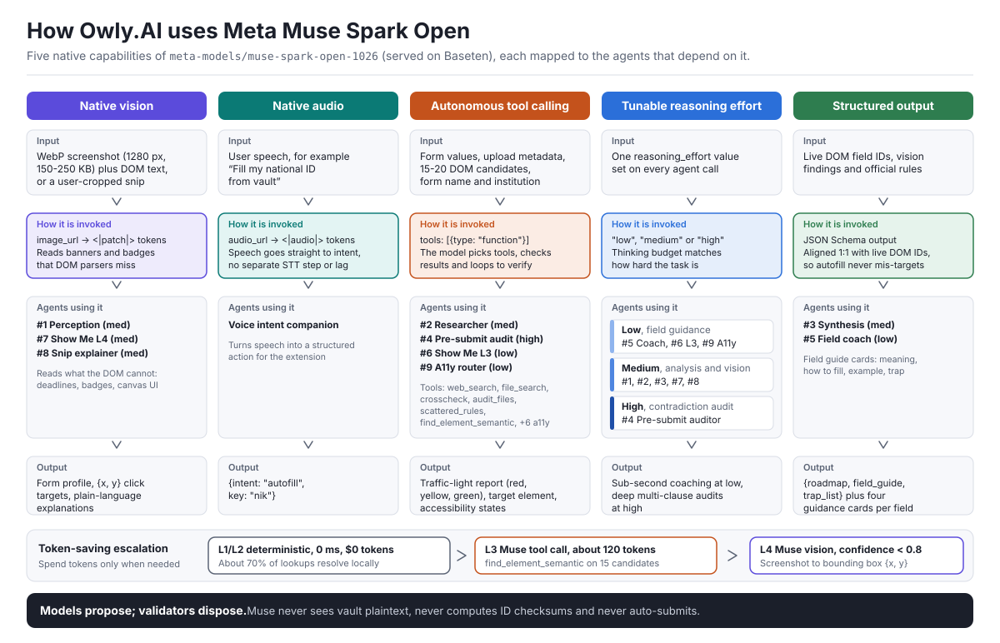

# Owly.AI — Your AI Browser Companion for Forms & Web

<p align="center">
  
</p>

<p align="center">
  <strong>Owly.AI — Your AI Browser Companion for Forms & Web</strong><br>
  Understand any page, fill forms with guidance, and catch mistakes before you submit.<br>
  <em>Built with Meta Muse Spark Open deployed on Baseten as private inference</em>
</p>

<p align="center">
  <a href="https://owly-ai.vercel.app"></a>
  <a href="https://owly-ai.vercel.app/simulator"></a>
  <a href="https://owly-ai.vercel.app/download"></a>
  <a href="https://www.youtube.com/watch?v=vfNBFFgfblg"></a>
  <a href="https://github.com/arfabi/owly"></a>
  
  
</p>

---

> **Owly.AI** is a privacy-first browser copilot that explains confusing forms, guides each field, and audits your draft *before* you press Submit, powered by Meta Muse Spark Open.

## 🧭 Quick Judging & Evaluation Guide (Test in 60s)

| | |
|---|---|
| **Name** | **Owly.AI** |
| **Type** | Chrome MV3 extension + Web (Next.js App Router & API Gateway) |
| **Track** | Build for Your World · Indie Developers |
| **Model** | `meta-models/muse-spark-open-1026` via Baseten (Dedicated Private Inference) |
| **🎬 Video Walkthrough** | [▶️ Watch Demo & Installation Tutorial on YouTube](https://www.youtube.com/watch?v=vfNBFFgfblg) |
| **🌐 Live Web Links** | [Landing Page](https://owly-ai.vercel.app) · [Form Simulator](https://owly-ai.vercel.app/simulator) |
| **📦 Extension Download**| [Download Extension (.ZIP)](https://owly-ai.vercel.app/download) *(or [Direct .ZIP](https://owly-ai.vercel.app/owly-extension.zip))* |

### 🏆 Rubric Scoring Alignment

| Criterion | Weight | Evidence | Where to Look |
|---|:---:|---|---|
| **Impact** | 30% | Solves real clerical rejections; copilot-not-autopilot philosophy; never auto-submits; 14 built-in accessibility tools ($0 tokens) | [Problem & Impact](#-the-problem--human-impact) · [Form Simulator](https://owly-ai.vercel.app/simulator) |
| **Use of Meta AI** | 25% | **9 specialized agents + Deep Essay Synthesizer**; native multimodal vision (`<\|patch\|>`), direct audio streaming (`<\|audio\|>`), autonomous tool calling, full 4-tier reasoning effort (`low` / `medium` / `high` / `xhigh`), structured schema outputs | [5 Core Capabilities & 9 Agents](#-in-depth-utilization-of-meta-muse-spark-open) · [Architecture](#️-system-architecture-compound-multi-agent-system-cmas) |
| **Technical Depth** | 20% | 20/20 E2E tests pass (100%) · Zero-Knowledge WebCrypto AES-256-GCM · Client-side PII scrubbing · Local validators (0 ms) · Two-tier guidance cache (<5 ms) · Live model response (~816 ms) | [System Architecture](#️-system-architecture-compound-multi-agent-system-cmas) · [Verification Spec (`feature/verification.md`)](feature/verification.md) |
| **Demo & UX** | 25% | Video walkthrough & tutorial · Production live app · Pre-built extension (.ZIP) ready to test in 60 seconds with no API key needed | [YouTube Tutorial](https://www.youtube.com/watch?v=vfNBFFgfblg) · [Live App](https://owly-ai.vercel.app) · [Demo Test Guide](#extension-demo-test-without-self-deployment) |

### Extension Demo Test without Self Deployment

> [!TIP]
> **No API keys or local server installation required!**  
> We have pre-compiled the extension and connected it directly to our live production gateway powered by **Meta Muse Spark Open**. You can evaluate the full end-to-end user experience in under 1 minute.  
> *(If you wish to inspect the codebase and run self-hosted locally with your own API credentials, see the [Self-Hosted & Local Development Guide](#-self-hosted--local-development-installation-guide) at the bottom).*

### 📺 Video Walkthrough & Installation Tutorial

[](https://www.youtube.com/watch?v=vfNBFFgfblg)

> 💡 **Watch on YouTube:** [https://www.youtube.com/watch?v=vfNBFFgfblg](https://www.youtube.com/watch?v=vfNBFFgfblg) — Step-by-step installation, developer mode setup, and live form simulation walkthrough.

1. **Download Pre-Built Extension (.ZIP):**  
   Download the ready-to-use extension package: [**Download owly-extension.zip**](https://owly-ai.vercel.app/owly-extension.zip) *(or visit our [Download Guide](https://owly-ai.vercel.app/download))*.
2. **Extract & Load in Chrome (Developer Mode):**  
   - Extract the downloaded `.zip` file on your machine.
   - Open Chrome and navigate to `chrome://extensions/`.
   - Toggle on **Developer mode** (top-right corner).
   - Click **Load unpacked** and select the extracted folder.
3. **Open the Live Form Simulator:**  
   Navigate to our realistic public scholarship & visa portal (stress-testing complex multi-step rules, biometric attachments, and essay validation):  
   👉 [**https://owly-ai.vercel.app/simulator**](https://owly-ai.vercel.app/simulator)
4. **Trigger Owly & Test Live Capabilities:**  
   - Click the prominent **"Access with Owly"** button on the right side of the form (Owly will detect the extension and automatically open the Side Panel).
   - Click **"Analyze This Form"** to watch the 3-Agent CMAS Triad scan the page and ground official rules in real-time.
   - Click any input field to see instant 4-element guidance cards (*Meaning, How to Fill, Example, Traps*).
   - Click **"1-Click AutoFill"** from the Vault and test the instant Undo stack.
   - Click **"Pre-Submit Traffic Light Audit"** to see multi-clause contradiction detection in action!

---

## 📑 Table of Contents
- [🧭 Quick Judging & Evaluation Guide (Test in 60s)](#-quick-judging--evaluation-guide-test-in-60s)
- [💔 The Problem & Human Impact](#-the-problem--human-impact)
  - [Industry Facts & Verified Data](#industry-facts--verified-data)
  - [Philosophy: Copilot, Not Autopilot](#philosophy-copilot-not-autopilot)
- [🏛️ System Architecture: Compound Multi-Agent System (CMAS)](#️-system-architecture-compound-multi-agent-system-cmas)
- [✨ Core Feature Breakdown (9 Pillars)](#-core-feature-breakdown-9-pillars)
- [🔬 In-Depth Utilization of Meta Muse Spark Open](#-in-depth-utilization-of-meta-muse-spark-open)
  - [1. 5 Core Meta Capabilities Exploited](#1-5-core-meta-capabilities-exploited)
  - [2. The 9 Meta Cognitive Agents](#2-the-9-meta-cognitive-agents-core-triad--specialized-tasks)
- [🚀 Self-Hosted & Local Development Installation Guide](#-self-hosted--local-development-installation-guide)
  - [Step 1: Clone the Repository](#step-1-clone-the-repository)
  - [Step 2: Set Up Supabase Database & Apply Schema](#step-2-set-up-supabase-database--apply-schema)
  - [Step 3: Configure Backend Environment Variables](#step-3-configure-backend-environment-variables-webenvlocal)
  - [Step 4: Start Web & API Server](#step-4-start-web--api-server)
  - [Step 5: Configure Extension API Endpoint](#step-5-configure-extension-api-endpoint)
  - [Step 6: Build & Load the Chrome MV3 Extension](#step-6-build--load-the-chrome-mv3-extension)
- [👥 Team](#-team)
- [🧰 Tech Stack](#-tech-stack)
- [📄 License](#-license)

---

## 💔 The Problem & Human Impact

A few months ago, a spouse tried to renew her driver's license online. Three days later: **Rejected**. Her qualifications were valid and her documents were authentic, but she had mistyped a single digit of an identification number in a field with ambiguous instructions. She was forced to pay the processing fee again and restart from scratch.

This happens to millions of people worldwide every single day: an incorrect photo aspect ratio, an obscure regulation buried in a fine-print footnote, and the government portal only notifies you **AFTER** you press Submit. For scholarship seekers, visa applicants, job seekers, and parents enrolling children: **people fail at the form, not at the requirements.**

### Industry Facts & Verified Data:
* **Form Fatigue & Abandonment Baseline (~68-70%):** Large-scale user experience research by the Baymard Institute demonstrates that multi-step digital forms suffer an average abandonment rate of ~69.9% due to confusing instructions, usability friction, and cognitive fatigue—friction that compounds exponentially on high-stakes administrative portals.
* **Administrative Burden on Aid & Visas (NCAN):** Studies by the National College Attainment Network (NCAN) on federal aid (FAFSA) reveal that administrative verification burdens and minor clerical discrepancies delay or derail funding for substantial cohorts of eligible applicants.
* **Avoidable Clerical Denials in High-Stakes Applications:** Consular and civil service audit reports consistently document that avoidable clerical mismatches, ambiguous attachment criteria, and minor syntax discrepancies remain the primary drivers of initial application delays and processing rejections.

### Philosophy: Copilot, Not Autopilot
High-stakes applications (visas, scholarships, professional licenses) are binding legal instruments where an automated bot submitting data blindly can permanently disqualify an applicant. We engineered Owly.AI as an active copilot that sits alongside the applicant: highlighting rules, clarifying bureaucratic terminology, validating syntax, and auditing drafts, while leaving 100% of final submission authority to the human applicant.

* **Who Benefits:** First-time applicants, older adults, and neurodivergent individuals or people with disabilities (ADHD, dyslexia, low vision).
* **Measurable Impact:** Drastic reduction in clerical rejections, elimination of bureaucratic anxiety, and hours of citizen time saved.

---

## 🏛️ System Architecture: Compound Multi-Agent System (CMAS)

Owly.AI implements a **Compound Multi-Agent System (CMAS)** that synergizes the probabilistic multimodal reasoning of **Meta Muse Spark Open** (`meta-models/muse-spark-open-1026`) with deterministic zero-latency client-side guardrails. To safeguard sensitive citizen data, model inference runs in dedicated, SOC 2 Type II-compliant Baseten serverless containers with guaranteed volatile in-memory execution and zero data retention for training.

> **Core Principle: "Models Propose; Validators Dispose."**  
> AI models formulate semantic reasoning and action plans (*proposes*), while local deterministic code scrubs PII, validates mathematical syntax, enforces cryptographic zero-knowledge, and renders DOM feedback (*disposes*). The AI model never touches unencrypted vault credentials, never calculates ID checksums, and never auto-submits.

<p align="center">
  
</p>

---

## ✨ Core Feature Breakdown (9 Pillars)

Owly.AI is an active compound browser agent combining multimodal cognitive intelligence with deterministic client-side execution, rather than a passive chatbot or simple RAG wrapper.

| # | Feature | What It Does | Meta Muse Spark Open | Spec |
|:---:|---|---|---|:---:|
| 1 | **Forms Guide** | Scan DOM → badges 1..N, step walkthrough | 3-Agent Triad (Perception/Researcher/Decision) + 4-element card | [→ forms_guide.md](feature/forms_guide.md) |
| 2 | **Pre-Submit Audit** | Traffic-light audit, score 0-100 | 5-Layer FSM (REQUIRED/FORMAT/DISCREPANCY/ATTACHMENT/RULE) + Semantic Reasoner | [→ audit.md](feature/audit.md) |
| 3 | **Autofill + Ingestion** | Upload doc → extract → 1-Click Fill + Undo | Vision OCR `<\|patch\|>` + ephemeral RAM + AES-256-GCM vault | [→ autofill.md](feature/autofill.md) |
| 4 | **Explain This** | Lightshot drag to explain clause/stamp | Vision analysis → 5-pillar JSON (title, explanation, legal, tips, action) | [→ explain.md](feature/explain.md) |
| 5 | **Show Me + Ghost** | "Show me: upload passport" → finds it | 4-tier: Exact <1ms → Synonym <5ms → Semantic ~280ms → Vision | [→ showme.md](feature/showme.md) |
| 6 | **Voice Companion** | PTT walkie-talkie & Live Talk hands-free | Web Audio VAD (RMS>18) + `<\|audio\|>` transcribe + TTS + tool calling | [→ voice.md](feature/voice.md) |
| 7 | **Ask Owly (Chat)** | Side panel contextual chat & grounded Q&A | Autonomous tool calling (`scroll_to`, `highlight`, `explain_clause`) + RAG regulation grounding | [→ chat.md](feature/chat.md) |
| 8 | **A11y Hub** | 14 tools for low-vision/dyslexia/ADHD | Function calling temp 0.1 + offline fallback | [→ accessibility.md](feature/accessibility.md) |
| 9 | **Security + Logs** | Zero-Knowledge + observability | PBKDF2 100k + PII scrubber + 7 domains (PLANNER/REASONING/ACTION...) | [→ security.md](feature/security.md) · [→ logs](feature/log_viewer.md) |

> 🧪 **Tested & Verified:** 20/20 E2E PASS, 816ms live inference, <5ms cache. [Read Full Verification Spec →](feature/verification.md)

---

## 🔬 In-Depth Utilization of Meta Muse Spark Open

Owly.AI is engineered around the native capabilities of **Meta Muse Spark Open** (`meta-models/muse-spark-open-1026`):

### 1. 5 Core Meta Capabilities Exploited

| Capability | How We Invoke It | Applied In | Why It Is Non-Trivial & High-Value |
|---|---|---|---|
| **Native Vision** | Compressed WebP `image_url` (150–250KB, 1280px) → `<\|patch\|>` tokens | Perception Agent, Visual Locator Level 4, Snip Explainer | Reads urgent deadline banners, color badges, and canvas tables lacking DOM text. Pure DOM parsers fail completely here. |
| **Native Audio** | Streaming audio via `audio_url` → `<\|audio\|>` tokens | Voice Intent Companion | Converts verbal speech (*"Fill my passport number from vault"*) directly into structured action intent `{intent: "autofill", key: "passport_number"}` without cascading STT lag. |
| **Autonomous Tool Calling** | `tools: [{type: "function"}]` with autonomous verification loop | Regulation Researcher, Traffic-Light Auditor, Show Me L3, A11y Intent Router | Model autonomously selects tools, evaluates arguments, and verifies results in an agentic loop rather than a single-shot prompt. |
| **Tunable Reasoning Effort** | Parameter `reasoning_effort` (`"low"`, `"medium"`, `"high"`, `"xhigh"`) | Adaptive thinking budget per agent | Compute efficiency: `low` for sub-second field coaching, `medium` for visual extraction, `high` for multi-clause contradiction auditing, and `xhigh` (380+ CoT tokens) for academic scholarship narrative synthesis. |
| **Structured Output Enforcing** | JSON Schema CoT output matching live DOM field IDs | Decision & Synthesis, Field Guide Cards | Generates strictly validated JSON aligned 1:1 with live DOM IDs, preventing autofill targeting misalignments. |

#### 🧠 4-Tier Adaptive Reasoning Spectrum

| Level | Reasoning Tokens | Target Latency | Agent / Component | Computational Rationale |
|:---:|:---:|:---:|---|---|
| **`low`** | ~0 – 32 tokens | **Sub-second (<600 ms)** | Field Coach, Show Me L3 (Semantic Locator), A11y Intent Router | Ultra-fast interactive guidance upon field focus without user-noticeable lag. |
| **`medium`** | ~32 – 96 tokens | **~800 ms – 1.5s** | Perception Profiler (Vision), Visual Snip Explainer, Show Me L4, Voice Companion | Fast multimodal token parsing (`<\|patch\|>`, `<\|audio\|>`) and plain jargon translation. |
| **`high`** | ~100 – 256 tokens | **~1.5s – 3.0s** | Decision & Synthesis Triad (Agent 3), Pre-Submit Traffic-Light Auditor | Multi-clause legal contradiction auditing (e.g. affirmative vs. regular GPA, age limits). |
| **`xhigh`** | ~380 – 600+ tokens | **~2.0s – 4.5s** | **Scholarship & Visa Essay Coach** (`/api/essay/coach`) | Exhaustive multi-step CoT thinking scratchpad for institutional essay criteria & coherence. |

---

### 2. The 9 Meta Cognitive Agents: Core Triad & Specialized Tasks

Owly's multi-agent system orchestrates a sequential **Core 3-Agent Triad** for initial page understanding alongside **6 Specialized On-Demand Agents**:

```
                  ┌─────────────────────────────────────────────────────────┐
                  │       CORE 3-AGENT TRIAD (Sequential Analysis)          │
                  │  1. Perception Profiler ➔ 2. Researcher ➔ 3. Synthesizer│
                  └───────────────────────────┬─────────────────────────────┘
                                              │
                      ┌───────────────────────┴───────────────────────┐
                      ▼                                               ▼
     ┌─────────────────────────────────┐             ┌─────────────────────────────────┐
     │   USER INTERACTION AGENTS       │             │   AUDIT & NAVIGATION AGENTS     │
     │ • Field Coach (Low Effort)      │             │ • Pre-Submit Auditor (High)     │
     │ • Visual Snip Explainer (Medium)│             │ • Show Me L3 Semantic (Low)     │
     │ • A11y Intent Router (Low)      │             │ • Show Me L4 Vision (Medium)    │
     └─────────────────────────────────┘             └─────────────────────────────────┘
```

| # | Agent | Category | Role & Core Capability | Reasoning Tier |
|:---:|---|---|---|:---:|
| 1 | **Perception & Form Profiler** | Core Triad (Step 1) | WebP screenshot + DOM analysis to extract form name, category, and deadlines | `medium` |
| 2 | **Regulation Researcher** | Core Triad (Step 2) | Grounded official rule search (`web_search` + RAG) with **Zero PII** transit | `medium` |
| 3 | **Decision & Synthesis** | Core Triad (Step 3) | Fuses vision + legal rules + DOM to emit structured roadmap and trap alerts | `high` |
| 4 | **Pre-Submit Auditor** | Specialized Task | Multi-clause contradiction checks and traffic-light pre-submit evaluation | `high` |
| 5 | **Field-by-Field Coach** | Specialized Task | Renders 4-element guidance cards (*Meaning, How to Fill, Example, Trap*) | `low` (sub-second) |
| 6 | **Show Me L3 (Semantic)** | Specialized Task | Bridges colloquial user queries with technical element IDs via tool calling | `low` |
| 7 | **Show Me L4 (Vision BBox)**| Specialized Task | Fallback visual bounding-box locator for icon buttons and canvas elements | `medium` |
| 8 | **Visual Snip Explainer** | Specialized Task | 2-turn multimodal crop to translate convoluted bureaucratic jargon | `medium` |
| 9 | **A11y Intent Router** | Specialized Task | Maps natural fatigue expressions to 14 discrete accessibility tools | `low` |

> 📖 **Deep-Dive CMAS Architecture Specification:**  
> For the complete multi-agent interaction protocol, token-saving cost escalation ladder, autonomous guardrails, and telemetry domains, see the master architecture document:  
> 👉 **[Read the Full CMAS & Multi-Agent Architecture Specification (`feature/agentic.md`)](feature/agentic.md)**

---

## 🚀 Self-Hosted & Local Development Installation Guide

> [!NOTE]
> **Custom Setup & Open-Source Inspection:**  
> This section is for developers, self-hosters, and technical auditors who want to run a private backend server with their own API keys and build the extension from source code.  
> *(If you are a hackathon judge or evaluator looking for immediate 60-second testing, use the [Extension Demo Test Guide](#extension-demo-test-without-self-deployment) above — no local server setup required!)*

To run the complete **Owly.AI** ecosystem locally or self-host on your own infrastructure, follow these 6 steps:

### Step 1: Clone the Repository
```bash
git clone https://github.com/arfabi/owly.git
cd owly
```

### Step 2: Set Up Supabase Database & Apply Schema
Owly.AI relies on Supabase PostgreSQL for the Zero-Knowledge Vault ciphertext sync, two-tier field guidance cache (`coach_cache`), and official regulatory guideline RAG chunks (`juknis_chunks` / regulation embeddings).

You can choose either **Supabase Cloud** (fastest, free) or **Local Supabase CLI**:

#### Option A: Supabase Cloud (Recommended, ~2 Mins)
1. Create a free project at [supabase.com](https://supabase.com).
2. Go to the **SQL Editor** tab in your Supabase dashboard.
3. Open the repository's [`supabase/schema.sql`](supabase/schema.sql) file, paste its content into the SQL Editor, and click **Run**.  
   *(This creates all tables, triggers, indexes, RLS policies, and automatically seeds the benchmark scholarship regulatory guidelines into vector chunks).*
4. Navigate to **Project Settings → API** to copy:
   - **Project URL**
   - **`anon` `public` key**
   - **`service_role` key** *(used for server-side cache and RAG access)*.

#### Option B: Local Supabase CLI (Docker)
```bash
# Initialize and start local Supabase instance
npx supabase init
npx supabase start

# Execute the migration schema
npx supabase db execute --file supabase/schema.sql
```

---

### Step 3: Configure Backend Environment Variables (`web/.env.local`)
Navigate to the `web` directory and copy the environment template:
```bash
cd web
cp .env.example .env.local
```
Open `.env.local` and insert your credentials:
```env
# 1. Supabase PostgreSQL Configuration (From Step 2)
NEXT_PUBLIC_SUPABASE_URL="https://your-project.supabase.co"
NEXT_PUBLIC_SUPABASE_ANON_KEY="your_supabase_anon_key_here"
SUPABASE_SERVICE_ROLE_KEY="your_supabase_service_role_key_here"

# 2. Baseten Inference API (Meta Muse Spark Open)
BASETEN_API_KEY="your_baseten_api_key_here"
BASETEN_BASE_URL="https://inference.baseten.co/v1"
MUSE_SPARK_MODEL_NAME="meta-models/muse-spark-open-1026"
```

---

### Step 4: Start Web & API Server
```bash
npm install
npm run dev
```
The Next.js development server will start on `http://localhost:3000`. You can access the Landing Page and Form Simulator directly in your browser.

---

### Step 5: Configure Extension API Endpoint
By default, the browser extension points to the production cloud gateway. To connect it to your local dev server or self-hosted VPS:
1. Open [extension/src/lib/api/client.ts](extension/src/lib/api/client.ts).
2. Update the `API_BASE_URL` constant on line 8 to point to your local backend:
```typescript
// Point to your local development server or custom VPS domain:
export const API_BASE_URL = "http://localhost:3000";
```
*(Note: If hosting on a public domain, use your domain URL, e.g., `https://api.yourdomain.com`)*.

---

### Step 6: Build & Load the Chrome MV3 Extension
Compile the extension source code:
```bash
cd ../extension
npm install
npm run build
```
This generates the production bundle inside `extension/dist/`.

**Loading into Chromium Browsers (Chrome, Edge, Brave, Opera):**
1. Navigate to `chrome://extensions/` in your browser.
2. Enable the **Developer mode** toggle in the top-right corner.
3. Click the **Load unpacked** button.
4. Select the `extension/dist/` directory from your repository.
5. Click the **Owly.AI** icon in your browser toolbar to open the AI Side Panel.

---

## 👥 Team

| Name | Role | Contact |
|---|---|---|
| **Ahmad Ridlo Fadlli Robbi** | Solo Creator (Fullstack & AI Engineer) | [fadlirobbi@gmail.com](mailto:fadlirobbi@gmail.com) · [@arfabi](https://github.com/arfabi) |

---

## 🧰 Tech Stack

| Layer | Stack |
|---|---|
| **Browser Extension** | Chrome Manifest V3 · React 18 · TypeScript · Vite · Tailwind CSS · WebCrypto AES-256-GCM · Closed Shadow DOM |
| **Web & Backend** | Next.js (App Router & API Gateway) · TypeScript · Tailwind CSS · Supabase PostgreSQL (`pgvector` & Cache) · Vercel |
| **AI & Inference** | **Meta Muse Spark Open** (`meta-models/muse-spark-open-1026` via Baseten) · Compound Multi-Agent System (9 Agents) |

---

## 📄 License
Distributed under the MIT License. See `LICENSE` for more information.