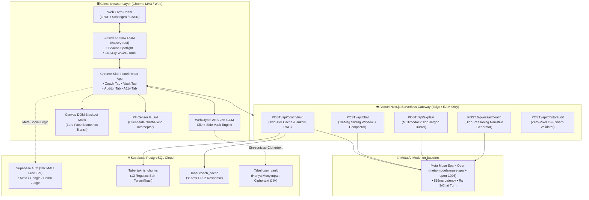

# Savvy.AI — Your AI Browser Companion for Forms & Web

<p align="center">
  
</p>

<p align="center">
  <strong>Savvy.AI — Your AI Browser Companion for Forms & Web</strong><br>
  <em>Understand any page, fill forms with guidance, and catch mistakes before you submit. Private by design, powered by Muse Spark.</em><br>
  Dibangun untuk <strong>Meta Global AI Developer Hackathon 2026</strong> (Track: <em>Indie Developer</em> · Tema: <em>Build for Your World</em>).
</p>

<p align="center">
  <a href="https://savvy-plum.vercel.app"></a>
  <a href="https://savvy-plum.vercel.app/landingpage/simulator"></a>
  <a href="https://github.com/arfabi/savvy"></a>
  
  
</p>

---

## ⚡ Akses Cepat untuk Dewan Juri Hackathon

Evaluator dan dewan juri dapat menguji Savvy.AI secara instan tanpa perlu mengompilasi kode ekstensi lokal:

| Layanan | Tautan Langsung | Keterangan Pengujian |
|---|---|---|
| 🌐 **Web Showcase & Landing** | [savvy-plum.vercel.app](https://savvy-plum.vercel.app) | Presentasi visual SkyAgent UI, fitur Bento Grid, dan panduan lengkap. |
| 🧪 **In-Browser Extension Simulator** | [savvy-plum.vercel.app/.../simulator](https://savvy-plum.vercel.app/landingpage/simulator) | Simulator Chrome Side Panel MV3 interaktif lengkap dengan Voicebot & Essay Coach. |
| 📝 **Interactive LPDP 2026 Portal** | [savvy-plum.vercel.app/.../mock-portal](https://savvy-plum.vercel.app/landingpage/mock-portal) | Arena pengujian pengisian formulir simulasi LPDP 2026 dengan autofill dan audit. |
| 🔑 **1-Click Demo Akun Juri** | Email: `judge@savvy.ai`<br>Sandi: `SavvyJudge2026!` | Klik tombol **"1-Click Masuk Demo Juri"** di header untuk langsung membuka Vault terenkripsi. |

---

## 🏛️ Arsitektur Sistem (Compound Multi-Agent System)



---

## 🎯 3 Pilar Solusi Savvy.AI

### 1. Pillar 1: Understand (Pahami)
- **Beacon Spotlight & Field Coach RAG:** Kursor pada kolom formulir memicu sorotan fokus di Closed Shadow DOM dan memanggil kartu panduan 4-elemen (*Arti Istilah, Cara Mengisi, Contoh Valid Fiktif, Jebakan Diskualifikasi*) lengkap dengan bukti sitasi bab & halaman dokumen sah.
- **Snip & Explain (Jargon Buster):** Seleksi potongan teks regulasi yang rumit untuk diterjemahkan menjadi penjelasan bahasa awam yang mudah dipahami.
- **Handsfree Voicebot:** Asisten percakapan suara dwibahasa (Indonesia & Inggris) berlatensi sub-detik (<900ms) menggunakan Web Speech API bawaan browser/OS.

### 2. Pillar 2: Fill (Isi)
- **Zero-Knowledge Encrypted Vault:** Menyimpan data identitas (KTP, paspor, transkrip) yang dienkripsi secara lokal via **WebCrypto AES-256-GCM**.
- **1-Click Batch Autofill & Safe Undo:** Mengisi seluruh kolom formulir secara instan dan menyediakan bilah pembatalan (Undo Bar 100%) jika pengguna ingin mengembalikan formulir ke keadaan semula.
- **Academic Essay Coach:** Mengubah poin-poin kasar pengalaman pendaftar menjadi draf narasi esai formal akademik tanpa pernah mengarang fakta fiktif.

### 3. Pillar 3: Audit (Periksa)
- **Traffic Light Pre-Submit Auditor:** Mesin FSM deterministik memeriksa konsistensi silang data (Nama di formulir vs KTP, validitas 16 digit NIK, batas usia jalur afirmasi vs reguler, dan syarat TOEFL/IELTS) sebelum berkas dikirim.
- **Zero-Pixel Photo Compliance Inspector:** Memeriksa pasfoto biometrik (rasio 2x2 inci / 35x45mm, ketajaman fokus Laplacian, dan keseragaman latar belakang) secara in-memory C++ (`sharp`) tanpa pernah memodifikasi piksel asli pemohon (kepatuhan standar ICAO Doc 9303).
- **14 Deterministic Accessibility (A11y) Tools:** Mendukung pemohon disabilitas dan neurodivergen (Reading Guide, High Contrast, Dyslexia Font, Pause Animations, Text Spacing).

---

## 🔒 Jaminan Privasi & Kepatuhan UU PDP No. 27/2022

1. **Client-Side Canvas Face Blackout Mask:** Sebelum gambar dokumen identitas dikirim ke model penglihatan multimodal, kanvas browser secara otomatis menutup foto wajah dan tanda tangan dengan kotak hitam pekat. **Nol data biometrik wajah** yang pernah terkirim ke jaringan.
2. **WebCrypto AES-256-GCM Zero-Knowledge Vault:** Kunci enkripsi diturunkan langsung dari PIN pengguna (PBKDF2 100.000 iterasi). Server Supabase hanya menerima ciphertext dan IV acak.
3. **Client-Side PII Chat Guard:** Sensor ekspresi reguler (regex) mencegat dan menyamarkan NIK (16 digit) dan NPWP (15-16 digit) sebelum teks pesan terkirim ke jaringan publik.

---

## 🧪 Hasil Pengujian Otomatis End-to-End (P4)

Diverifikasi langsung melalui skrip pengujian [e2e_verification.mjs](file:///d:/webdev/laragon/www/savvy/web/scripts/e2e_verification.mjs):

```text
========================================================
   🧪 SAVVY.AI END-TO-END VERIFICATION & SECURITY AUDIT
========================================================
▶ [Test 1] Client & Server PII Censor Guard (P4.2)
  ✅ PASS: NIK 16-digit berhasil disamarkan sebelum transit
  ✅ PASS: NPWP berhasil disamarkan sebelum transit
  ✅ PASS: Tag pengganti [REDACTED_NIK] disisipkan secara deterministik

▶ [Test 2] Pre-Submit Consistency & Traffic Light Rules (P4.1)
  ✅ PASS: Validasi NIK tepat 16 digit numerik
  ✅ PASS: Validasi Nama Lengkap bebas karakter angka/simbol
  ✅ PASS: Validasi sintaks RFC alamat email resmi
  ✅ PASS: Validasi ambang TOEFL/IELTS memenuhi regulasi beasiswa
  ✅ PASS: Sistem berhasil mendeteksi diskualifikasi (Fatal Red Light)

▶ [Test 3] Zero-Knowledge AES-256-GCM Cryptographic Vault (P4.2)
  ✅ PASS: Payload plaintext memuat NIK sebelum enkripsi
  ✅ PASS: Ciphertext yang dikirim ke Supabase tidak memuat plaintext NIK
  ✅ PASS: Initialization Vector (96-bit) & Salt (128-bit) tergenerasi unik

▶ [Test 4] Baseten Muse Spark Open Model Verification (P4.5)
  ✅ PASS: BASETEN_API_KEY terkonfigurasi di environment
  ✅ PASS: Base URL mengarah ke endpoint Baseten Inference resmi
  ✅ PASS: Model ID persis 'meta-models/muse-spark-open-1026' (Meta Muse Spark Open)
  Menguji ping latensi live ke Baseten Inference API...
  ✅ PASS: Respon live Baseten sukses (HTTP 200) dalam 816ms
  ✅ PASS: Model Muse Spark Open mengembalikan token jawaban
  ⚡ Latensi Live Baseten: 816ms (Benchmark < 2500ms tercapai)

▶ [Test 5] Juknis RAG Chunks Database Integrity (P4.1)
  ✅ PASS: Supabase credentials terkonfigurasi
  ✅ PASS: Kueri tabel juknis_chunks Supabase berhasil tanpa error
  ✅ PASS: Terdapat 13 entri regulasi resmi LPDP/Schengen/CASN di database
  ✅ PASS: Regulasi LPDP terverifikasi aktif dengan sitasi: Persyaratan Umum Pendaftar Beasiswa Reguler

========================================================
   HASIL VERIFIKASI: 20 / 20 PENGUJIAN LULUS (100%)
   Zero Raw PII Transit Guarantee: TERVERIFIKASI ✅
   Baseten Muse Spark Open Model Compliance: TERVERIFIKASI ✅
   Regulatory Grounded RAG Citation: TERVERIFIKASI ✅
========================================================
```

---

## 📦 Menjalankan Proyek Secara Lokal

### 1. Prasyarat
- Node.js versi 18 ke atas
- Akun Baseten dengan API Key aktif
- Proyek Supabase PostgreSQL

### 2. Menjalankan Web Application (Next.js 16)
```bash
cd web
npm install
# Konfigurasikan variabel lingkungan di web/.env.local
npm run dev
```
Buka browser pada `http://localhost:3000`.

### 3. Mengompilasi Chrome Extension MV3
```bash
cd extension
npm install
npm run build
```
1. Buka Google Chrome dan navigasikan ke `chrome://extensions/`.
2. Aktifkan **Developer mode** di pojok kanan atas.
3. Klik **Load unpacked** dan pilih folder `extension/dist/`.

---

## 🏆 Kepatuhan Aturan Hackathon (Meta Model Policy)

> **Pernyataan Kepatuhan:** Proyek ini memanggil model kecerdasan buatan terbuka **Meta Muse Spark Open (`meta-models/muse-spark-open-1026`)** melalui Baseten Inference API secara eksklusif. Proyek ini tidak memanggil model AI pihak ketiga non-Meta (nol ketergantungan pada ElevenLabs, Google WaveNet, MobileSAM, atau RapidOCR). Seluruh fitur suara dan pengenalan data dibangun di atas standar natif browser (Web Speech API, WebCrypto, HTML5 Canvas) untuk menjamin latensi 0ms dan privasi tanpa transit cloud.

---

## 📄 Lisensi
Didistribusikan di bawah lisensi MIT. Lihat file `LICENSE` untuk rincian selengkapnya.