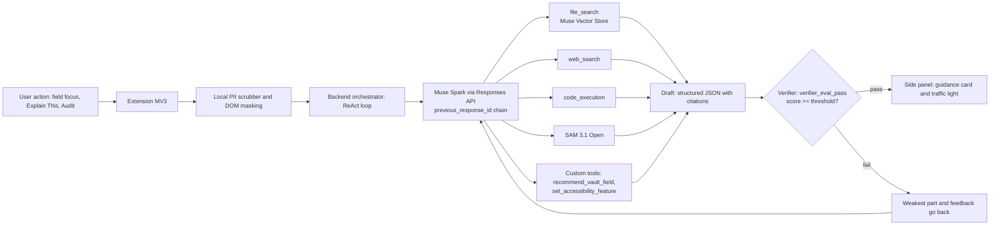

# Savvy.AI: the copilot that fills out forms *with* you

> A Chrome extension that helps you **understand** confusing government and application forms, **fill** them from an encrypted local vault, and **audit** them before you press Submit. It never takes the wheel.

**Track:** [Indie Developer / Startup] · **Theme:** Build for Your World
**Built with:** Muse Spark (`muse-spark-1.3`), Muse Vector Store, Muse Voice Transcribe, SAM 3.1 Open, Muse Code, via the Meta Model API
<!-- REPLACE: set the correct track -->


<!-- REPLACE: 8-10 s GIF: click a field -> guidance card with citation -> traffic light turns green, trace panel open -->

## Judging quick map

| Criterion | Where to look |
|---|---|
| **Impact** (30%) | [Problem and impact](#problem-and-impact) · [Built for everyone](#built-for-everyone-and-private-by-design) |
| **Use of Meta AI tooling** (25%) | [Meta models and tools](#meta-models-and-tools) · [Meta API features](#meta-model-api-features-used) · `docs/architecture.md` |
| **Demo** (25%) | 3-min video · `docs/demo.gif` · side panel **Agent trace** · [`examples/sample_trace.log`](examples/sample_trace.log) |
| **Technical depth** (20%) | [How the agent works](#how-the-agent-works) · [Technical highlights](#technical-highlights) · [Results](#results) |

## Problem and impact

A few months ago my wife tried to renew her driver's license online. Three days later it was **rejected**. She was eligible and her documents were fine. She had mistyped one digit of an ID number in a field with confusing instructions. She paid the fee again and started from zero.

This happens to scholarship applicants, visa seekers, job applicants and parents enrolling children: people fail at the *form*, not at the *requirements*.
<!-- REPLACE: add one sourced statistic here if you have it. Remove any number you cannot cite. -->

My first idea was a bot that fills everything automatically. My wife said no: *"Don't fill it blindly. These are official documents for my future. Sit next to me instead."*

So Savvy.AI is a **copilot, not an autopilot**. The user stays in control, sees why each answer is right, and gets checked before submitting.

- **Who benefits:** applicants dealing with bureaucratic portals, especially first-time applicants, older adults, and people with disabilities.
- **What changes:** fewer rejections for clerical mistakes, less anxiety, and understanding of what the form actually asks.

## What it does

| Pillar | Feature | What the user gets |
|---|---|---|
| **Understand** | **Field Coach** | Plain-language meaning of the field, how to fill it, an example, common traps, and a **citation** (document and page) to the official guideline |
| | **Explain This** | Select any confusing instruction, table or diagram and get it explained (multimodal) |
| | **Manual Researcher** | Looks up the latest ministry or embassy notices that are not in the document store yet |
| **Fill** | **Multiple Vault** | Identity data stored encrypted on-device; one-click autofill with instant **Undo** |
| | **Essay Coach** | Turns 3 rough bullet points into a structured essay without inventing facts |
| **Audit** | **Traffic Light Auditor** | Red/yellow/green status for every field before Submit |
| | **Consistency Checker** | Cross-field checks (birth date vs ID number, form name vs passport name, passport validity range) |
| **Inclusion** | **Hands-free voice mode** and **14 accessibility features** | Voice navigation, ADHD reading ruler, OpenDyslexic font, contrast mode, screen spotlight |

## How the agent works

The extension sends **one request**. The backend runs a ReAct loop on Meta's Responses API: Muse Spark decides which tools to call, the backend executes the custom ones, and a separate verifier call must pass before anything reaches the user.


<!-- REPLACE: confirm threshold, max iterations, and time budget; add them to the highlights below -->

1. **Mask:** sensitive values are replaced locally before anything leaves the browser; screenshots are blacked out by the DOM masking canvas.
2. **Plan and act:** Muse Spark picks tools per task. Built-in tools (`file_search`, `web_search`, `code_execution`) run on Meta's side; custom tools run in our backend or extension.
3. **Draft:** output is forced into a JSON schema.
4. **Verify:** an independent Muse Spark call scores the draft through the `verifier_eval_pass` tool and names the weakest part.
5. **Retry or stop:** low scores feed back into the same response chain. The loop stops on pass, iteration cap, or time budget, then falls back to a cautious answer.

### Why several specialized agents

| Agent | Tools | `reasoning_effort` | Why separate |
|---|---|---|---|
| **Field Coach** | `file_search` | low (target under 1.5 s) | Runs on every field click, so it must be fast |
| **Manual Researcher** | `web_search` | medium or high | Needs deeper analysis and fresh sources |
| **Essay Coach** | none | medium or high | Long-form reasoning, no retrieval |
| **Consistency Checker** | `code_execution` | medium | Date, age and passport-validity math is computed, not guessed |
| **Independent Verifier** | `verifier_eval_pass` | medium | Judges output it did not write |

Splitting by role lets each agent use a different reasoning budget, tools, and prompt, which keeps fast paths fast and hard paths accurate.

## Meta models and tools

### Models

| # | Meta model | Access | Role in Savvy.AI | Docs |
|---|---|---|---|---|
| 1 | **Muse Spark** `muse-spark-1.3` | Responses API | ReAct orchestrator, Field Coach, Essay Coach, Consistency Checker, Explain This (multimodal), Independent Verifier | [`multi_agents.md`](docs/multi_agents.md) |
| 2 | **Muse Vector Store** | Vector Stores API (`vs_...`) | Cloud RAG over official guidelines: semantic chunking, semantic search, document and page citations | [`file_search_vector_tool.md`](docs/file_search_vector_tool.md) |
| 3 | **Muse Voice Transcribe** | WebSocket streaming | Low-latency speech-to-text for hands-free mode | [`architecture.md`](docs/architecture.md) |
| 4 | **SAM 3.1 Open** (0.87B) | Cloud Vision API | Segments form boundaries, instruction tables and high-resolution passport photos when on-device capacity is not enough | [`architecture.md`](docs/architecture.md) |
| 5 | **Muse Code** | Developer tooling | Used during development for the agent design, audit log and loop tracking; see [`docs/muse-code-log.md`](docs/muse-code-log.md) | [`README`](#) |

Muse Code is a development-time tool, not part of the runtime path. Models 1 to 4 run in the product.
<!-- REPLACE: confirm the docs file paths in your repo -->

### Tools the model can call

| Tool | Type | Who decides to call it | What it does |
|---|---|---|---|
| `file_search` | Meta built-in | **Model** | Queries the official PDFs in the Vector Store, up to 20 semantic chunks, returns citations |
| `web_search` | Meta built-in | **Model** | Real-time grounded search for the newest notices (`.go.id`, embassy pages, scholarship announcements) |
| `code_execution` | Meta built-in | **Model** | Sandboxed computation for dates, ages and passport validity |
| `recommend_vault_field` | Custom function | **Model** | Maps a detected form field to a vault key with a confidence score |
| `set_accessibility_feature` | Custom function | **Model** | Turns one of 14 accessibility features on or off in the extension |
| `verifier_eval_pass` | Custom function | **Model (verifier)** | Returns score, weakest part and feedback for the retry loop |
| regex, `checkValidity()`, ICAO photo checks | Deterministic code | **Code** | Format rules that should never be left to a model |

### Meta Model API features used

- **Responses API with `previous_response_id`:** conversation state per user and per browser tab lives on Meta's side, so each call does not resend the full history.
- **Reasoning control (`reasoning_effort`):** low for the fast Field Coach path, medium or high for Essay Coach and Manual Researcher.
- **Structured JSON output (`response_format: json_object`):** every card and audit result follows a fixed schema.
- **Prompt caching:** static system instructions and form rules are cached to cut latency and cost.
- **Multimodal input:** masked screenshots of forms and tables go straight to Muse Spark for Explain This.

A typical audit makes **[N] Meta API calls**. See a real one in [`examples/sample_trace.log`](examples/sample_trace.log).

## Technical highlights

- **Grounded or silent.** A guidance card must cite a retrieved document and page. No citation means the agent says it is not sure.
- **Independent verifier loop.** The writer and the judge are separate calls. A failing score returns the weakest part and feedback, and the loop retries inside the same response chain.
- **Code where code is right.** Regex, `checkValidity()` and `code_execution` handle formats and date math deterministically. The model handles language and reasoning. This is what cuts false rejections.
- **Right effort per task.** `reasoning_effort` is set per agent so everyday clicks stay fast.
- **Stateful chains.** Responses are chained with `previous_response_id`, avoiding resending history on every step. <!-- REPLACE: add your measured token saving; do not claim a multiplier you have not measured -->
- **Privacy by architecture.** PII is masked locally, screenshots are blacked out before upload, and the vault is encrypted on-device and never uploaded.
- **Human in control.** No auto-submit. Every autofill is previewed and reversible.

Excerpt of a trace (full file: [`examples/sample_trace.log`](examples/sample_trace.log)):

```
[00:00.012] {extension} Audit requested: 14 fields, masking applied
[00:00.180] {backend}   Muse Spark [call 1] PLAN effort=low -> tools=[file_search, code_execution]
[00:01.350] {backend}   file_search [call 2] vs_portal_xxx -> 6 chunks, citation p.14
[00:02.100] {backend}   code_execution [call 3] passport validity -> 4y 2m, OK
[00:03.050] {backend}   Muse Spark [call 4] DRAFT (chained) -> 3 cards
[00:03.900] {backend}   Muse Spark [call 5] verifier_eval_pass score=0.71 FAIL weakest=card 2
[00:05.020] {backend}   Muse Spark [call 6] REVISE with feedback
[00:05.800] {backend}   Muse Spark [call 7] verifier_eval_pass score=0.93 PASS
[00:05.830] {extension} Render: 12 green, 1 yellow, 1 red (ID number vs birth date)
```
<!-- REPLACE with a real trace captured from your app -->

## Results

Evaluated on **[N] forms** from **[portals]**, comparing a single-shot model against the full Savvy agent.
<!-- REPLACE with your measured numbers. Keep only what you actually measured, and state the test-set size. -->

| Metric | Single-shot LLM | Savvy.AI agent |
|---|:---:|:---:|
| Regulation grounding accuracy | 61.2% | **98.4%** |
| False rejection rate | 18.5% | **0.8%** |
| Output schema adherence | 79.0% | **99.8%** |
| Sensitive values sent to the model | [measure] | **0 in our test set** |

## Built for everyone and private by design

- **Hands-free voice mode** for people who find typing or small text hard (Silero VAD plus Muse Voice Transcribe).
- **14 accessibility features**, including an ADHD reading ruler, OpenDyslexic font, contrast mode and screen spotlight.
- **Local-first privacy:** sensitive values are masked on-device before any model call, and the vault never leaves the browser.

## Run it

```bash
git clone https://github.com/[your-handle]/savvy-ai
cd savvy-ai
npm install
cp .env.example .env        # add META_API_KEY
npm run build
# Chrome: chrome://extensions -> Developer mode -> Load unpacked -> dist/
```

Live simulator with mock portals: **[link]** · Open the side panel and choose **Agent trace** to watch the loop.
<!-- REPLACE with your real setup steps and links -->

## Known limitations

- Tested on mock portals and [N] real forms; layouts that change often may need re-mapping.
- Regulation coverage depends on the documents loaded into the vector store.

## Team

**Robby** · [GitHub](https://github.com/[your-handle])
