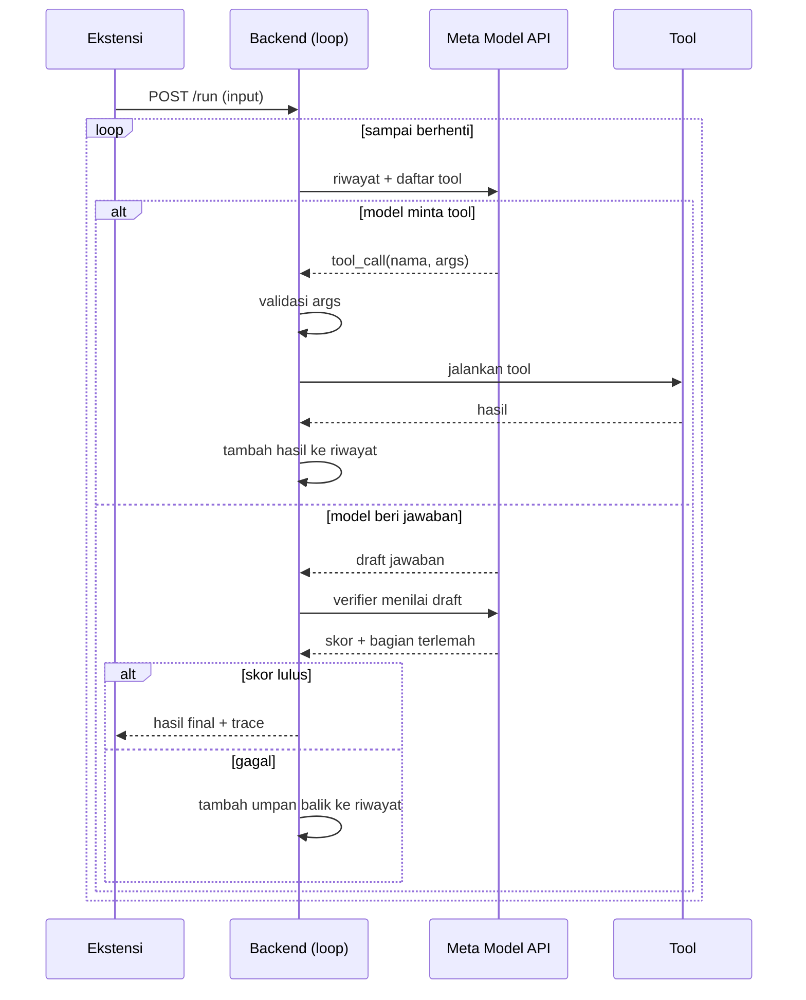

# Agentic Loop dan Looping Agent
### Panduan untuk arsitektur: Ekstensi Browser → Backend API → Meta Model API

> Catatan: nama endpoint, parameter, dan fitur Meta Model API di dokumen ini bersifat ilustrasi. Cek dokumentasi resminya sebelum menulis kode.

---

## 1. Istilah

| Istilah | Arti |
|---|---|
| **Agentic loop** | Pola siklus: *pikir → bertindak (tool) → amati hasil → putuskan lanjut atau berhenti* |
| **Looping agent** | Agen (LLM + tool + kode pengendali) yang menjalankan siklus itu berulang sampai selesai |
| **Single agent** | Satu LLM dengan satu riwayat percakapan, menjalankan loop sendiri |
| **Multi-agent** | Beberapa agen dengan prompt, tool, dan riwayat masing-masing, saling bertukar hasil |
| **Verifier** | Panggilan model terpisah yang menilai hasil sebelum dikirim |

Satu kalimat: **LLM memutuskan, kode menjalankan, hasilnya dikembalikan ke LLM, ulangi sampai ada alasan berhenti.**

---

## 2. Siapa melakukan apa

```
┌────────────┐   1 request    ┌──────────────────┐   N panggilan   ┌────────────┐
│  EKSTENSI  │ ─────────────► │  BACKEND (server │ ──────────────► │ META MODEL │
│  (UI saja) │ ◄───────────── │  kamu) = LOOP    │ ◄────────────── │    API     │
└────────────┘  hasil + trace └──────────────────┘   keputusan     └────────────┘
                                      │
                                      ▼
                              TOOL (kode lokal,
                              SAM 3.1, web search, dll)
```

| Komponen | Tugas |
|---|---|
| **Ekstensi** | Mengambil input, mengirim **satu** request, menampilkan hasil dan panel trace |
| **Backend** | **Menjalankan loop**: memanggil model, mengeksekusi tool, validasi, batas iterasi, fallback, mencatat trace |
| **Meta Model API** | **Bernalar**: memilih tool dan argumen, menulis draft, menilai (verifier). Model **stateless**: tiap panggilan harus membawa riwayat lengkap |
| **Tool** | Kode yang benar-benar bertindak: hitung, ambil data, segmentasi gambar, dll |

Prinsip penting: **model tidak menjalankan tool**. Model hanya *meminta* "panggil tool X dengan argumen Y". Backend yang menjalankan dan mengirim hasilnya kembali.

---

## 3. Alur satu request



Satu request dari ekstensi dapat berarti **5-8 panggilan** ke Meta Model API. Itu normal.

---

## 4. Kerangka kode backend (Node.js)

```js
async function runAgent(input, emit) {            // emit = kirim trace ke ekstensi (SSE)
  const MAX_ITER = 6, TIME_BUDGET_MS = 15000, PASS = 0.85;
  const start = Date.now();
  const messages = [system(), user(input)];       // KODE: riwayat
  const seen = new Set();                         // KODE: deteksi loop berulang

  for (let i = 1; i <= MAX_ITER; i++) {
    if (Date.now() - start > TIME_BUDGET_MS) return fallback("timeout");

    const res = await meta.chat({ messages, tools: TOOL_SCHEMAS });   // API
    emit({ i, type: "model", note: summarize(res) });

    if (!res.toolCalls?.length) {                 // model memberi draft jawaban
      const v = await verify(res.text, messages); // API (panggilan terpisah)
      emit({ i, type: "verify", score: v.score });
      if (v.score >= PASS) return success(res.text);
      messages.push(feedback(v.weakest));         // KODE
      continue;
    }

    messages.push(res.assistantMessage);          // KODE: simpan keputusan model
    for (const call of res.toolCalls) {
      const key = call.name + JSON.stringify(call.args);
      if (seen.has(key)) return fallback("repeat");
      seen.add(key);

      let result;
      if (!isValid(call)) result = { error: "invalid arguments" };    // KODE
      else {
        try { result = await TOOLS[call.name](call.args); }           // KODE atau API
        catch (e) { result = { error: e.message }; }                  // error dikembalikan ke model
      }
      emit({ i, type: "tool", name: call.name });
      messages.push(toolResult(call.id, result));                     // KODE
    }
  }
  return fallback("max_iter");
}
```

Legenda: **API** = memanggil Meta Model API, **KODE** = berjalan di backend kamu.

---

## 5. Kapan loop berhenti

| Kondisi | Hasil |
|---|---|
| Model tidak minta tool lagi **dan** verifier lulus | **Sukses**: jawaban + sumber + trace |
| Batas iterasi tercapai | Fallback |
| Batas waktu habis | Fallback |
| Tool dan argumen sama dipanggil berulang | Fallback |
| Error beruntun, atau batas token/biaya | Fallback |

**Fallback yang baik:** jawaban hati-hati dari informasi yang sudah terkumpul, tanpa klaim yang tidak terbukti. Jangan pernah mengirim error kosong ke ekstensi.

---

## 6. Kapan perlu loop, kapan tidak

```
1 panggilan model          → tugas satu langkah (klasifikasi, ringkasan, ekstraksi)
Pipeline tetap (kode)      → urutan langkah selalu sama
Single agent + loop        → langkah berikut tergantung hasil sebelumnya
Multi-agent                → konteks membengkak, peran berbeda, atau butuh paralel
```

**Pakai loop jika:**
- hasil bisa salah dan bisa dicek (angka, format, fakta),
- tool bisa gagal atau kosong dan perlu dicoba cara lain,
- tugasnya eksplorasi bertahap.

**Tanpa loop jika:**
- satu langkah sudah cukup,
- output subjektif tanpa kriteria objektif,
- latensi harus sangat rendah.

**Multi-agent hanya jika** ada alasan nyata: konteks terlalu besar, bisa dikerjakan paralel, atau peran dan hak akses benar-benar berbeda. Jangan dipakai hanya agar terlihat canggih.

**Cara memutuskan:** coba satu panggilan dulu, ukur hasilnya, tambahkan satu komponen (tool, loop, verifier), ukur lagi, pertahankan hanya yang memperbaiki hasil secara terukur.

---

## 7. Trace dan log

Backend mencatat tiap langkah, mengirimnya ke ekstensi lewat SSE (atau array `trace` di respons), dan ekstensi menggabungkannya dengan log lokalnya.

Format:

```
[14:02:31.120] {extension} Kirim request ke backend
[14:02:31.201] {backend}   Loop mulai (max_iter=6)
[14:02:32.034] {backend}   Muse Spark [call 1] memilih tool=extract_numbers
[14:02:33.268] {backend}   tool extract_numbers -> 3 angka (12ms)
[14:02:35.802] {backend}   Muse Spark [call 4] VERIFY skor=0.71 -> GAGAL
[14:02:38.222] {backend}   Muse Spark [call 7] VERIFY skor=0.93 -> LULUS
[14:02:38.275] {extension} Render hasil (total 7.1s)
```

Tips:
- Pakai `request_id` yang sama di kedua sisi.
- Kirim waktu relatif dari awal request agar tidak tergantung jam perangkat.
- Tandai baris panggilan Meta API agar mudah terlihat juri.
- Log harus berasal dari eksekusi nyata. Jangan tampilkan API key atau prompt penuh.

---

## 8. Yang ditampilkan untuk juri

| Bukti | Dimana |
|---|---|
| Tool apa saja dan **siapa yang memutuskan memanggilnya** (LLM atau kode) | Tabel di README |
| Kondisi berhenti dan fallback | Bagian Technical highlights |
| Satu trace nyata | `examples/sample_trace.log` + panel "Show agent trace" |
| Alasan memilih single-agent atau multi-agent | Satu kalimat jujur di README |
| Hasil ukuran dengan dan tanpa loop | Tabel kecil di README |

---

## 9. Kesalahan umum

- Menjalankan loop di ekstensi. Taruh di backend agar kunci API aman dan trace terpusat.
- Tidak ada batas iterasi atau waktu, sehingga biaya dan latensi tidak terkendali.
- Mengirim hasil tool mentah yang besar ke konteks. Ringkas dulu.
- Verifier memakai prompt dan konteks yang sama persis dengan penulis, sehingga hanya menyetujui diri sendiri.
- Terlalu banyak tool (lebih dari 7). Model makin sulit memilih.
- Mengklaim "multi-agent" padahal hanya satu loop. Tulis apa adanya: *single-agent loop with a separate verifier*.

---

## 10. Checklist sebelum submit

- [ ] Ekstensi hanya mengirim satu request dan menampilkan hasil
- [ ] Loop dan semua pemanggilan Meta API ada di backend
- [ ] Ada batas iterasi, batas waktu, dan deteksi pemanggilan berulang
- [ ] Argumen tool divalidasi, error tool dikembalikan ke model
- [ ] Ada verifier terpisah dan fallback aman
- [ ] Trace nyata tampil di panel dan tersimpan sebagai contoh
- [ ] README memuat tabel tool, alasan arsitektur, dan hasil ukuran asli
