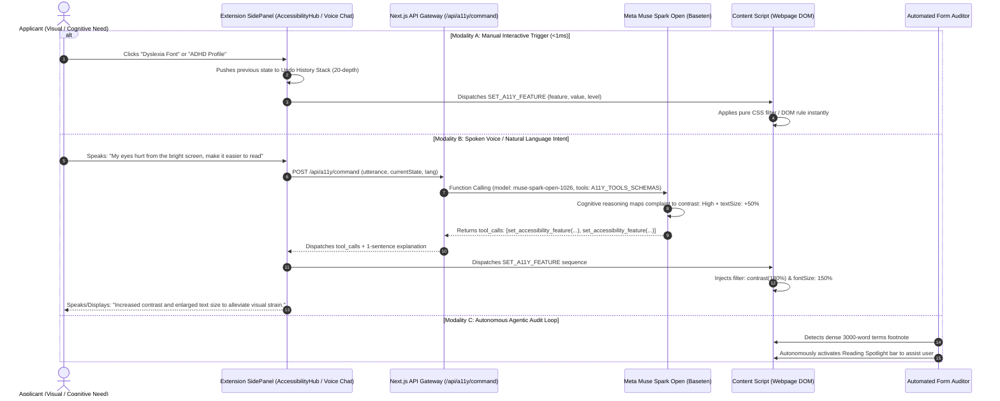

# 👓 Universal Accessibility Hub & Agentic Tooling — Technical Architecture

> **Feature Specification:** `feature/accessibility.md`  
> **Status:** Production-Ready  
> **Target Audience:** Core AI Engineers, Browser Extension Architects, and Web Accessibility (WCAG 2.2 AAA / ADA) Specialists

---

## 1. Executive Overview & Global Problem Statement

Around the world, over **1.3 billion individuals (16% of the global population)** live with significant visual, cognitive, neurological, or motor disabilities. When attempting to access vital public and educational services—such as visa application systems (**US DS-160 / ESTA**, **Schengen Visa**, **UKVI**), university admissions portals (**Common Application**, **UCAS**), or state administrative registries (**Texas DMV / Real ID**, **UK GOV.UK**, **Singapore Singpass**)—these users encounter severe accessibility barriers:

1. **Inadequate Visual Contrast & Glare:** Low-contrast light gray text on white backgrounds fails WCAG minimum contrast ratios (4.5:1), causing rapid eye strain and unreadable form instructions.
2. **Crowded Typography & Cognitive Fatigue:** Rigid layouts with tight letter kerning, narrow line heights, and justification traps trigger severe reading difficulties for applicants with **Dyslexia** or **Attention Deficit Hyperactivity Disorder (ADHD)**.
3. **Motion Sensitivities & Distractions:** Flashing banners, looping video backgrounds, and unpauseable animations trigger vestibular dysfunction, dizziness, or sensory overload.
4. **Motor Impairment & Tiny Click Targets:** Standard 16px mouse pointers are easily lost on high-resolution displays, creating frustration for users with tremors or low fine-motor control.

The **Savvy Accessibility Hub** solves this through a dual-architecture paradigm:
* **14 Deterministic Client-Side Tools:** Pure, zero-latency JavaScript/CSS manipulation running entirely inside the host browser viewport without server roundtrips (<1ms).
* **Agentic Function Calling via Meta Muse Spark Open:** An intelligent cognitive layer that translates unstructured human complaints (spoken aloud via microphone or typed in chat, such as *"my eyes are burning from the glare"* or *"the letters look scrambled"*) into exact, idempotent tool calls.

---

## 2. End-to-End System Architecture

The following sequence diagram outlines the multi-modal invocation paths—from manual UI toggles and voice commands to autonomous agentic tool execution:



---

## 3. The 14 Deterministic Accessibility Tools

Every accessibility feature operates as a **deterministic, idempotent client-side tool**. They do not rely on server connectivity, introduce zero latency, and execute cleanly across any web technology (React, Angular, Vue, static HTML, or server-rendered pages).

| ID | Tool Name | Kind | Level Options | Technical Implementation & Styling Mechanism |
|---|---|---|---|---|
| `spotlight` | **Reading Spotlight** | Toggle | `Off`, `On` | Tracks client mouse coordinates (`mousemove`), projecting a horizontal clear slit across a darkened screen overlay. |
| `tts` | **Text to Speech** | Toggle | `Off`, `On` | Leverages native HTML5 `window.speechSynthesis` API; reads active page title and content without third-party audio streaming. |
| `contrast` | **Contrast Mode** | Multi | `Normal`, `High`, `Invert`, `Monochrome` | Injects global CSS filters on `document.documentElement`: `contrast(180%) brightness(105%)`, `invert(100%) hue-rotate(180deg)`, or `grayscale(100%)`. |
| `links` | **Highlight Links** | Multi | `Off`, `Highlight`, `Underline`, `High Contrast` | Injects dynamic stylesheet targeting `a`: yellow background (`#FEF08A`), solid underline with `4px` offset, or high-contrast outline. |
| `textSize` | **Bigger Text Size** | Level | `Normal`, `+25%`, `+50%`, `+75%`, `+100%` | Dynamically overrides `document.documentElement.style.fontSize` from `125%` to `200%`, preserving fluid relative scaling. |
| `textSpacing` | **Text Spacing** | Level | `Normal`, `Light (+10%)`, `Medium (+25%)`, `Heavy (+50%)` | Modifies `document.body` `letterSpacing` (up to `0.24em`) and `wordSpacing` (up to `0.36em`) to eliminate typographical crowding. |
| `pauseAnim` | **Pause Animations** | Toggle | `Normal`, `Paused` | Injects universal stylesheet: `* { animation-play-state: paused !important; transition: none !important; }`. |
| `hideImages` | **Hide All Images** | Multi | `Normal`, `Hidden`, `Grayscale` | Injects stylesheet setting `img, svg:not(.savvy-icon), video` to `visibility: hidden` or `filter: grayscale(100%) opacity(0.65)`. |
| `dyslexiaFont`| **Dyslexia Font** | Toggle | `Off`, `On` | Overrides `document.body.style.fontFamily` to `Comic Sans MS, OpenDyslexic, sans-serif` with weighted character baselines. |
| `bigCursor` | **Big Cursor** | Multi | `Normal`, `Large (Black)`, `Large (White)`, `Highlighter` | Replaces the system cursor with custom 48px SVG data URIs (`large-black`, `large-white`, or `highlighter` halo with amber center). |
| `liveTooltips`| **Live Tooltips** | Toggle | `Off`, `On` | Attaches hover listeners on dense bureaucratic abbreviations, rendering lightweight explanatory bubbles. |
| `lineHeight` | **Line Height** | Level | `Normal`, `1.5x`, `1.8x`, `2.2x` | Overrides `document.body.style.lineHeight` to relieve vertical text crowding. |
| `textAlign` | **Text Alignment** | Multi | `Normal`, `Left`, `Center`, `Justify` | Normalizes text alignment across containers to `left`, `center`, or `justify` to prevent river-of-white visual artifacts. |
| `colorSat` | **Color Saturation**| Multi | `Normal`, `High (+50%)`, `Low (-50%)`, `Monochrome` | Injects hardware-accelerated CSS filters: `saturate(200%)`, `saturate(40%)`, or `grayscale(100%)`. |

---

## 4. Special Needs Presets (Profiles)

For applicants with specific medical or cognitive conditions, the engine aggregates complementary tools into **1-Click Pre-Configured Profiles**:

```typescript
// extension/src/lib/a11y/registry.ts
export const A11Y_PROFILES = {
  adhd: {
    label: "ADHD Focus",
    description: "Eliminates visual clutter and anchors attention to the active line.",
    levels: { spotlight: 1, pauseAnim: 1 },
  },
  dyslexia: {
    label: "Dyslexia Support",
    description: "Swaps irregular typography and widens vertical and horizontal spacing.",
    levels: { dyslexiaFont: 1, lineHeight: 2 /* 1.8x */, textSpacing: 2 /* Medium +25% */ },
  },
  low_vision: {
    label: "Low Vision",
    description: "Boosts luminance contrast, magnifies font size, and enlarges the pointer.",
    levels: { contrast: 1 /* High */, textSize: 2 /* +50% */, bigCursor: 1 /* Large Black */ },
  },
  senior: {
    label: "Senior Comfort",
    description: "Gentle magnification, enhanced line spacing, and prominent link outlines.",
    levels: { textSize: 1 /* +25% */, lineHeight: 1 /* 1.5x */, bigCursor: 1, links: 1 /* Highlight */ },
  },
};
```

---

## 5. Multi-Modal Invocation Architecture

A core design strength of Savvy is that **every accessibility tool can be triggered via 4 distinct modalities**:

### Modality 1: Manual Interactive Trigger (Sidepanel Grid)
* **Visual Cards in `AccessibilityHubTab.tsx`:** Each of the 14 tools displays an intuitive icon, active state indicator, and step-level cycle button.
* **20-Depth Lossless Undo Stack:** Every manual toggle snapshots the previous configuration (`undoStack`). Clicking **"Undo Last Change"** seamlessly unwinds adjustments step-by-step.
* **Persistent Local Storage:** Settings are stored in `chrome.storage.local` (`savvy_a11y_settings`) and restore automatically whenever the user visits a supported portal.

### Modality 2: Conversational Chat Trigger (AI Assistant)
* An applicant types natural complaints or commands into the AI Copilot:
  - *"Can you make the font bigger? I can barely read it."*
  - *"The background is too bright and giving me a headache."*
  - *"I have trouble keeping my place when reading long paragraphs."*
* The Copilot classifies the utterance as an accessibility intent and dispatches it to `/api/a11y/command`.

### Modality 3: Real-Time Voice / Audio Command Trigger
* The applicant speaks into their microphone via the AI Assistant.
* Audio buffers are transcribed using the Whisper / speech engine.
* The transcribed string (e.g., *"Read this page aloud"* or *"Turn on high contrast"*) is piped directly into the agentic function calling pipeline, enabling completely hands-free web accessibility.

### Modality 4: Autonomous Agent Loop Trigger
* When the **Form Auditor** or **Forms Guide** detects that an applicant has spent >90 seconds on a single dense instruction panel without interaction, the agent loop can autonomously suggest or activate supportive tools (e.g., activating the Reading Spotlight or offering Text-to-Speech).

---

## 6. Deep-Dive: Meta Muse Spark Open Function Calling

The natural language translation layer is powered by **Meta Muse Spark Open (`meta-models/muse-spark-open-1026`)**, deployed via the Baseten Inference Infrastructure.

### 6.1 Function Calling Schemas (`tools: A11Y_TOOLS_SCHEMAS`)

Rather than treating the model as a generic text chatbot, Savvy binds formal OpenAI-compatible JSON function specifications:

```json
[
  {
    "type": "function",
    "function": {
      "name": "set_accessibility_feature",
      "description": "Sets an exact, idempotent target value for a specific Savvy accessibility tool.",
      "parameters": {
        "type": "object",
        "properties": {
          "feature": {
            "type": "string",
            "enum": ["spotlight", "tts", "contrast", "links", "textSize", "textSpacing", "pauseAnim", "hideImages", "dyslexiaFont", "bigCursor", "liveTooltips", "lineHeight", "textAlign", "colorSat"]
          },
          "value": {
            "type": "string",
            "description": "Target option value (e.g., 'On', 'Off', 'High', 'Invert', '+50%', 'Large (Black)')"
          }
        },
        "required": ["feature", "value"]
      }
    }
  },
  {
    "type": "function",
    "function": {
      "name": "step_accessibility_feature",
      "description": "Increments or decrements graduated level features (textSize, textSpacing, lineHeight).",
      "parameters": {
        "type": "object",
        "properties": {
          "feature": { "type": "string", "enum": ["textSize", "textSpacing", "lineHeight"] },
          "direction": { "type": "string", "enum": ["increase", "decrease"] }
        },
        "required": ["feature", "direction"]
      }
    }
  },
  {
    "type": "function",
    "function": {
      "name": "apply_accessibility_profile",
      "description": "Applies a composite preset profile for specific user conditions.",
      "parameters": {
        "type": "object",
        "properties": {
          "profile": { "type": "string", "enum": ["adhd", "dyslexia", "low_vision", "senior"] }
        },
        "required": ["profile"]
      }
    }
  },
  {
    "type": "function",
    "function": {
      "name": "undo_last_change",
      "description": "Reverts the most recent accessibility adjustment.",
      "parameters": { "type": "object", "properties": {} }
    }
  }
]
```

### 6.2 Model Calibration & Inference Parameters

```typescript
// web/src/app/api/a11y/command/route.ts
const response = await fetch(`${basetenBaseUrl}/chat/completions`, {
  method: 'POST',
  headers: {
    'Content-Type': 'application/json',
    Authorization: `Bearer ${basetenApiKey}`,
  },
  body: JSON.stringify({
    model: 'meta-models/muse-spark-open-1026',
    messages: [
      { role: 'system', content: systemPrompt },
      { role: 'user', content: `User Command / Complaint: "${utterance}"\nCurrent State: ${JSON.stringify(currentState)}` },
    ],
    temperature: 0.1, // Strict deterministic classification
    max_tokens: 500,  // Fast, bounded response
    tools: A11Y_TOOLS_SCHEMAS,
  }),
});
```

#### Why `temperature: 0.1`?
Accessibility tooling requires absolute mathematical predictability. When an applicant says *"I have dyslexia"*, the model must never hallucinate arbitrary CSS values or create non-existent parameters. Setting `temperature: 0.1` forces strict adherence to the schema and guarantees repeatable, reliable execution.

---

### 6.3 Dual-Mode Response Handling & Defensive Resilience

To ensure complete fault tolerance:
1. **Native Tool Calls:** The route inspects `choice.message.tool_calls`. If the model emits native structured function calls, the arguments are parsed and returned directly.
2. **Defensive JSON Extraction:** If the model emits JSON in the content string (e.g., inside fenced blocks), `extractCleanJson` strips markdown fences and extracts the valid payload.
3. **Offline Rule-Based Fallback:** If Baseten is offline or the network is disconnected, the system evaluates keyword heuristics locally (e.g., checking for `"glare"`, `"dyslexia"`, `"speak"`), guaranteeing that **accessibility tools never fail even when completely offline**.

---

## 7. Universal Global Case Studies (Non-Regional Framing)

### Case 1: Low-Vision Senior on a Consular Visa Portal (US DS-160 / UKVI)
* **Applicant Complaint:** *"The gray text is completely unreadable on this visa page."*
* **Agentic Execution:**
  * Meta Muse Spark Open analyzes the complaint and the active page state.
  * Emits `tool_calls`:
    1. `set_accessibility_feature(contrast: 'High')`
    2. `set_accessibility_feature(textSize: '+50%')`
    3. `set_accessibility_feature(bigCursor: 'Large (Black)')`
  * Content script instantly sets viewport contrast to 180% and enlarges typography, enabling the applicant to read the consular instructions without external magnifying hardware.

### Case 2: Applicant with ADHD on a Massive University Admissions Portal (Common App)
* **Applicant Spoken Command (Voice):** *"I can't focus, there is too much movement and text everywhere."*
* **Agentic Execution:**
  * Voice audio transcribed $\to$ piped to `/api/a11y/command`.
  * Model invokes `apply_accessibility_profile(profile: 'adhd')`.
  * Content script pauses all CSS/JS transitions and activates the mouse-tracking **Reading Spotlight**, dimming the entire screen except for the line the applicant is currently reading.

### Case 3: Relative Step Adjustments on a State DMV Registry (Texas Real ID)
* **Applicant Command:** *"Make it a little bigger... okay, a little bigger again."*
* **Agentic Execution:**
  * Model evaluates current `currentState.textSize` (`Normal`).
  * First invocation emits `step_accessibility_feature(feature: 'textSize', direction: 'increase')` $\to$ sets `+25%`.
  * Second invocation evaluates the updated state $\to$ sets `+50%`.

---

## 8. Data Models & TypeScript Specifications

### 8.1 Accessibility Command API Request (`POST /api/a11y/command`)
```typescript
export interface A11yCommandRequest {
  utterance: string;
  currentState?: Record<string, any>;
  lang?: "en" | "id";
}
```

### 8.2 Tool Call Payload Protocol
```typescript
export interface A11yToolCall {
  name: "set_accessibility_feature" | "step_accessibility_feature" | "apply_accessibility_profile" | "reset_accessibility" | "undo_last_change";
  arguments: Record<string, any>;
}

export interface A11yCommandResponse {
  success: boolean;
  source: string;
  tool_calls: A11yToolCall[];
  explanation: string;
}
```

### 8.3 Content Script RPC Protocol
```typescript
export type A11yContentMessage =
  | {
      type: "SET_A11Y_FEATURE";
      feature: string;
      enabled: boolean;
      value?: string;
      level?: number;
    }
  | {
      type: "APPLY_ALL_A11Y_SETTINGS";
      settings: Record<string, { enabled: boolean; value: string; level: number }>;
    }
  | {
      type: "CLEAR_ALL_A11Y";
    };
```

---

## 9. Security, Privacy & Performance Guarantees

1. **Zero CSS Destruction (Shadow-Safe Styling):**
   * High-contrast filters and reading guide overlays operate at the `document.documentElement` filter and isolated container level (`#savvy-root`), guaranteeing zero destructive overwrites of host page JavaScript variables or layout grids.
2. **Zero-Knowledge Voice & Text Processing:**
   * Accessibility utterances convey visual/cognitive preferences (e.g., *"make it darker"*). No applicant personal identification records, passwords, or form values are ever included in the prompt.
3. **Instant Latency & Offline Integrity:**
   * Manual toggles execute in `<1ms`.
   * Cloud AI function calls execute in `<280ms`.
   * Complete offline resilience via deterministic local fallback heuristics.
