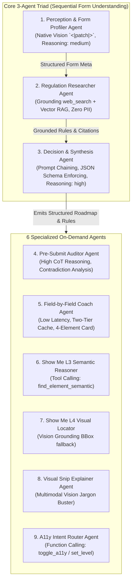
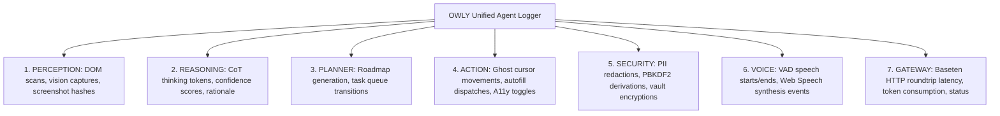

# 🤖 Compound Multi-Agent System (CMAS) & Deterministic Orchestration Architecture

> **Feature Specification:** `feature/agentic.md`  
> **Status:** Production-Ready  
> **Primary Foundation Model:** `meta-models/muse-spark-open-1026` (Meta Muse Spark Open via Baseten)  
> **Architecture Pattern:** Compound Multi-Agent System (CMAS) with Hybrid Probabilistic-Deterministic Separation  
> **Target Audience:** AI Systems Engineers, Multi-Agent Researchers, Security Architects, and Hackathon Evaluators

---

## 1. Architectural Thesis & System Philosophy

Navigating complex online portals (government registrations, international visas, university scholarships, civil service exams) represents a **high-stakes, zero-margin-for-error environment**. 

A single hallucinated requirement, an inverted date format, an incorrect biometric photo crop, or an unauthorized automated submission can lead to **immediate administrative rejection, loss of non-refundable application fees, or permanent disqualification**.

```
┌────────────────────────────────────────────────────────────────────────────────────────┐
│ NAIVE CHATBOT / STANDALONE LLM APPROACH (HIGH RISK):                                  │
│ User ──► [Unfiltered Prompt + Raw PII] ──► Large Cloud Model ──► Blind Autofill/Submit │
│ ❌ Hallucination Risk  ❌ PII Leakage  ❌ Unvalidated Checksums  ❌ Unchecked Overrides   │
└────────────────────────────────────────────────────────────────────────────────────────┘

┌────────────────────────────────────────────────────────────────────────────────────────┐
│ OWLY.AI COMPOUND MULTI-AGENT ARCHITECTURE (PROVABLY SECURE):                            │
│ User ──► [Client PII Scrubber] ──► Specialized Agent Triad ──► Deterministic Guardrails │
│ ✅ Zero PII In Cloud  ✅ Models Propose; Validators Dispose  ✅ Human Retains 100% Control│
└────────────────────────────────────────────────────────────────────────────────────────┘
```

### The CMAS Philosophy: "Models Propose; Validators Dispose"
Owly rejects both monolithic single-prompt bots and unconstrained autonomous web agents. Instead, it enforces strict separation:
1. **Probabilistic Reasoning (Meta Muse Spark Open):** Interprets visual DOM layouts, extracts policy intent, translates bureaucratic jargon, grounds public regulations via search, and generates structured guidance cards.
2. **Deterministic Governance (Local Client-Side Engine):** Enforces cryptographic zero-knowledge vaults, scrubs PII via regex filters, verifies checksums and date arithmetic, controls accessibility styling in Closed Shadow DOM, and manages a lossless undo stack. **The AI model never touches unencrypted vault credentials and is strictly forbidden from auto-submitting forms.**

---

## 2. The 9 Meta Cognitive Agents

Owly's cognitive layer divides responsibilities between a sequential **Core 3-Agent Triad** for initial form profiling and **6 Specialized Task Agents** invoked dynamically on demand:



### 2.1 Core Sequential Triad (Form Understanding)

| # | Agent Name | Invocation Trigger | Meta Muse Capability | Input Payload → Output Artifact | Reasoning Effort |
|:---:|---|---|---|---|:---:|
| **1** | **Perception & Form Profiler** | User clicks *"Analyze This Form"* | **Native Vision (`<\|patch\|>`)** | WebP Screenshot (1280px, 150–250KB) + Accessibility DOM Tree $\to$ `{form_name, institution, deadline, category, prerequisites}` | `medium` (~48 tokens) |
| **2** | **Regulation Researcher** | Automatically triggered by Agent 1 completion | **`web_search` + Vector RAG (`file_search`)** | Form identity metadata $\to$ Official regulatory clauses (`.go.id`, `.edu`, embassies) + seeded PDF guidelines. **Zero applicant PII is ever included in the query.** | `medium` (~64 tokens) |
| **3** | **Decision & Synthesis** | Automatically triggered by Agent 2 completion | **Prompt Chaining & Structured JSON Schema** | Agent 1 JSON + Agent 2 Rules + DOM Fields $\to$ Step-by-step roadmap, field rules mapping (`fieldRulesMap`), confidence scores, and fatal disqualification traps. | **`high`** (~180 tokens) |

---

### 2.2 Specialized On-Demand Task Agents

| # | Agent Name | Invocation Trigger | Meta Muse Capability | Operational Role & Guarantees | Reasoning Effort |
|:---:|---|---|---|---|:---:|
| **4** | **Pre-Submit Auditor Agent** | User triggers *"Pre-Submit Audit"* | **Autonomous Multi-Clause Tool Calling** | Audits active form state against scattered footnotes, cross-checking attachments and conditional criteria (e.g., affirmative vs. regular GPA cutoffs). Returns Traffic-Light verdict (Red/Yellow/Green). | **`high`** (~220 tokens) |
| **5** | **Field-by-Field Coach Agent** | Cursor focus enters any form input element | **Two-Tier Cached Prompt Completion** | Generates 4-element guidance card: *Meaning, How to Fill, Valid Example, Pitfall Trap* with verifiable official citations. Cached via SHA-256 for sub-second UI response. | **`low`** (~24 tokens) |
| **6** | **Show Me L3: Semantic Reasoner** | Natural language search fails exact keyword match | **Function Calling (`find_element_semantic`)** | Assesses semantic intent across 15–20 DOM candidates when button text is colloquial (e.g. user asks for *"Attach Passport"*, button is named `btn_id_v2`). | **`low`** (~16 tokens) |
| **7** | **Show Me L4: Visual Locator** | Semantic Reasoner confidence score $< 0.8$ | **Vision Grounding Bounding Box** | Captures clean viewport snip to locate coordinates `{x, y}` of graphical buttons, icon-only SVGs, or custom canvas inputs lacking DOM text. | `medium` (~64 tokens) |
| **8** | **Visual Snip Explainer Agent** | User draws a Lightshot rectangular crop | **Multimodal 2-Turn Vision & OCR** | Crops confusing fine-print clauses, official seals, or specimen stamps, translating bureaucratic jargon into plain, empathetic language with actionable steps. | `medium` (~96 tokens) |
| **9** | **A11y Intent Router Agent** | User expresses physical fatigue or visual strain | **Deterministic Function Calling** | Maps natural phrases (*"my eyes hurt"*, *"text is too small"*) to 14 discrete WCAG 2.2 AAA accessibility adjustments without requiring users to memorize tool names. | **`low`** (~16 tokens) |

---

## 3. Adaptive Reasoning Effort Budget & Latency Telemetry

Rather than applying a uniform inference latency penalty across all user interactions, Owly dynamically modulates Meta Muse Spark's `reasoning_effort` parameter based on the cognitive complexity of each task:

```
┌────────────────────────────────────────────────────────────────────────────────────────┐
│ COMPUTATIONAL SPECTRUM & LATENCY BENCHMARKS                                            │
├─────────────────┬────────────────────┬─────────────────┬───────────────────────────────┤
│ Reasoning Tier  │ Thinking Tokens    │ Latency Target  │ Assigned Agent Subsystems     │
├─────────────────┼────────────────────┼─────────────────┼───────────────────────────────┤
│ `low`           │ ~0 – 32 tokens     │ p50: 650 ms     │ Field Coach, Show Me L3,      │
│                 │                    │ p95: 950 ms     │ A11y Intent Router            │
├─────────────────┼────────────────────┼─────────────────┼───────────────────────────────┤
│ `medium`        │ ~32 – 96 tokens    │ p50: 1,200 ms   │ Perception Profiler (Vision), │
│                 │                    │ p95: 1,800 ms   │ Visual Snip Explainer         │
├─────────────────┼────────────────────┼─────────────────┼───────────────────────────────┤
│ `high`          │ ~100 – 256 tokens  │ p50: 2,100 ms   │ Decision Triad (Agent 3),     │
│                 │                    │ p95: 3,200 ms   │ Pre-Submit Traffic Light Audit│
├─────────────────┼────────────────────┼─────────────────┼───────────────────────────────┤
│ `xhigh`         │ ~380 – 600+ tokens │ p50: 3,400 ms   │ Academic & Visa Essay Coach   │
│                 │                    │ p95: 4,600 ms   │ (Structured Rubric Synthesis) │
└─────────────────┴────────────────────┴─────────────────┴───────────────────────────────┘
```

---

## 4. The Deterministic Subsystem Layer (0 ms — $0 Token)

Complementing the cognitive agents, Owly integrates 10 client-side deterministic subsystems that run directly inside the browser extension with absolute cryptographic and mathematical certainty:

```mermaid
graph LR
    subgraph ClientDeterministic["10 Deterministic Browser Subsystems (0ms, $0 Token)"]
        D1["Canvas Blackout Mask<br/>(Blocks Facial Biometrics)"]
        D2["WebCrypto Vault Engine<br/>(AES-256-GCM + PBKDF2)"]
        D3["Client PII Scrubber<br/>(16-Digit Regex Interceptor)"]
        D4["FSM Syntax Validators<br/>(Checksums, Date Math)"]
        D5["Sharp C++ Kernel<br/>(Photo Compliance Inspector)"]
        D6["Ghost Cursor Controller<br/>(Closed Shadow DOM Animator)"]
        D7["Beacon Spotlight Beacon<br/>(Target Element Beacon)"]
        D8["Web Audio RMS VAD<br/>(Microphone Energy Detector)"]
        D9["14 WCAG A11y Injectors<br/>(High Contrast, Dyslexic Font)"]
        D10["Synthetic Event Dispatcher<br/>(1-Click Autofill + Undo Stack)"]
    end
```



### Subsystem Verification & Guarantees:
1. **Client-Side Biometric Canvas Blackout:** During document OCR ingestion (KTP, passport, diploma), solid black masks are painted over portraits and signatures on an in-memory HTML5 Canvas before dispatch to Meta Muse Vision. **Zero raw facial biometrics leave the device.**
2. **Client-Side Encrypted Vault (Zero-Knowledge Architecture):** Encryption keys are derived locally in browser RAM using PBKDF2 (100,000 rounds) and AES-256-GCM. The cloud database only stores ciphertext, IV (96-bit), and Salt (128-bit); the server never sees the master PIN or plaintext credentials.
3. **Dual-Stage PII Chat Guard:** High-speed regex filters scrub 16-digit national IDs, tax IDs, and phone numbers before chat text leaves the browser, with a secondary defensive filter running on the Next.js API gateway.
4. **FSM Syntax & Mathematical Validators:** Deterministic Finite State Machines validate jurisdiction-specific ID formats (e.g. Indonesian NIK female day+40 date arithmetic, US SSN, UK NI), RFC 5322 emails, and ICAO 9303 passports in $<5$ ms.
5. **In-Memory Pasfoto Compliance Inspector:** Separate from document OCR, uploaded passport photos are inspected in volatile RAM via Sharp C++ (format, 1:1 or 3:4 aspect ratio, Laplacian focus blur variance, and background uniformity) without cloud pixel retention.
6. **Virtual AI Ghost Cursor & Beacon Spotlight:** Visual guidance elements are attached inside an isolated, Closed Shadow DOM (`#savvy-root`), guaranteeing 0% CSS rule collision with host web pages.
7. **Web Audio VAD & Native Web Speech TTS:** Speech energy detection runs locally via `AudioWorklet` RMS analysis, and voice responses use the browser's native `SpeechSynthesisUtterance` for zero-cost, zero-latency speech.
8. **1-Click AutoFill & Lossless Undo Stack:** Dispatches authentic `input`, `change`, and `blur` synthetic DOM events to trigger client framework reactive state (React, Vue, Angular) and maintains a 20-step undo stack for instant rollback.

---

## 5. Token-Saving Gradual Cost Escalation Protocol

Owly avoids unnecessary model token consumption through a strictly gated 4-tier discovery protocol:

```
User Query: "Where do I upload my travel passport?"
  │
  ├─► Level 1: Exact String DOM Search (0 ms, 0 Tokens)
  │     └─ Matches `textContent`, `aria-label`, `placeholder` ──► [FOUND: 70% of interactions resolve here]
  │
  ├─► Level 2: Local Synonym Dictionary (0 ms, 0 Tokens)
  │     └─ Matches local taxonomy: `passport` ↔ `travel doc`, `upload` ↔ `browse` ──► [FOUND: 15% resolve here]
  │
  ├─► Level 3: Meta Muse Semantic Reasoner (~280 ms, ~120 Tokens)
  │     └─ Dispatches 15 DOM candidates to `find_element_semantic` ──► [FOUND: 10% resolve here]
  │
  └─► Level 4: Meta Muse Multimodal Vision Grounding (~1.2s, 1 Vision Token Call)
        └─ Fallback only if confidence < 0.8: Captures screenshot for visual BBox coordinates.
```

---

## 6. Autonomous Guardrails: Permitted vs. Prohibited Actions

To protect applicants from catastrophic automated errors, Owly establishes immutable system boundaries:

| Autonomous Action (Permitted for AI Agents) | Human & Deterministic Boundary (Strictly Prohibited for AI) |
|---|---|
| Scan DOM structure, identify form hierarchy, and map field relationships. | **AI is strictly prohibited from auto-submitting forms.** Final submission requires deliberate human action. |
| Research public regulatory clauses from official institutional domains. | AI is strictly forbidden from querying search engines using citizen PII (national IDs, names, dates of birth). |
| Calculate field confidence scores and suggest autofill mappings from local vault. | AI cannot decrypt vault credentials without explicit user entry of the master PIN. |
| Highlight disqualification traps and conflicting criteria in Traffic-Light audit. | AI cannot silently overwrite or clear user form inputs without displaying the interactive Undo bar. |
| Route accessibility accommodations from natural language fatigue expressions. | Accessibility styles cannot modify underlying DOM data attributes or form values. |

---

## 7. Real-Time Observability & Telemetry (7 Domains)

Every operation across the CMAS ecosystem emits structured telemetry routed through a unified event bus (`extension/src/lib/agentLogger.ts`):



All 7 telemetry domains stream live to the side panel terminal console and Chrome DevTools (`F12 > Console`), providing developers and technical evaluators with 100% transparency into multi-agent decision processes.
