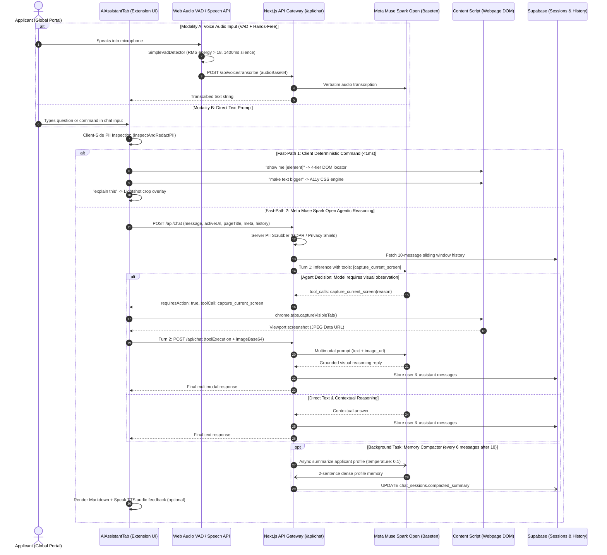

# 🦉 Ask Owly & AI Chat Assistant — Technical Architecture

> **Feature Specification:** `feature/chat.md`  
> **Status:** Production-Ready  
> **Target Audience:** Core AI Engineers, Browser Extension Architects, Multimodal Agent Researchers, and Accessibility Specialists

---

## 1. Executive Overview & Universal Problem Statement

When applicants navigate high-stakes online portals—including consular visa application platforms (**US DS-160 / ESTA**, **UKVI**, **Schengen Visa portals**), university admissions registries (**Common Application**, **UCAS**), or governmental licensing systems (**Texas Real ID / DMV**, **UK GOV.UK**, **Singapore Singpass**)—they face immense friction:

1. **Ambiguous Bureaucratic Terminology:** Confusing instructions such as *"Attach a certificate of non-encumbrance"* or *"Provide an Apostille-certified affidavit"* leave applicants uncertain and prone to error.
2. **Hidden or Poorly Placed Navigation:** Multi-step forms often bury critical buttons (e.g., *"Fee Waiver Request"*, *"Save & Continue"*, or *"Document Upload"*) inside obscure collapsible accordion elements.
3. **Accessibility & Motor Constraints:** Applicants with tremors, visual fatigue, or motor impairments struggle with standard keyboard/mouse input, requiring a voice-driven, hands-free assistant.
4. **Disjointed Assistance:** Standard chatbots lack viewport awareness—they cannot observe the screen, inspect active DOM elements, adjust accessibility filters, or verify form inputs.

**Ask Owly (Savvy AI Assistant)** solves this by serving as an **agentic, multi-modal copilot**. Powered by **Meta Muse Spark Open (`meta-models/muse-spark-open-1026`)**, Owly is not merely a conversational bot; it operates as an **autonomous orchestrator** connected to deterministic browser tools, multimodal screen vision, voice activity detection, and encrypted identity storage.

---

## 2. End-to-End System Architecture

The following diagram illustrates the complete operational lifecycle—from user utterance (text or voice) to deterministic tool execution, multi-turn agentic loops, and background memory compacting:



---

## 3. Multi-Modal Interaction Capabilities

### 3.1 Typed Natural Language Copilot
* Rendered inside the extension SidePanel (`AiAssistantTab.tsx`).
* Features full Markdown rendering via `MarkdownRenderer.tsx` (tables, code snippets, numbered lists, warning callouts).
* Action buttons embedded directly in responses (e.g., *"Open Full Audit Tab"*, *"Analyze Form Now"*, *"Open Accessibility HUB"*).

### 3.2 Live Hands-Free Voice Pipeline (Web Audio API + VAD)
* **Zero-Latency Client-Side VAD (`SimpleVadDetector`):**
  - Implemented in [`extension/src/lib/voice/vad.ts`](file:///d:/webdev/laragon/www/savvy/extension/src/lib/voice/vad.ts) using the Web Audio API `AnalyserNode`.
  - **RMS Sensitivity Threshold:** `energyThreshold = 18`.
  - **Silence Timeout:** `silenceDurationMs = 1400ms` before automatically finalizing speech chunks.
  - **FFT Size:** `512` for efficient frequency domain analysis.
* **Audio Transcription Endpoint (`/api/voice/transcribe`):**
  - Powered by Meta Muse Voice Transcribe on Baseten.
  - Uses `audio_url` data payload with prompt: *"Transcribe this applicant speech verbatim and accurately."*
  - Dual-layer fallback to browser-native `webkitSpeechRecognition` when offline.
* **Audio Output (TTS):**
  - Leverages HTML5 `window.speechSynthesis` with automated language matching (`en-US` or `id-ID`) and 1.05x natural cadence.

### 3.3 Visual Snip & Image Attachment Integration
* Users can click the **Lightshot Snip button** or drag an image directly into the chat.
* Screenshots are cropped to exact canvas coordinates (`cropScreenshot`) and encoded as `image/jpeg` at 90% quality before transmission.

---

## 4. Deterministic Tools Callable by the AI Assistant

Owly is equipped with **deterministic tools** that can be invoked via client fast-paths or Meta Muse Spark Open Function Calling:

### Tool 1: `capture_current_screen` (Multi-Turn Vision Agent Loop)
* **Schema Definition:**
  ```json
  {
    "name": "capture_current_screen",
    "description": "Captures a screenshot of the user's active viewport. Call this tool IF the user asks about photos, images, visual elements, button locations, page layout, or anything requiring visual observation of the screen.",
    "parameters": {
      "type": "object",
      "properties": {
        "reason": {
          "type": "string",
          "description": "Reason why a screenshot of the user's viewport is necessary to answer the inquiry."
        }
      },
      "required": ["reason"]
    }
  }
  ```
* **Execution Flow:**
  1. **Turn 1:** The user asks: *"Does the photo on my screen meet the visa background requirement?"*
  2. Meta Muse Spark Open analyzes the prompt, realizes it lacks visual grounding, and emits a structured `tool_call` for `capture_current_screen`.
  3. The extension sidepanel intercepts the response, triggers `chrome.runtime.sendMessage({ type: "CAPTURE_VISIBLE_TAB" })`, and captures the viewport.
  4. **Turn 2:** The client immediately dispatches Turn 2 to `/api/chat` with `toolExecution` metadata and the base64 screenshot.
  5. The model evaluates the image multimodally with `reasoning_effort: 'medium'` and delivers an exact, visually grounded answer.

### Tool 2: `SHOW ME` Element Finder (4-Tier Cascading Navigator)
* When a user commands *"Show me: upload transcript button"*:
  * **Level 1 (Exact DOM Match):** Case-insensitive DOM scanner locates the element in <1ms.
  * **Level 2 (Synonym Heuristics):** Matches against an extensive international vocabulary (e.g., `register` $\leftrightarrow$ `sign up`, `attach` $\leftrightarrow$ `upload`).
  * **Level 3 (AI Semantic Match):** Sends candidate elements to Meta Muse Spark Open (`/api/element/match`) with a strict confidence threshold (`confidence >= 0.8`).
  * **Level 4 (Multimodal Vision Fallback):** Takes a screenshot and visually explains element coordinates.
* **Result:** Anchors the browser viewport and pulses an animated **Beacon Spotlight** and **Ghost Cursor** on the element.

### Tool 3: Accessibility Hub Agentic Fast-Path
* When a user expresses visual strain (e.g., *"the screen is too bright"*, *"increase font size"*, *"I have dyslexia"*):
  * Parsed via `matchA11yFastPath` or dispatched to `/api/a11y/command`.
  * Instantly sets deterministic CSS filters (High Contrast 180%, OpenDyslexic font, Reading Spotlight slit).
  * Automatically pushes previous viewport configurations to the **20-Depth Lossless Undo Stack**.

### Tool 4: Lightshot Visual Snip ("Explain This")
* Triggered when the user says *"Explain this section"* or clicks the Snip tool.
* Injects a full-viewport crosshair overlay allowing the user to box any confusing clause, sending the cropped bitmap to the 5-pillar cognitive buster.

### Tool 5: Form Analyzer & Autofill Bridge
* Triggered when the user commands *"Autofill this form"*.
* Checks if the active DOM form has been analyzed. If yes, launches the AES-256 Vault autofill engine; if not, triggers the autonomous form scanner.

### Tool 6: Traffic Light Form Audit Engine
* Triggered when the user asks *"Audit my form"* or *"Check for mistakes"*.
* Executes the Finite State Machine (FSM) rules engine against active inputs, returning counts of **REQUIRED**, **FORMAT**, and **RULE** warnings.

---

## 5. Technical Deep Dive: Meta Muse Spark Open Implementation

The core reasoning engine is **Meta Muse Spark Open (`meta-models/muse-spark-open-1026`)**, deployed on Baseten Inference Infrastructure.

### 5.1 Model Calibration & Hyperparameters

```typescript
// Turn 1: Deterministic Tool Calling Evaluation
const response = await fetch(`${basetenBaseUrl}/chat/completions`, {
  method: 'POST',
  headers: {
    'Authorization': `Bearer ${basetenApiKey}`,
    'Content-Type': 'application/json'
  },
  body: JSON.stringify({
    model: 'meta-models/muse-spark-open-1026',
    messages: messagesPayload,
    tools: AVAILABLE_TOOLS,
    tool_choice: 'auto',
    reasoning_effort: 'medium',
    temperature: 0.2, // Strict tool-selection discipline
    max_tokens: 800
  })
});

// Turn 2: Multimodal Visual Grounding Synthesis
const responseTurn2 = await fetch(`${basetenBaseUrl}/chat/completions`, {
  method: 'POST',
  headers: {
    'Authorization': `Bearer ${basetenApiKey}`,
    'Content-Type': 'application/json'
  },
  body: JSON.stringify({
    model: 'meta-models/muse-spark-open-1026',
    messages: turn2MessagesPayload,
    reasoning_effort: 'medium',
    temperature: 0.3, // Natural, empathetic conversational tone
    max_tokens: 800
  })
});
```

#### Why Dual-Temperature Tuning?
* **Turn 1 (`temperature: 0.2`):** Strictly forces the model to decide whether to call a tool or answer textually. Lower temperature prevents hallucinated tool names or malformed arguments.
* **Turn 2 (`temperature: 0.3`):** Once visual data is attached, a slightly higher temperature enables natural, nuanced, and empathetic explanations of complex visual layouts.

### 5.2 Context Payload Construction
Every request dynamically embeds real-time metadata extracted from the active browser tab:
* Active Domain & URL.
* Document Title (`document.title`).
* OpenGraph Title & Description (`og:title`, `og:description`).
* Meta Keywords & Viewport Language (`<html lang="...">`).
* Active visual screenshot / crop data (if applicable).

### 5.3 Sliding Window & Background Auto-Compacting Loop
To maintain low latency and prevent context-window exhaustion over long sessions:
1. **Sliding Window:** The gateway fetches only the **last 10 messages** from Supabase (`chat_messages`).
2. **Asynchronous Compactor (`triggerCompacting`):**
   * Triggered when `message_count > 10` and `message_count % 6 === 0`.
   * Fires a background, non-blocking call to Meta Muse Spark Open:
     ```typescript
     {
       model: 'meta-models/muse-spark-open-1026',
       messages: [
         ...fullContext,
         {
           role: 'user',
           content: 'Extract and summarize key applicant profile facts (name, application goal, educational background, GPA, language test scores, and constraints) in at most 2 dense sentences for future session context memory.'
         }
       ],
       temperature: 0.1,
       max_tokens: 150
     }
     ```
   * Updates `chat_sessions.compacted_summary`.
   * Subsequent conversation turns inject `[Applicant Profile Context Memory]: <summary>` as a high-priority system prompt, ensuring zero loss of user background facts across hours of form filling.

---

## 6. Zero-Knowledge Privacy & PII Scrubber

To comply with global data protection frameworks (**GDPR**, **California CCPA**, **APPI**, and national Data Protection Acts), Savvy incorporates a dual-layer PII filter:

```typescript
// Universal PII Regex Scrubber
const PII_REGEX_NATIONAL_ID = /\b[1-9]\d{15}\b/g;          // 16-digit National IDs
const PII_REGEX_SSN         = /\b\d{3}-\d{2}-\d{4}\b/g;    // US Social Security Numbers
const PII_REGEX_TAX         = /\b\d{2}\.?\d{3}\.?\d{3}\.?\d{1}-?\d{3}\.?\d{3}\b/g; // Tax IDs
const PII_REGEX_CARD        = /\b(?:\d{4}[ -]?){3}\d{4}\b/g; // Credit/Debit Cards
```

1. **Client-Side Real-Time Warning:** As the applicant types into the chat input, `inspectAndRedactPII` scans the string. If sensitive numbers are detected, a prominent security warning banner appears before the user can press Send.
2. **Server-Side API Scrubber:** If PII is submitted, the server sanitizes the text, halts AI transmission, logs a `SECURITY` domain event, and politely instructs the user to store the credentials in their zero-knowledge AES-256 Vault instead.

---

## 7. Domain-Specific Agent Logging (`agent_logs`)

All agentic activities emit structured telemetry categorized by domain:

| Domain | Purpose / Trigger |
|---|---|
| `SECURITY` | PII scrubber verification, vault encryption checks, data sanitization. |
| `PERCEPTION` | Viewport screenshot capture, Lightshot visual cropping, audio stream decode. |
| `PLANNER` | Tool selection decisions (`capture_current_screen`), Show Me routing, compacting triggers. |
| `ACTION` | Dispatched tool executions to content scripts, CSS DOM modifications, form fills. |
| `REASONING` | Meta Muse Spark Open inference timing, token counts, and semantic confidence scores. |
| `VOICE` | VAD voice energy detection, speech start/end events, verbatim transcriptions. |

---

## 8. Universal Global Case Studies

### Case 1: Autonomous Screen Capture on a Consular Visa Portal (US DS-160 / UKVI)
* **User Inquiry:** *"Does the signature section on my screen require an ink signature or an electronic digital ID?"*
* **Agentic Execution:**
  1. Turn 1 evaluates prompt: requires visual inspection of the active document canvas.
  2. Muse Spark Open emits `capture_current_screen(reason: 'Inspect signature box format')`.
  3. Extension captures the tab and dispatches Turn 2.
  4. Muse Spark Open inspects the image: identifies a digital signature certificate badge and clarifies: *"This section requires a digital certificate upload (e-Signature), not a scanned ink signature."*

### Case 2: Locating a Hidden Fee Waiver on a University Admissions Portal (Common App)
* **User Command:** *"Show me: application fee waiver"*
* **Agentic Execution:**
  1. The 4-tier locator runs Level 1 and Level 2 DOM scans.
  2. Level 3 sends candidates to Meta Muse Spark Open, finding a collapsed accordion button titled *"Financial Hardship Verification"*.
  3. Confidence score returns `0.94`.
  4. The ghost cursor glides across the screen, expands the accordion, and anchors the **Beacon Spotlight** on the fee waiver checkbox.

### Case 3: Hands-Free Voice Navigation for an Applicant with Motor Tremors
* **User Spoken Command:** *"Read this page out loud and make the contrast higher."*
* **Agentic Execution:**
  1. `SimpleVadDetector` captures voice buffer; Whisper transcribes the utterance.
  2. Fast-path triggers `set_accessibility_feature(contrast: 'High')`.
  3. Content script sets `contrast(180%)` on the DOM.
  4. Native TTS begins reading the main content headers aloud in sequence.

---

## 9. Summary of Key Code Artifacts

| Component | File Path | Function / Responsibility |
|---|---|---|
| **Feature Specification** | [`feature/chat.md`](file:///d:/webdev/laragon/www/savvy/feature/chat.md) | Universal technical architecture and specification document. |
| **API Chat Gateway** | [`web/src/app/api/chat/route.ts`](file:///d:/webdev/laragon/www/savvy/web/src/app/api/chat/route.ts) | Next.js API route handling 2-turn agent loops, tools, and Baseten inference. |
| **Voice Transcribe API** | [`web/src/app/api/voice/transcribe/route.ts`](file:///d:/webdev/laragon/www/savvy/web/src/app/api/voice/transcribe/route.ts) | Verbatim speech-to-text powered by Meta Muse Voice. |
| **Voice Activity Detector** | [`extension/src/lib/voice/vad.ts`](file:///d:/webdev/laragon/www/savvy/extension/src/lib/voice/vad.ts) | Client-side Web Audio AnalyserNode speech energy detector. |
| **AI Assistant UI Tab** | [`extension/src/components/AiAssistantTab.tsx`](file:///d:/webdev/laragon/www/savvy/extension/src/components/AiAssistantTab.tsx) | Sidepanel chat interface, tool orchestrator, and voice controller. |
| **API Client Connector** | [`extension/src/lib/api/client.ts`](file:///d:/webdev/laragon/www/savvy/extension/src/lib/api/client.ts) | Typed fetch wrappers for chat, voice, and multimodal communication. |
