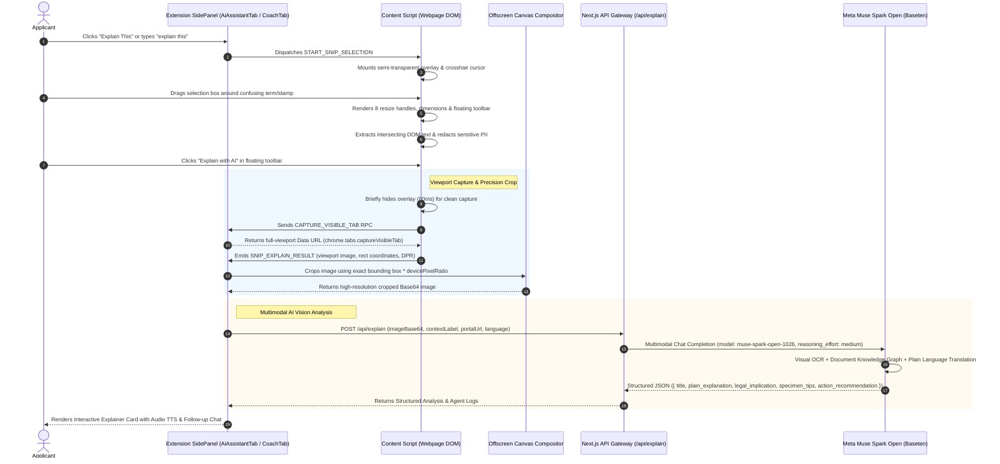

# 🔍 "Explain This" Multimodal Visual Snip Engine — Technical Architecture

> **Feature Specification:** `feature/explain.md`  
> **Status:** Production-Ready  
> **Target Audience:** Core AI Engineers, Browser Extension Architects, and Computer Vision Specialists

---

## 1. Executive Overview & Global Problem Statement

Navigating high-stakes international web applications—such as consular visa portals (**US DS-160 / ESTA**, **Schengen Visa**, **UKVI**), global university admissions and scholarship portals (**Common Application**, **UCAS**, **Fulbright**, **Chevening**), and state administrative registries (**Texas DMV / Real ID**, **UK GOV.UK**, **Singapore Singpass**)—frequently presents applicants with dense, intimidating bureaucratic terminology.

Applicants regularly encounter ambiguous prompts, such as:
* *"Attach an Apostille-certified degree equivalence or Consular Legalization certificate."*
* *"Provide SEVIS ID and Form DS-2019 Certificate of Eligibility number."*
* *"Submit an official Bank Solvency Attestation bearing an authorized teller stamp."*
* *"Provide a secondary Proof of Principal Residency satisfying Real ID Category B criteria."*

When faced with unfamiliar clauses or document requirements:
1. **Context Switching:** Users leave the application tab to search across search engines, encountering outdated forums, conflicting opinions, or predatory third-party services.
2. **Visual Ambiguity:** Bureaucratic requirements often center around **visual artifacts** (e.g., official colored seals, watermarks, digital signature barcodes, or specific stamp specimens) that cannot be described effectively with plain text search queries.
3. **Application Abandonment & Disqualification:** Misunderstanding a single clause frequently leads applicants to upload the wrong document, triggering administrative rejection.

The **"Explain This" Engine** is an in-browser multimodal visual explainer. Built directly into the Savvy Chrome Extension, it provides an interactive, Lightshot-style screen-snip tool. Users drag a selection rectangle over any confusing section of a webpage or document specimen, and **Meta Muse Spark Open** visually analyzes the snip to return an instant, plain-language translation, regulatory implications, specimen verification tips, and actionable next steps.

---

## 2. End-to-End System Architecture

The following sequence diagram outlines the complete lifecycle: from the user's screen-snip selection to offscreen canvas cropping and multimodal visual inference.



---

## 3. User Experience & Interaction Workflow

### 3.1 Step 1: Triggering Selection Mode
Selection mode can be invoked through multiple ergonomic paths:
* **Sidepanel Primary Action:** Clicking the prominent **"Explain This (Multimodal Snip)"** button in the AI Assistant or Coach tabs.
* **Conversational Intent:** Typing natural queries into the AI Copilot (e.g., *"explain this"*, *"what does this mean?"*, *"snip screen"*). The intent classifier detects the prompt and triggers screen selection automatically.
* **Keyboard Shortcut:** Configurable hotkey to enter snip mode instantly without opening the sidepanel first.

### 3.2 Step 2: In-Browser Lightshot-Style Screen Snip Overlay
Upon activation, the Content Script (`content.ts`) injects a non-destructive full-viewport overlay:
* **Backdrop Dimming:** Semi-transparent backdrop (`rgba(15, 23, 42, 0.65)`) with an active crosshair cursor (`cursor: crosshair`).
* **Active Crop Box:** High-contrast selection border (`#398CF5`) with an outer box-shadow that highlights the selected area while keeping the surrounding page dimmed.
* **8-Point Precision Resize Handles:** Interactive anchors (`nw`, `n`, `ne`, `e`, `se`, `s`, `sw`, `w`) allowing the user to fine-tune the cropped bounding box with pixel-level precision.
* **Live Dimension Indicator:** Floating monospace badge displaying real-time dimensions (e.g., `480 × 260 px`).
* **Floating Action Toolbar:** Anchored beneath the selection box, featuring:
  1. **"Explain with AI"** (Primary gradient button with lightning icon).
  2. **"Copy Text"** (Secondary button extracting clean text directly to clipboard).
  3. **"Cancel" / Escape Key** (Closes the overlay cleanly).

### 3.3 Step 3: Client-Side Privacy Shield & DOM Text Extraction
Before any pixels are transmitted, the Content Script performs client-side inspection on all elements intersecting the crop coordinates (`extractTextInRect()`):
1. **Text Node Traversal:** Gathers rendered text content within the bounding box.
2. **Input Value Masking:** If the crop box overlaps interactive input or textarea elements, raw values are evaluated.
3. **Automatic PII Redaction:** Universal identity numbers (e.g., Social Security Numbers, 16-digit national IDs, passport strings) are stripped via client-side regex:
   ```typescript
   fullText = fullText.replace(/\b[1-9][0-9]{15}\b/g, "[REDACTED_NATIONAL_ID]");
   ```

### 3.4 Step 4: Offscreen Canvas Compositing & DPR Normalization
Screens on modern displays (Apple Retina, high-DPI Windows laptops) utilize high Device Pixel Ratios (`window.devicePixelRatio = 2` or `3`). A naive crop using CSS pixels produces blurry, misaligned images.

The extension handles high-DPI scaling using an offscreen HTML5 `<canvas>`:
```typescript
const canvas = document.createElement("canvas");
const ctx = canvas.getContext("2d");
const dpr = msg.rect.devicePixelRatio || 1;

canvas.width = msg.rect.width * dpr;
canvas.height = msg.rect.height * dpr;

const img = new Image();
img.onload = () => {
  ctx.drawImage(
    img,
    msg.rect.left * dpr,
    msg.rect.top * dpr,
    msg.rect.width * dpr,
    msg.rect.height * dpr,
    0,
    0,
    canvas.width,
    canvas.height
  );
  const croppedBase64 = canvas.toDataURL("image/png");
  // Transmit croppedBase64 to /api/explain
};
img.src = fullScreenshotDataUrl;
```

---

## 4. Deep-Dive: Meta Muse Spark Open Multimodal Vision

The intelligence core of the Explain Engine is powered by **Meta Muse Spark Open (`meta-models/muse-spark-open-1026`)**, accessed via the Baseten High-Performance Inference Gateway.

### 4.1 Production Model Configuration

```typescript
// web/src/app/api/explain/route.ts
const response = await fetch(`${basetenBaseUrl}/chat/completions`, {
  method: 'POST',
  headers: {
    Authorization: `Bearer ${basetenApiKey}`,
    'Content-Type': 'application/json',
  },
  body: JSON.stringify({
    model: 'meta-models/muse-spark-open-1026',
    messages: [
      { role: 'system', content: systemPrompt },
      {
        role: 'user',
        content: [
          {
            type: 'image_url',
            image_url: { url: formattedImageUrl },
          },
          {
            type: 'text',
            text: userInstruction,
          },
        ],
      },
    ],
    reasoning_effort: 'medium', // Critical for visual deciphering
    temperature: 0.2,           // Low temperature for factual consistency
    max_tokens: 800,
  }),
});
```

### 4.2 Parameter Calibration & Empirical Rationale

| Parameter | Calibrated Value | Engineering Rationale & Empirical Findings |
|---|---|---|
| `model` | `meta-models/muse-spark-open-1026` | Unified multimodal vision-language model trained to interpret both graphical specimens (stamps, watermarks, signatures) and rendered digital typography. |
| `reasoning_effort` | `'medium'` | **Crucial:** Visual crops often contain faint seals, low-contrast watermarks, or dense legal font. Setting `medium` allows the model ~350–500 internal reasoning tokens to parse visual artifacts and cross-reference regulatory standards before outputting text. |
| `temperature` | `0.2` | Keeps answers grounded in administrative legal truth while avoiding robotic repetition. Prevents hallucinating nonexistent legal requirements. |
| `max_tokens` | `800` | Optimal capacity to emit a complete 5-field structured JSON response without premature truncation. Typical response payload consumes ~420 tokens. |

---

### 4.3 Structured JSON Schema & Cognitive Output Design

To guarantee consistent presentation across the extension UI, the model emits an unadorned JSON object conforming to a 5-pillar cognitive schema:

```json
{
  "title": "Apostille Authentication Certificate (Hague Convention)",
  "plain_explanation": "An Apostille is an official certificate issued by a government authority that verifies the authenticity of a signature, seal, or stamp on a public document so it can be recognized internationally across member countries of the 1961 Hague Apostille Convention.",
  "legal_implication": "If your diploma or transcript lacks an Apostille, foreign university admissions or visa consulates will reject your application as unverified, assuming the document could be fraudulent or unauthenticated.",
  "specimen_tips": "A genuine Apostille is a square sticker or separate sheet (at least 9x9 cm) attached to the document. It features the French title 'Apostille (Convention de La Haye du 5 octobre 1961)', contains a unique 10-point numbered list, and bears the official embossed or ink seal of the issuing state authority.",
  "action_recommendation": "Do not upload a simple notarized copy. Submit your original degree to your state's Secretary of State or National Ministry of Foreign Affairs to obtain the official Apostille certificate before uploading."
}
```

#### The 5 Pillars of Plain-Language Translation:
1. **`title`:** Pinpoints the exact administrative or legal entity captured in the crop.
2. **`plain_explanation`:** Translates complex legalese into clear, empathetic prose accessible to any applicant.
3. **`legal_implication`:** Explains the *why*—the administrative consequence and regulatory reasoning behind the requirement.
4. **`specimen_tips`:** Gives concrete visual cues so the applicant can physically verify their document (seals, signatures, registration codes).
5. **`action_recommendation`:** Delivers an immediate, unambiguous step the applicant should execute next.

---

## 5. Compound Multi-Agent System & Execution Loops

The Explain feature operates as an asynchronous **Compound Multi-Agent Architecture**:

```
                       [ Host Webpage Viewport ]
                                  │
                      (User Drags Selection Box)
                                  ▼
                  ┌───────────────────────────────┐
                  │ 1. Perception & Snip Agent    │
                  │    (Lightshot Overlay)        │
                  └───────────────┬───────────────┘
                                  │
                  ┌───────────────┴───────────────┐
                  ▼                               ▼
   ┌─────────────────────────────┐ ┌─────────────────────────────┐
   │ 2. DOM Text Scraper Agent   │ │ 3. Offscreen Canvas Agent   │
   │    - Intersecting Nodes     │ │    - Viewport Tab Capture   │
   │    - PII Sanitization       │ │    - DPR Scale & Precision  │
   └──────────────┬──────────────┘ └──────────────┬──────────────┘
                  │                               │
                  └───────────────┬───────────────┘
                                  │
                    (Cropped Image + Page Context)
                                  ▼
                  ┌───────────────────────────────┐
                  │ 4. Multimodal Vision Reasoner │
                  │    Agent (Muse Spark Open)    │
                  │    - Visual Artifact Analysis │
                  │    - Regulatory Knowledge Base│
                  └───────────────┬───────────────┘
                                  │
                                  ▼
                  ┌───────────────────────────────┐
                  │ 5. Synthesis & Copilot Agent  │
                  │    - Interactive Visual Card  │
                  │    - Audio TTS Playback       │
                  │    - Follow-Up QA Loop        │
                  └───────────────────────────────┘
```

### Agent Loop: Visual Inspection to Follow-Up QA
1. **Visual Crop:** The user selects a visual area.
2. **Multimodal Analysis:** Muse Spark Open returns the 5-pillar structured explanation.
3. **Conversational Continuation:** The explanation is injected directly into the active Copilot thread in `AiAssistantTab.tsx`. The user can immediately ask follow-up questions:
   - *"Where do I get this in Texas?"*
   - *"Can I submit my electronic PDF copy instead?"*
   - The Copilot maintains conversation history with the visual snip context, answering subsequent questions with continuous grounding.

---

## 6. Universal Global Case Studies (Non-Regional Framing)

### Case 1: Consular Visa Application (US DS-160 / UKVI)
* **Visual Snip:** A section requesting *"SEVIS ID and Form DS-2019 Exchange Visitor Certificate of Eligibility Number"*.
* **Identified Entity:** Form DS-2019 (Exchange Visitor Status).
* **Plain Explanation:** Explains that this document is issued by the designated sponsor organization (e.g., university or exchange agency) verifying eligibility before a visa interview can be scheduled.
* **Specimen Tip:** Points out that the SEVIS ID starts with the letter **N** followed by 10 digits in the upper right-hand corner.

### Case 2: Schengen Visa Financial Requirements
* **Visual Snip:** Clause stating *"Bank account statements covering the last 3 months with official branch stamp and signature"*.
* **Identified Entity:** Bank Solvency Attestation.
* **Plain Explanation:** Explains that consulates require proof of liquid funds to ensure the traveler can finance their stay without working unlawfully.
* **Specimen Tip:** Clarifies that standard online banking PDF printouts are rejected unless stamped in wet ink by a bank teller or verified with a scannable bank QR verification code.

### Case 3: State DMV Driver License / Real ID Application
* **Visual Snip:** Prompt requesting *"Secondary Proof of Texas Residency (Group B)"*.
* **Identified Entity:** Real ID Proof of Residency.
* **Plain Explanation:** Explains that federal Real ID standards require two separate documents showing the applicant's full legal name and physical residential address (not a P.O. Box).
* **Action Recommendation:** Advises selecting a utility bill dated within 90 days alongside a signed lease agreement.

---

## 7. Data Models & TypeScript Specifications

### 7.1 Visual Snip RPC Payload (`SnipExplainResult`)
```typescript
export interface SnipBoundingBox {
  left: number;
  top: number;
  width: number;
  height: number;
  viewportWidth: number;
  viewportHeight: number;
  devicePixelRatio: number;
}

export interface SnipExplainMessage {
  type: "SNIP_EXPLAIN_RESULT";
  fullScreenshot: string; // Base64 data URL
  text: string;           // Extracted intersecting DOM text
  rect: SnipBoundingBox;
}
```

### 7.2 API Request Payload (`/api/explain`)
```typescript
export interface ExplainApiRequest {
  imageBase64: string;
  contextLabel?: string;
  portalUrl?: string;
  language?: "en" | "id";
}
```

### 7.3 Structured Explanation Response (`ExplainAnalysisResponse`)
```typescript
export interface ExplainAnalysisResult {
  title: string;
  plain_explanation: string;
  legal_implication: string;
  specimen_tips: string;
  action_recommendation: string;
}

export interface ExplainApiResponse {
  success: boolean;
  analysis: ExplainAnalysisResult;
  agent_logs?: Array<{
    domain: string;
    message: string;
    data?: any;
  }>;
}
```

---

## 8. Security, Privacy & Compliance Guarantees

1. **Zero-Knowledge Cropping:**
   * Full-screen viewport captures are processed purely in volatile browser memory.
   * Only the user-selected cropped region is transmitted over TLS to the inference gateway. The surrounding viewport is immediately garbage-collected.
2. **Client-Side PII Pre-Scrubbing:**
   * Text nodes overlapping the crop box are scrubbed of identity numbers before reaching cloud inference.
3. **No Model Retention or Training:**
   * All API calls to Meta Muse Spark Open via Baseten enforce ephemeral request lifecycles. Cropped image buffers are discarded immediately following inference generation and are never used for model training or data harvesting.
4. **Non-Destructive DOM Injection:**
   * The selection overlay operates within an isolated shadow-safe layer that leaves the host webpage DOM tree and form state completely untouched.
