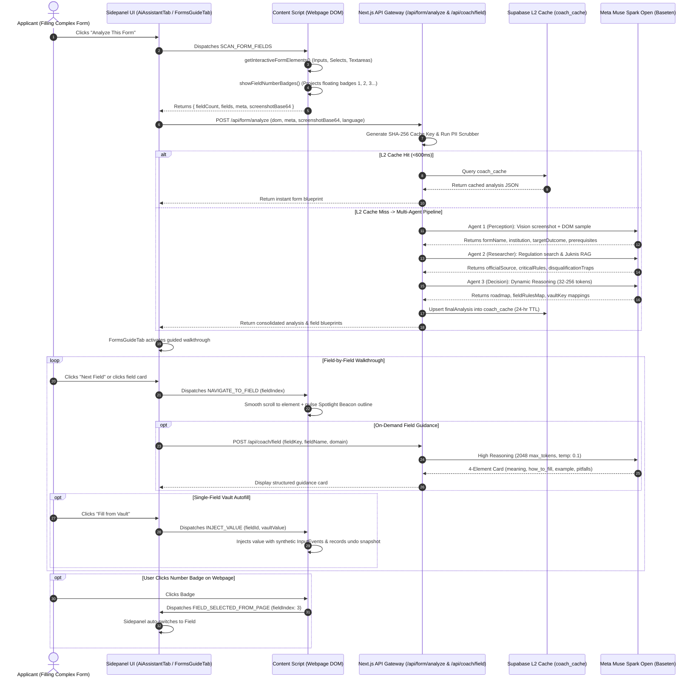

# 📋 Forms Guide & Form Analyzer ("Analyze This Form") — Technical Architecture

> **Feature Specification:** `feature/forms_guide.md`  
> **Status:** Production-Ready  
> **Target Audience:** Core AI Engineers, Browser Extension Architects, Full-Stack Web Developers, and Accessibility Specialists

---

## 1. Executive Overview & Universal Problem Statement

Across international administrative, educational, and consular portals—including visa systems (**US DS-160 / ESTA**, **UK Visas & Immigration / UKVI**, **Schengen Visa portals**), university admissions (**Common Application**, **UCAS**), and state registries (**Texas DMV / Real ID**, **UK GOV.UK**, **Singapore Singpass**)—applicants routinely encounter complex, high-friction forms:

1. **Cryptic Bureaucratic Jargon:** Labels such as *"Principal Alien Registration Number"*, *"Place of Birth (Municipality only)"*, or *"Tax Certificate Serial Number"* are confusing, causing applicants to enter invalid formats or country names inappropriately.
2. **High-Stakes Disqualification Risk:** A minor typographical discrepancy (e.g., mismatching full legal names, abbreviation of middle names, or invalid date formats) can trigger automatic pre-screening disqualification or weeks of manual review delay.
3. **Cognitive Fatigue in Long Multi-Section Forms:** Forms spanning 30 to 80 fields induce severe cognitive overload. Applicants lose track of progress and miss subtle mandatory asterisks.
4. **Disconnected Autofill:** Standard browser autofill blindly blasts values across form inputs without understanding context, overriding delicate conditional fields or triggering form validation rejections.

**Forms Guide ("Analyze This Form")** solves this through a **co-pilot guided walkthrough**. It combines an automated client DOM scanner, interactive on-page numbered badges, an on-demand **AI Field Coach (4-element guidance cards)**, and a **4-Agent Orchestration Pipeline powered by Meta Muse Spark Open (`meta-models/muse-spark-open-1026`)**.

---

## 2. End-to-End System Architecture

The following sequence diagram outlines the entire operational lifecycle—from one-click form scanning to multi-agent reasoning, interactive badge projection, and single-field autofill:



---

## 3. The Guided Walkthrough Interface

The Forms Guide provides an interactive, card-based interface in [`extension/src/components/FormsGuideTab.tsx`](file:///d:/webdev/laragon/www/savvy/extension/src/components/FormsGuideTab.tsx):

### 3.1 Field Header & Step Navigation
* **Progress Meter:** Displays current step progress (e.g., *"Field 3 of 18"* or *"Field 12 of 45"*).
* **Previous / Next Buttons (`handleNavigateField`):** Allows rapid keyboard or button stepping. Each step immediately sends `NAVIGATE_TO_FIELD` to the webpage, scrolling the viewport and centering the active input element.
* **Status Badges:** Displays verification badges:
  - `🟢 Official Guidance`: Grounded in verified agency regulations or official `.gov` / `.edu` documentation.
  - `✨ Meta AI Guidance`: Synthesized via Meta Muse Spark Open high-reasoning inference.

### 3.2 The 4-Element Guidance Card
Every individual field displays a structured, cognitive guidance card:
1. **Meaning (`meaning`):** A clear, 1–2 sentence explanation of the field's administrative purpose in plain language.
2. **How to Fill (`how_to_fill`):** Concrete, step-by-step instructions for data formatting (e.g., *"Do not include spaces or dashes"* or *"City of birth only, do not write country"*).
3. **Valid Example (`example`):** A realistic, compliant sample entry (e.g., `"Jakarta"`, `"3271041908980002"`, or `"John Doe"`).
4. **Disqualification Pitfalls (`pitfalls`):** Warning of common traps that lead to rejection (e.g., *"Entering a nickname rather than your full legal name will cause identity verification failure"*).

### 3.3 Safe Single-Field Autofill ("Fill from Vault")
* Rather than filling all fields at once, the user can inspect each field individually and click **"Fill from Vault"** (`handleFillFromVault`).
* **Masked Security Preview:** If the vault is locked, sensitive values are masked (`327xxxxxx02`). Once authenticated via Master PIN / Password, values decrypt locally in extension memory.
* **Dispatched Event Simulation:** Injects values using synthetic `new Event('input', { bubbles: true })` and `new Event('change', { bubbles: true })`, ensuring reactive frameworks (React, Angular, Vue) register the state changes.

---

## 4. Multi-Agent Form Analysis Pipeline (`/api/form/analyze`)

The core intelligence behind "Analyze This Form" is an orchestrated **4-Agent Pipeline** implemented in [`web/src/app/api/form/analyze/route.ts`](file:///d:/webdev/laragon/www/savvy/web/src/app/api/form/analyze/route.ts).

### 4.1 Step 0: SHA-256 Two-Tier Cache Lookup (`coach_cache`)
To prevent redundant LLM inference across millions of applicants filling the same visa or admissions forms:
* **Cache Key Computation:**
  $$\text{CacheKey} = \text{SHA256}(\text{domain} : \text{fieldCount} : \text{sortedFieldIds} : \text{language})$$
* If an active entry exists in Supabase (`coach_cache`), the entire multi-agent payload returns in **<600ms** with zero LLM API costs.

### 4.2 Step 0.5: Defense-in-Depth PII Scrubber
* All field labels, placeholders, and page metadata pass through `stripPII()` before any AI prompt construction.
* Regular expressions strip 16-digit national IDs, email addresses, and phone numbers.
* **Absolute Privacy Guarantee:** User input values (`.value`) are never collected or sent to the server.

### 4.3 Agent 1: Perception & Form Profiler (Multimodal Vision)
* **Role:** Analyzes the visual screenshot of the viewport combined with a DOM structural sample.
* **Calibrated Hyperparameters:** `temperature: 0.2`, `reasoning_effort: 'medium'`, `max_tokens: 600`.
* **Output Schema:**
  ```json
  {
    "formName": "DS-160 Nonimmigrant Visa Application",
    "institution": "U.S. Department of State",
    "targetOutcome": "Consular Visa Appointment Confirmation",
    "category": "Immigration & Consular Services",
    "prerequisites": ["Valid International Passport", "Digital Portrait Photo (2x2 inch)", "Travel Itinerary"],
    "difficultyLevel": "High",
    "estimatedTime": "45 - 60 Mins"
  }
  ```

### 4.4 Agent 2: Regulation Researcher (Meta Grounding & Juknis RAG)
* **Role:** Searches official regulatory databases (`juknis_chunks`) and verified government domains (`.gov`, `.edu`, `.ac.id`).
* **Outputs:**
  - `officialSource`: Verified citation reference.
  - `deadlines`: Submission timeline constraints.
  - `criticalRules`: Essential document formatting requirements.
  - `disqualificationTraps`: Known administrative rejection triggers.

### 4.5 Agent 3: Decision, Synthesis & Chaining (High Dynamic Reasoning)
* **Dynamic Reasoning Token Scaling:**
  - Small forms (`fieldCount < 8`): `32 tokens` (`low`).
  - Verified official portals: `256 tokens` (`high`).
  - Standard forms: `64 tokens` (`medium`).
* **Field Blueprint Mapping:** Matches each DOM input to an exact `vaultKey` with an associated confidence score:
  ```json
  {
    "fieldId": "applicant_dob",
    "action": "Select date of birth strictly matching physical passport.",
    "vaultKey": "personal.birthDate",
    "confidenceScore": 0.96,
    "validation": "YYYY-MM-DD"
  }
  ```
* **Synthesis:** Produces the comprehensive executive **Roadmap** and pre-submission **Traps Checklist**.

### 4.6 Agent 4: Consolidation & L2 Cache Indexing
* Merges outputs into `finalAnalysis` and saves to Supabase `coach_cache` with a **24-hour TTL**.

---

## 5. On-Demand AI Field Coach Engine (`/api/coach/field`)

When an applicant navigates to a specific field in the walkthrough, the client requests real-time guidance from [`web/src/app/api/coach/field/route.ts`](file:///d:/webdev/laragon/www/savvy/web/src/app/api/coach/field/route.ts).

### 5.1 High-Reasoning Calibration
```typescript
const basetenRes = await fetch(`${basetenBaseUrl}/chat/completions`, {
  method: 'POST',
  headers: {
    'Authorization': `Bearer ${basetenApiKey}`,
    'Content-Type': 'application/json'
  },
  body: JSON.stringify({
    model: 'meta-models/muse-spark-open-1026',
    messages: [
      { role: 'system', content: 'You are a precise JSON generator for form guidance. Always output strictly valid JSON.' },
      { role: 'user', content: prompt }
    ],
    reasoning_effort: 'high',
    temperature: 0.1,    // Absolute deterministic adherence
    max_tokens: 2048,    // Ample space for detailed bureaucratic examples
    response_format: { type: 'json_object' }
  })
});
```

### 5.2 Strict Bureaucratic Invariance Rules
The prompt enforces strict bureaucratic rules to avoid standard chatbot hallucinations:
* **Place of Birth Invariance:** Enforces that Place of Birth refers strictly to the **City, Regency, or Municipality** (e.g., *"Jakarta"*, *"London"*, *"Kudus"*), never country names (*"France"* or *"City, Country"*).
* **Date of Birth Invariance:** Enforces calendar date format (`YYYY-MM-DD`), preventing confusion with birth locations.

---

## 6. Deterministic Browser Tools Callable via Forms Guide

Forms Guide operates a suite of **deterministic client-side tools** executed via Chrome extension messaging:

| Tool Message | Origin | Destination | Technical Mechanism & Styling Impact |
|---|---|---|---|
| `SCAN_FORM_FIELDS` | Sidepanel | Content Script | Queries `input:not([type=hidden])`, `select`, `textarea`, computes bounding rects, and extracts labels. |
| `SHOW_FIELD_NUMBERS` | Sidepanel | Content Script | Injects absolute-positioned floating numbered badges (`1`, `2`, `3`...) next to every discovered form field. |
| `HIDE_FIELD_NUMBERS` | Sidepanel | Content Script | Cleans up and detaches floating number badge DOM elements. |
| `NAVIGATE_TO_FIELD` | Sidepanel | Content Script | Focuses target input (`el.focus()`), scrolls smoothly to viewport center, and highlights active badge. |
| `SHOW_FIELD_SPOTLIGHT`| Sidepanel | Content Script | Injects pulsing SVG beacon spotlight around active target input. |
| `FIELD_SELECTED_FROM_PAGE` | Content Script | Sidepanel | Dispatched when user clicks a floating badge on the webpage; auto-switches sidepanel to that field card. |
| `INJECT_VALUE` | Sidepanel | Content Script | Dispatches synthetic `InputEvent` & `Event('change')` with target vault value, snapshotting prior state for undo. |

---

## 7. Universal Global Case Studies

### Case 1: Consular Visa Application (US DS-160 / UKVI)
* **Problem:** Form contains 50+ fields across 8 pages with stringent immigration consequences for discrepancies.
* **Agentic Execution:**
  1. "Analyze This Form" identifies the form as DS-160.
  2. Agent 2 extracts the critical rule: *"Names must match Machine Readable Zone (MRZ) of passport exactly."*
  3. Forms Guide guides the user field-by-field, mapping `Given Names` and `Surname` from the encrypted vault.
  4. The 4-element guidance card for *"National Identification Number"* instructs: *"Enter 16-digit national ID if citizen, otherwise enter 'DOES NOT APPLY'"*.

### Case 2: College Admissions Portal (Common Application)
* **Problem:** Ambiguous academic fields (e.g., *"Class Rank Reporting"*, *"Cumulative GPA Scale"*).
* **Agentic Execution:**
  1. Agent 1 infers university admission context.
  2. The on-demand coach card explains GPA scale formatting (`4.0 Unweighted` vs `5.0 Weighted`).
  3. Single-click autofill populates GPA and high school registry code from academic vault credentials.

### Case 3: State DMV / Real ID Driver License Portal
* **Problem:** Specific residential address formatting requirements to satisfy proof-of-residency audits.
* **Agentic Execution:**
  1. Content script renders numbered badges `1` through `14`.
  2. Applicant clicks Badge #5 on the page; Forms Guide immediately brings up the Address Line 1 guidance card.
  3. Field coach cautions: *"Do not use a P.O. Box. State Real ID guidelines require a physical residential street address."*

---

## 8. Summary of Implementation Files

| Component | File Path | Function / Responsibility |
|---|---|---|
| **Feature Specification** | [`feature/forms_guide.md`](file:///d:/webdev/laragon/www/savvy/feature/forms_guide.md) | Universal technical architecture and specification document. |
| **Multi-Agent Form Analyzer** | [`web/src/app/api/form/analyze/route.ts`](file:///d:/webdev/laragon/www/savvy/web/src/app/api/form/analyze/route.ts) | 4-agent orchestration pipeline (Perception, Research, Decision, Cache). |
| **AI Field Coach API** | [`web/src/app/api/coach/field/route.ts`](file:///d:/webdev/laragon/www/savvy/web/src/app/api/coach/field/route.ts) | High-reasoning generation of 4-element structured guidance cards. |
| **Forms Guide UI Component** | [`extension/src/components/FormsGuideTab.tsx`](file:///d:/webdev/laragon/www/savvy/extension/src/components/FormsGuideTab.tsx) | Card-based field walkthrough, step navigator, and single-field autofill. |
| **DOM Scanning & Badges Engine** | [`extension/src/content.ts`](file:///d:/webdev/laragon/www/savvy/extension/src/content.ts) | Scans DOM inputs, projects floating numbered badges, and handles spotlighting. |
| **Client API Connector** | [`extension/src/lib/api/client.ts`](file:///d:/webdev/laragon/www/savvy/extension/src/lib/api/client.ts) | Client fetch wrappers with logging for `analyzeForm` and `fetchFieldCoachGuidance`. |
