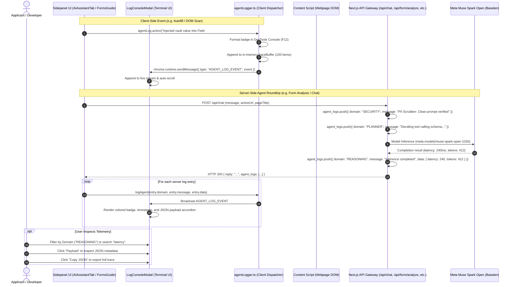

# 🖥️ Log Viewer & Agent Observability Console — Technical Architecture

> **Feature Specification:** `feature/log_viewer.md`  
> **Status:** Production-Ready  
> **Target Audience:** Core AI Engineers, Browser Extension Architects, Full-Stack Developers, and Security / Compliance Auditors

---

## 1. Executive Overview & Universal Problem Statement

In autonomous, multi-modal web agents—especially those that interact with sensitive official platforms (visa portals, university registries, state licensing, tax systems)—traditional "black-box" AI systems introduce major challenges:

1. **Lack of Agentic Explainability:** Users and engineers cannot determine *why* an AI agent decided to take a specific action (e.g., why did it take a screenshot, why did it click a button, or why did it pick a particular field?).
2. **Hidden Security & Privacy Risks:** In strict regulatory environments (**GDPR**, **California CCPA**, **UU PDP**), users must verify that their personal identification numbers (SSNs, national IDs, credit cards) are never transmitted to cloud LLMs in plaintext.
3. **Complex Multi-Context Debugging:** Browser extensions operate across three isolated runtime execution environments (**Content Script**, **Background Service Worker**, and **SidePanel UI**), making unified logging across contexts difficult.
4. **Distributed Inference Tracking:** When requests traverse client DOM scanners, Next.js gateways, Supabase caches, and cloud model inference endpoints (**Meta Muse Spark Open on Baseten**), developers require sub-millisecond trace visibility.

**The Savvy Log Viewer & Agent Observability Console** solves this by providing a **unified, real-time telemetry stream**. It captures, visualizes, and synchronizes lifecycle events across all **7 Agent Domains**, bridging client-side DOM actions and server-side Meta Muse Spark Open inference into an interactive DevTools-grade terminal.

---

## 2. End-to-End System Architecture

The following sequence diagram outlines how client-side actions and server-side inference telemetry flow into the unified `LogConsoleModal`:



---

## 3. The 7 Agent Domains

Every log event is tagged with one of **7 standardized Agent Domains**, each associated with a unique visual identity, badge color, and semantic responsibility in [`extension/src/lib/agentLogger.ts`](file:///d:/webdev/laragon/www/savvy/extension/src/lib/agentLogger.ts):

| Domain | Icon | Brand Color | Visual Styling | Lifecycle Responsibilities |
|---|---|---|---|---|
| `PLANNER` | 🧭 | `#7045ED` (Purple) | `bg-purple-950 text-purple-300` | Agent state transitions, multi-agent pipeline routing, tool invocation decisions (`capture_current_screen`), compacting triggers. |
| `PERCEPTION` | 👁️ | `#398CF5` (Blue) | `bg-blue-950 text-blue-300` | DOM observation, field discovery, element bounding coordinates, viewport dimensions, Lightshot screen snips. |
| `REASONING` | 🧠 | `#0D9488` (Teal) | `bg-teal-950 text-teal-300` | Meta Muse Spark Open inference latencies, token consumption, dynamic reasoning token allocation (32–256 tokens), confidence scores. |
| `ACTION` | ⚡ | `#F59E0B` (Amber) | `bg-amber-950 text-amber-300` | Concrete browser DOM mutations, synthetic `InputEvent` dispatches, single-field & 1-click autofill, undo stack pushes, Spotlight Beacon pulsing. |
| `SECURITY` | 🛡️ | `#EF5350` (Red) | `bg-red-950 text-red-300` | WebCrypto AES-256-GCM encryption/decryption, client & server PII scrubbers (SSN/National ID/Cards), GDPR & UU PDP compliance checks. |
| `VOICE` | 🎙️ | `#6366F1` (Indigo) | `bg-indigo-950 text-indigo-300` | Web Audio API VAD volume levels, RMS energy thresholds, speech start/end boundaries, verbatim speech-to-text transcriptions. |
| `GATEWAY` | ☁️ | `#0284C7` (Sky Blue) | `bg-sky-950 text-sky-300` | Next.js API requests, SHA-256 L1/L2 cache hits/misses, HTTP response status codes, network roundtrip latencies. |

---

## 4. Client-Side Logging Engine (`agentLogger.ts`)

The client dispatcher ([`extension/src/lib/agentLogger.ts`](file:///d:/webdev/laragon/www/savvy/extension/src/lib/agentLogger.ts)) operates three simultaneous output targets:

```typescript
export interface AgentLogEvent {
  timestamp: string;
  domain: AgentDomain;
  message: string;
  data?: any;
}

// In-memory ring buffer (retains last 100 events)
const traceBuffer: AgentLogEvent[] = [];

export function logAgent(domain: AgentDomain, message: string, data?: any, broadcast: boolean = true) {
  const timestamp = new Date().toLocaleTimeString();
  const cfg = BADGE_STYLES[domain] || { bg: "#171B3D", color: "#FFFFFF", icon: "🤖" };

  // 1. Chrome DevTools Console Output (CSS styled)
  const badgeStyle = `background: ${cfg.bg}; color: ${cfg.color}; font-weight: bold; border-radius: 4px; padding: 2px 6px; font-size: 11px;`;
  const timeStyle = `color: #64748B; font-size: 10px; margin-left: 4px;`;
  const msgStyle = `color: #0F172A; font-weight: 600; font-size: 12px;`;

  if (data !== undefined) {
    console.log(`%c${cfg.icon} [Savvy Agent: ${domain}]%c ${timestamp}%c ${message}`, badgeStyle, timeStyle, msgStyle, data);
  } else {
    console.log(`%c${cfg.icon} [Savvy Agent: ${domain}]%c ${timestamp}%c ${message}`, badgeStyle, timeStyle, msgStyle);
  }

  // 2. In-Memory Ring Buffer Update
  traceBuffer.push({ timestamp, domain, message, data });
  if (traceBuffer.length > 100) traceBuffer.shift();

  // 3. Cross-Context Runtime Broadcast (Content Script <-> SidePanel <-> Worker)
  if (broadcast && typeof chrome !== "undefined" && chrome.runtime?.sendMessage) {
    chrome.runtime.sendMessage({
      type: "AGENT_LOG_EVENT",
      event: { timestamp, domain, message, data: data ? JSON.parse(JSON.stringify(data)) : undefined }
    }).catch(() => {});
  }
}
```

### 4.1 Developer Ergonomics API
The module exports convenient, domain-specific helpers used throughout the extension codebase:
```typescript
agentLog.planner("Routing to Show Me 4-tier element locator...");
agentLog.perception("Identified 24 interactive form inputs on screen.");
agentLog.reasoning("Queried Meta Muse Spark Open with reasoning_effort: 'medium'");
agentLog.action("Dispatched synthetic InputEvent into #applicant_name");
agentLog.security("Shielded prompt: 0 PII leaks detected.");
agentLog.voice("Speech complete (1400ms silence detected).");
agentLog.gateway("Cache L2 Hit: Loaded instant form analysis in 12ms.");
```

---

## 5. Server-Side Telemetry Emitting & Client Ingestion

Every backend API route in the Next.js service ([`web/src/app/api/chat/route.ts`](file:///d:/webdev/laragon/www/savvy/web/src/app/api/chat/route.ts), [`web/src/app/api/form/analyze/route.ts`](file:///d:/webdev/laragon/www/savvy/web/src/app/api/form/analyze/route.ts), [`web/src/app/api/coach/field/route.ts`](file:///d:/webdev/laragon/www/savvy/web/src/app/api/coach/field/route.ts), etc.) records server-side diagnostic events:

```typescript
// Initialized at route start
const agent_logs: Array<{ domain: string; message: string; data?: any }> = [];

// During PII Check
agent_logs.push({
  domain: 'SECURITY',
  message: 'Data Privacy Guard: Clean prompt verified, 0 PII leaks detected.'
});

// During Tool Execution Decision
agent_logs.push({
  domain: 'PLANNER',
  message: `Agentic Decision: Muse Spark opted to invoke tool '${toolName}'`,
  data: { toolCallId, name: toolName, arguments: parsedArgs }
});

// During Model Inference
agent_logs.push({
  domain: 'REASONING',
  message: `Meta Muse Spark Open inference completed in ${latency}ms`,
  data: {
    model: 'meta-models/muse-spark-open-1026',
    totalTokens: completion.usage?.total_tokens,
    promptTokens: completion.usage?.prompt_tokens,
    completionTokens: completion.usage?.completion_tokens
  }
});

// Appended to HTTP response JSON
return NextResponse.json({ reply, agent_logs });
```

### 5.1 Client Ingestion Bridge (`client.ts`)
When the extension's API connector ([`extension/src/lib/api/client.ts`](file:///d:/webdev/laragon/www/savvy/extension/src/lib/api/client.ts)) receives the HTTP response, it unpacks `res.agent_logs` and pipes them into the client logger:
```typescript
if (resData.agent_logs && Array.isArray(resData.agent_logs)) {
  resData.agent_logs.forEach((logItem: any) => {
    const fn = (agentLog as any)[logItem.domain?.toLowerCase()];
    if (typeof fn === "function") {
      fn(logItem.message, logItem.data);
    }
  });
}
```
This guarantees that **server-side AI reasoning events appear seamlessly in the client's terminal console alongside local DOM events.**

---

## 6. Interactive Log Console Modal UI (`LogConsoleModal.tsx`)

The Log Console is accessed via the **Terminal icon button** in [`extension/src/components/Header.tsx`](file:///d:/webdev/laragon/www/savvy/extension/src/components/Header.tsx), which features a live pulsing green radar beacon (`animate-ping`).

### 6.1 Terminal Features & Controls
* **Live Pulsing Status Badge:** Displays `LIVE` with an animated pulsing emerald dot, indicating active listener subscription.
* **Domain Filter Pills:** Quick filters for `ALL`, `REASONING`, `PERCEPTION`, `PLANNER`, `ACTION`, `SECURITY`, `VOICE`, and `GATEWAY`, displaying real-time event counts in parentheses:
  ```
  [All Logs (34)]  [🧠 Reasoning (8)]  [👁️ Perception (6)]  [⚡ Action (12)]  [🛡️ Security (4)]
  ```
* **Real-Time Full-Text Search:** Case-insensitive search bar filtering across domain names, message strings, and nested JSON payload attributes.
* **Auto-Scroll Toggle:** Smart auto-scroll button that keeps the console locked to the newest incoming events while allowing the user to pause auto-scroll when inspecting older logs.
* **Structured Payload Accordion:** Each log entry displays a **"Payload"** toggle. Clicking it unfolds a highlighted JSON preformatted block showing raw request/response metadata, token counts, and coordinates.
* **1-Click Copy JSON (`handleCopyLogs`):** Copies all currently filtered logs as formatted JSON to the system clipboard, making it effortless to paste into bug trackers or evaluation suites.
* **Clear Logs (`handleClearLogs`):** Instantly purges the active display view.

---

## 7. Deep-Dive: Meta Muse Spark Open Inference Telemetry

The Log Viewer provides transparent, quantifiable metrics for every interaction with **Meta Muse Spark Open (`meta-models/muse-spark-open-1026`)**:

### 7.1 Sample Raw Log Event: Tool Selection Decision
```json
{
  "timestamp": "08:42:15 PM",
  "domain": "PLANNER",
  "message": "Agentic Decision: Muse Spark opted to invoke tool 'capture_current_screen'",
  "data": {
    "toolCallId": "call_1793542935000",
    "name": "capture_current_screen",
    "arguments": {
      "reason": "Verify whether signature requires digital cryptographic ID or scanned ink"
    }
  }
}
```

### 7.2 Sample Raw Log Event: Model Inference Performance
```json
{
  "timestamp": "08:42:16 PM",
  "domain": "REASONING",
  "message": "Meta Muse Spark Open inference completed in 284ms",
  "data": {
    "model": "meta-models/muse-spark-open-1026",
    "totalTokens": 384,
    "promptTokens": 248,
    "completionTokens": 136
  }
}
```

### 7.3 Sample Raw Log Event: Defense-in-Depth PII Scrubber
```json
{
  "timestamp": "08:42:17 PM",
  "domain": "SECURITY",
  "message": "Defense-in-Depth PII Scrubber: 0 personal values passed. Fields sanitized.",
  "data": {
    "fieldCount": 18
  }
}
```

---

## 8. Summary of Implementation Files

| Component | File Path | Function / Responsibility |
|---|---|---|
| **Feature Specification** | [`feature/log_viewer.md`](file:///d:/webdev/laragon/www/savvy/feature/log_viewer.md) | Universal technical architecture and specification document. |
| **Client Logging Engine** | [`extension/src/lib/agentLogger.ts`](file:///d:/webdev/laragon/www/savvy/extension/src/lib/agentLogger.ts) | Core dispatcher, DevTools console formatter, ring buffer, and runtime broadcaster. |
| **Log Console Modal UI** | [`extension/src/components/LogConsoleModal.tsx`](file:///d:/webdev/laragon/www/savvy/extension/src/components/LogConsoleModal.tsx) | Terminal overlay with domain filters, full-text search, auto-scroll, and JSON export. |
| **Terminal Header Trigger** | [`extension/src/components/Header.tsx`](file:///d:/webdev/laragon/www/savvy/extension/src/components/Header.tsx) | Live pulsing status radar and console launch button. |
| **Client API Telemetry Bridge** | [`extension/src/lib/api/client.ts`](file:///d:/webdev/laragon/www/savvy/extension/src/lib/api/client.ts) | Unpacks server `agent_logs` and forward-broadcasts into the client logger. |
| **Server Route Emitting** | [`web/src/app/api/chat/route.ts`](file:///d:/webdev/laragon/www/savvy/web/src/app/api/chat/route.ts) | Records security, planner, reasoning, and token telemetry during API execution. |
