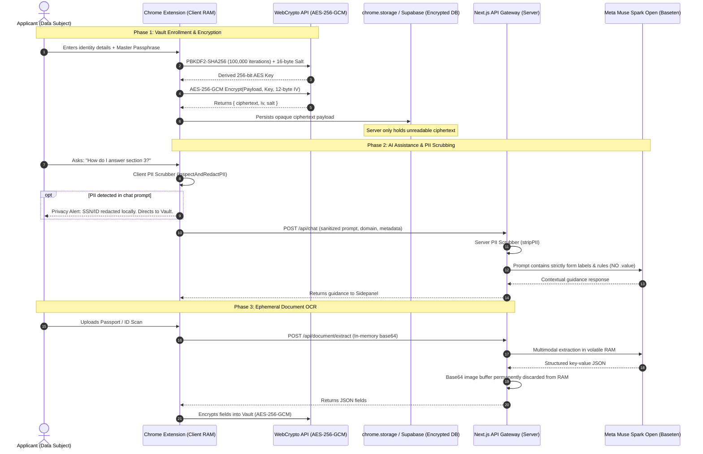

# 🛡️ Security, Privacy & Zero-Knowledge Architecture

> **Feature Specification:** `feature/security.md`  
> **Status:** Production-Ready  
> **Target Audience:** Security Architects, Cryptographic Engineers, Privacy Compliance Officers (GDPR / CCPA), and AI Safety Researchers

---

## 1. Executive Overview & Threat Model

Online form assistance operates at the intersection of extreme user convenience and critical data sensitivity. When applicants fill out government registries, consular visa applications (**US DS-160 / ESTA**, **UKVI**, **Schengen Visa**), university admissions (**Common App**, **UCAS**), or state administrative portals (**Texas DMV / Real ID**, **UK GOV.UK**, **Singapore Singpass**), they handle their most private identity credentials:

* **National Identification Numbers & SSNs**
* **Passport Serial Numbers & Machine-Readable Zone (MRZ) Codes**
* **Academic Transcripts & Grade Point Averages**
* **Residential Addresses, Phone Numbers, and Date of Birth**

In standard AI applications, sending these records to cloud LLMs creates unacceptable risks: third-party data broker exposure, training set memorization, and regulatory non-compliance with global privacy laws (**European Union GDPR**, **California Consumer Privacy Act / CCPA**, **UK Data Protection Act**, and **APPI**).

### The Savvy Zero-Knowledge Paradigm
Savvy eliminates these risks through a strict architectural principle: **The server and cloud AI models are never entrusted with raw plaintext credentials.**
* **Zero-Knowledge Vault:** Data is encrypted on the client device using **AES-256-GCM** before touching persistent storage.
* **Ephemeral Document Ingestion:** Uploaded identity files are parsed in volatile RAM and permanently erased within milliseconds.
* **Client & Server PII Scrubbing:** All LLM prompts are aggressively stripped of personal identification strings.
* **Hardcoded Authentication Isolation:** Password fields, CVVs, bank PINs, and OTP tokens are unconditionally blacklisted from extension DOM scanners.

---

## 2. End-to-End Cryptographic & Privacy Lifecycle

The following diagram illustrates how credentials move safely through the system with zero plaintext exposure:



---

## 3. Cryptographic Implementation: Client-Side WebCrypto AES-256-GCM

All credential encryption and decryption occur strictly on the user's local machine inside the browser extension sandbox using the native **W3C Web Cryptography API** ([`extension/src/lib/crypto/vault.ts`](file:///d:/webdev/laragon/www/savvy/extension/src/lib/crypto/vault.ts)).

### 3.1 Key Derivation Function (PBKDF2-SHA256)
A high-entropy cryptographic key is derived from the applicant's master passphrase:
* **Algorithm:** PBKDF2 (`Password-Based Key Derivation Function 2`).
* **Underlying Hash Function:** HMAC-SHA-256.
* **Work Factor (Iterations):** **100,000 iterations**, providing formidable resistance against GPU-accelerated dictionary attacks and rainbow table computations.
* **Cryptographic Salt:** A unique 16-byte cryptographically secure pseudorandom salt (`crypto.getRandomValues(new Uint8Array(16))`) generated per vault item.

```typescript
// extension/src/lib/crypto/vault.ts
async function deriveKey(passphrase: string, salt: Uint8Array): Promise<CryptoKey> {
  const enc = new TextEncoder();
  const keyMaterial = await crypto.subtle.importKey(
    "raw",
    enc.encode(passphrase),
    { name: "PBKDF2" },
    false,
    ["deriveKey"]
  );

  return crypto.subtle.deriveKey(
    {
      name: "PBKDF2",
      salt: salt as any,
      iterations: 100000,
      hash: "SHA-256",
    },
    keyMaterial,
    { name: "AES-GCM", length: 256 },
    false,
    ["encrypt", "decrypt"]
  );
}
```

### 3.2 Authenticated Encryption (AES-256-GCM)
* **Cipher Mode:** Galois/Counter Mode (GCM).
* **Key Length:** 256-bit symmetric key (`length: 256`).
* **Initialization Vector (IV):** A unique 12-byte cryptographically secure random IV (`crypto.getRandomValues(new Uint8Array(12))`) generated for every single write operation. An IV is never reused.
* **Integrity Authentication:** GCM generates an authentication tag that guarantees **both confidentiality and data integrity** (AEAD). If any byte of the ciphertext or IV is tampered with in transit or on disk, decryption fails immediately.

```typescript
// Encrypted Storage Payload Schema
export interface EncryptedPayload {
  ciphertext: string; // Base64 encoded AES-256-GCM ciphertext
  iv: string;         // Base64 encoded 12-byte IV
  salt: string;       // Base64 encoded 16-byte PBKDF2 salt
}
```

---

## 4. Defense-in-Depth PII Scrubber

To protect applicants from accidentally leaking identity numbers through the conversational AI assistant, Savvy enforces a dual-stage PII filter:

### 4.1 Stage 1: Client-Side Pre-Flight Interceptor (`censor.ts`)
As the user types into the chat input, [`extension/src/lib/privacy/censor.ts`](file:///d:/webdev/laragon/www/savvy/extension/src/lib/privacy/censor.ts) inspects the string in real time:

```typescript
// Regex definitions
const NATIONAL_ID_REGEX  = /\b([1-9][0-9]{5}[0-7][0-9][0-1][0-9][0-9]{4})\b/g; // 16-digit National IDs
const TAX_ID_REGEX       = /\b(\d{2}\.?\d{3}\.?\d{3}\.?\d{1}-?\d{3}\.?\d{3}|\d{15,16})\b/g; // Tax IDs
const CREDIT_CARD_REGEX  = /\b(?:\d{4}[-\s]?){3}\d{4}\b/g;                      // Credit / Debit Cards
```

* **Action on Detection:**
  1. Displays a prominent security warning banner above the chat input.
  2. Redacts the sensitive pattern locally: `[REDACTED_NIK_3271****0002]`.
  3. Directs the user to store the value in their zero-knowledge AES-256 Vault rather than pasting it into open chat windows.

### 4.2 Stage 2: Server-Side Defensive Sanitizer (`route.ts`)
If an applicant bypasses client inspection, the server gateway ([`web/src/app/api/chat/route.ts`](file:///d:/webdev/laragon/www/savvy/web/src/app/api/chat/route.ts)) executes an aggressive secondary scrub:

```typescript
// Universal PII Regex Scrubber
const PII_REGEX_NATIONAL_ID = /\b[1-9]\d{15}\b/g;
const PII_REGEX_SSN         = /\b\d{3}-\d{2}-\d{4}\b/g;
const PII_REGEX_TAX         = /\b\d{2}\.?\d{3}\.?\d{3}\.?\d{1}-?\d{3}\.?\d{3}\b/g;
const PII_REGEX_CARD        = /\b(?:\d{4}[ -]?){3}\d{4}\b/g;
```

* **Action on Detection:**
  1. Blocks downstream transmission to Meta Muse Spark Open.
  2. Emits an audit log tagged to the `SECURITY` domain.
  3. Returns a structured privacy advisory referencing GDPR / Data Protection compliance.

---

## 5. Hardcoded Exclusion of Passwords & Financial Inputs

In [`extension/src/content.ts`](file:///d:/webdev/laragon/www/savvy/extension/src/content.ts), the core DOM scanner (`getInteractiveFormElements`) contains hardcoded exclusions:

```typescript
// Hardcoded Blacklist in DOM Scanners
const isSensitiveOrAuth = 
  el.type === "password" ||
  el.name.toLowerCase().includes("password") ||
  el.id.toLowerCase().includes("password") ||
  el.name.toLowerCase().includes("cvv") ||
  el.id.toLowerCase().includes("cvv") ||
  el.name.toLowerCase().includes("pin") ||
  el.name.toLowerCase().includes("otp");
```

* **Zero Password Capture:** Input elements of `type="password"`, CVV security codes, bank PINs, and OTP tokens are **completely invisible** to the AI copilot, Forms Guide, and Autofill engines.
* **No AutoFill Injection:** The extension refuses to suggest or inject values into authentication elements.
* **No Telemetry Logging:** Keystrokes inside sensitive fields never emit events to the Log Console.

---

## 6. Zero Document Retention Policy (Ephemeral In-Memory OCR)

When an applicant uploads an identity document (passport, national ID, academic transcript) for smart extraction via [`/api/document/extract`](file:///d:/webdev/laragon/www/savvy/web/src/app/api/document/extract/route.ts):

1. **In-Memory Buffer Processing:** The document is received as a base64 string in server RAM.
2. **Direct Inference Stream:** The buffer is piped directly into Meta Muse Spark Open's multimodal vision API via an ephemeral HTTPS stream.
3. **Immediate Memory Deallocation:** As soon as structured key-value pairs are returned, the image buffer is deallocated and purged from memory.
4. **Zero Persistent Storage:** The server maintains **no database tables, no file storage buckets (e.g., S3, Google Cloud Storage), and no temporary disk caches** for uploaded identity documents.
5. **Client-Side Finalization:** Extracted fields are delivered directly back to the extension, where they are immediately encrypted into the client vault.

---

## 7. Data Retention & Cache Expiration Lifecycle

| Data Category | Storage Location | Encryption Status | Retention / TTL Policy | User Erasure Right |
|---|---|---|---|---|
| **Identity Profile Credentials** | Local `chrome.storage` / Supabase | AES-256-GCM Ciphertext | Indefinite until deleted by user | 1-Click **"Delete Vault"** purges all ciphertext instantly. |
| **Uploaded Identity Documents** | Temporary Server RAM | In-transit TLS 1.3 | **0 seconds** (Purged immediately post-extraction) | Fully ephemeral; no records exist to delete. |
| **Form Analysis Cache (`coach_cache`)** | Supabase Cache Table | Public Schema JSON | **24-Hour TTL** (`expires_at` auto-purge) | Cache contains zero user PII; auto-expires. |
| **Chat Conversation History** | Supabase `chat_messages` | In-transit TLS 1.3 | Rolling 10-message window (Auto-compacted) | 1-Click **"New Conversation"** clears local session. |
| **Telemetry Trace Buffer** | Extension RAM | Ephemeral In-Memory | Capped at **100 events** (FIFO ring buffer) | 1-Click **"Clear Logs"** clears console display. |

---

## 8. AI Safety & Meta Muse Spark Open Guardrails

The integration with **Meta Muse Spark Open (`meta-models/muse-spark-open-1026`)** incorporates strict AI safety controls:

1. **Zero-PII Prompt Construction:** Form analysis prompts pass only DOM structure (tag names, labels, placeholders) and page metadata. Under no circumstances is a user's input value (`input.value`) included in the prompt.
2. **Strict Schema Constraints (`response_format: { type: 'json_object' }`):** Output is bound to rigid JSON schemas, preventing model jailbreaks, unintended conversational drift, or prompt injection exploits from malicious web forms.
3. **Deterministic Low-Temperature Inference (`temperature: 0.1`):** Minimizes creative variance and parameter hallucination, guaranteeing reliable adherence to security rules.
4. **Defensive Viewport Boundaries:** The autonomous `capture_current_screen` tool operates strictly on the active viewport. It cannot capture off-screen windows, hidden browser tabs, or desktop application frames.

---

## 9. Global Compliance & Regulatory Mapping

| Regulatory Standard | Legal Requirement | Savvy Architectural Implementation |
|---|---|---|
| **EU GDPR (Art. 25 & 32)** | *Privacy by Design & Cryptographic Protection of Personal Data* | Client-side AES-256-GCM zero-knowledge vault; PBKDF2-SHA256 key derivation with 100,000 iterations. |
| **EU GDPR (Art. 17)** | *Right to Erasure ("Right to be Forgotten")* | 1-Click **"Delete Vault"** immediately destroys all local keys and remote ciphertext blocks. |
| **EU GDPR (Art. 5(1)(c))** | *Data Minimization* | AI prompts transmit only DOM labels and schemas; zero user `.value` records forwarded. |
| **California CCPA / CPRA** | *Prohibition on Sale & Unauthorized Sharing of PII* | Zero data monetization or advertising broker transfers; zero document retention. |
| **W3C Web Standards** | *Browser Sandbox Isolation* | Strict separation of Content Script, Background Worker, and SidePanel origins. |

---

## 10. Summary of Security Code Artifacts

| Component | File Path | Function / Responsibility |
|---|---|---|
| **Security Specification** | [`feature/security.md`](file:///d:/webdev/laragon/www/savvy/feature/security.md) | Universal cryptographic architecture and privacy compliance document. |
| **WebCrypto Vault Engine** | [`extension/src/lib/crypto/vault.ts`](file:///d:/webdev/laragon/www/savvy/extension/src/lib/crypto/vault.ts) | Implements client-side AES-256-GCM encryption and PBKDF2 key derivation. |
| **Client PII Censor** | [`extension/src/lib/privacy/censor.ts`](file:///d:/webdev/laragon/www/savvy/extension/src/lib/privacy/censor.ts) | Real-time regex detector and redaction engine for chat inputs. |
| **Server PII Sanitizer** | [`web/src/app/api/chat/route.ts`](file:///d:/webdev/laragon/www/savvy/web/src/app/api/chat/route.ts) | Defensive server-side PII scrubber halting transmissions containing credentials. |
| **Ephemeral Document OCR** | [`web/src/app/api/document/extract/route.ts`](file:///d:/webdev/laragon/www/savvy/web/src/app/api/document/extract/route.ts) | In-memory multimodal extraction with zero persistent file retention. |
| **Public Privacy Policy** | [`web/src/app/privacy/page.tsx`](file:///d:/webdev/laragon/www/savvy/web/src/app/privacy/page.tsx) | User-facing privacy transparency and mathematical security commitments. |
| **Security Telemetry Logs** | [`extension/src/lib/agentLogger.ts`](file:///d:/webdev/laragon/www/savvy/extension/src/lib/agentLogger.ts) | Tracks PII interceptions, encryption operations, and vault access under the `SECURITY` domain. |
