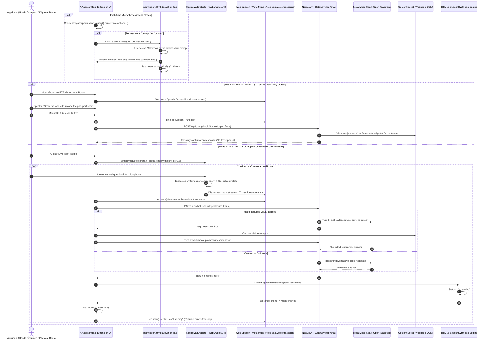
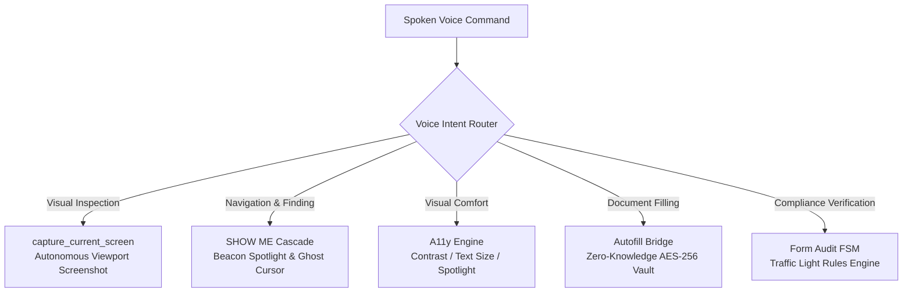

# 🎙️ Voice Companion (Push to Talk & Live Talk) — Technical Architecture

> **Feature Specification:** `feature/voice.md`  
> **Status:** Production-Ready  
> **Target Audience:** Core AI Engineers, Audio Processing Architects, Chrome Extension Developers, and Accessibility Specialists

---

## 1. Executive Overview & Universal Problem Statement

When applicants navigate high-stakes online portals—including consular visa systems (**US DS-160 / ESTA**, **UKVI**, **Schengen Visa**), university admissions registries (**Common Application**, **UCAS**), or state administrative platforms (**Texas Real ID / DMV**, **UK GOV.UK**, **Singapore Singpass**)—they face severe visual and physical demands:

1. **Multitasking Constraints:** Applicants frequently hold physical identity documents (e.g., passports, birth certificates, tax statements, language test certificates) with both hands while attempting to read instructions and type on a keyboard.
2. **Motor Impairments & Visual Fatigue:** Applicants with tremors, arthritis, low vision, or cognitive strain find manual keyboard entry and precision mouse targeting frustrating and exhausting.
3. **Chrome Extension Sandbox Limitations:** Modern Chromium browsers restrict direct microphone permission prompts inside Manifest V3 SidePanel iframes, causing standard voice implementations to fail silently.
4. **Context-Free Voice Bots:** Typical voice assistants lack viewport grounding; they cannot see what is currently displayed on screen, navigate the DOM, or invoke deterministic browser actions.

**Savvy Voice Companion** addresses this with a **dual-mode conversational audio architecture**:
* **Push to Talk (PTT):** A walkie-talkie mode for focused, silent inquiries with text-only outputs.
* **Live Talk:** A full-duplex, continuous hands-free dialogue loop powered by client-side Voice Activity Detection (VAD) and spoken Text-to-Speech (TTS) audio feedback.
* **Autonomous Tool Orchestration:** Voice intents directly drive **Meta Muse Spark Open (`meta-models/muse-spark-open-1026`)** function calling, viewport screen capture, and 4-tier DOM element location.

---

## 2. End-to-End System Architecture

The following sequence diagram details the full lifecycle of both **Push to Talk** and **Live Talk**, including permission elevation, VAD energy detection, speech-to-text transcription, deterministic tool execution, and audio synthesis:



---

## 3. The Two Voice Modes: Push to Talk vs. Live Talk

| Architectural Dimension | Push to Talk (PTT) | Live Talk (Full-Duplex) |
|---|---|---|
| **Interaction Model** | Hold-to-speak (Walkie-talkie paradigm). | Continuous, hands-free open microphone loop. |
| **Activation Trigger** | `onMouseDown` / `onTouchStart` on the microphone icon. | Single toggle switch (`handleVadToggle`). |
| **Speech Boundary Detection** | Explicit `onMouseUp` / `onTouchEnd` event. | Automated client-side VAD with 1,400ms silence detection. |
| **AI Output Modality** | **Text Only** (`shouldSpeakOutput: false`). No spoken audio output. | **Spoken Audio via TTS** (`shouldSpeakOutput: true`) + Markdown text. |
| **Ideal Use Case** | Quiet environments (libraries, shared offices, open desks). | True hands-free document entry while holding physical passports/transcripts. |
| **Interruption Handling** | User manually controls start and finish timing. | Microphone automatically pauses during AI audio playback to prevent echo. |

### 3.1 Push to Talk Implementation (`AiAssistantTab.tsx`)
```typescript
const handlePttMouseDown = () => {
  setIsPttPressed(true);
  setVoiceStatus("listening");
  pttTranscriptRef.current = "";
  
  const rec = new SpeechRecognition();
  rec.lang = isId ? "id-ID" : "en-US";
  rec.continuous = true;
  rec.interimResults = true;
  
  rec.onresult = (event) => {
    let transcript = "";
    for (let i = event.resultIndex; i < event.results.length; i++) {
      transcript += event.results[i][0].transcript;
    }
    if (transcript.trim()) {
      pttTranscriptRef.current = transcript.trim();
      setInputText(transcript.trim());
    }
  };
  rec.start();
  recognitionRef.current = rec;
};

const handlePttMouseUp = async () => {
  if (!isPttPressed) return;
  setIsPttPressed(false);
  setVoiceStatus("thinking");
  
  if (recognitionRef.current) {
    recognitionRef.current.stop();
  }
  
  const textFromSpeech = pttTranscriptRef.current.trim();
  if (textFromSpeech) {
    // PTT output is text only -> shouldSpeakOutput = false
    await handleSendMessage(textFromSpeech, null, null, false);
  }
};
```

### 3.2 Live Talk Implementation (`AiAssistantTab.tsx`)
```typescript
const handleVadToggle = async () => {
  if (!isLiveTalkActive) {
    setIsLiveTalkActive(true);
    isLiveTalkActiveRef.current = true;
    setVoiceStatus("listening");

    const rec = new SpeechRecognition();
    rec.lang = isId ? "id-ID" : "en-US";
    rec.continuous = true;
    rec.interimResults = true;

    rec.onresult = (event) => {
      // Accumulate interim and final transcripts
      let final = "";
      for (let i = event.resultIndex; i < event.results.length; i++) {
        if (event.results[i].isFinal) final += event.results[i][0].transcript;
      }

      if (final.trim()) {
        rec.stop(); // Stop microphone while AI answers and speaks
        setVoiceStatus("thinking");

        // Live Talk output: Spoken via Web Speech API (shouldSpeakOutput: true)
        handleSendMessage(final.trim(), null, null, true).finally(() => {
          if (isLiveTalkActiveRef.current) {
            setTimeout(() => {
              if (isLiveTalkActiveRef.current) {
                try {
                  rec.start();
                  setVoiceStatus("listening");
                } catch (_) {}
              }
            }, 500); // 500ms acoustic echo prevention gap
          }
        });
      }
    };
    rec.start();
  } else {
    // Teardown Live Talk
    isLiveTalkActiveRef.current = false;
    setIsLiveTalkActive(false);
    window.speechSynthesis.cancel();
    setVoiceStatus("idle");
  }
};
```

---

## 4. Microphone Access & Chrome Extension Sandbox Elevation

### 4.1 The Manifest V3 SidePanel Limitation
In Chrome Extensions using Manifest V3 SidePanels (`sidepanel.html`), calling `navigator.mediaDevices.getUserMedia({ audio: true })` fails or throws `NotAllowedError` if permission has not been previously granted on a top-level tab. Chrome intentionally prohibits iframe-based origin elevation prompts.

### 4.2 The First-Party Elevation Bridge (`permission.html`)
Savvy bypasses this limitation cleanly using an automated tab elevation flow:

1. When `AiAssistantTab` mounts or detects an audio permission rejection:
   ```typescript
   // extension/src/components/AiAssistantTab.tsx
   const openPermissionTab = () => {
     if (typeof chrome !== "undefined" && chrome.tabs?.create) {
       chrome.tabs.create({ url: chrome.runtime.getURL("permission.html") });
     }
   };
   ```
2. The user is presented with a branded, bilingual prompt ([`extension/public/permission.html`](file:///d:/webdev/laragon/www/savvy/extension/public/permission.html)):
   - Explains clearly why microphone access is required.
   - Upon clicking **"Allow Microphone Access"**, calls `navigator.mediaDevices.getUserMedia({ audio: true })` in the top-level tab context.
   - Chrome triggers the standard browser permissions modal in the top-left corner.
3. Upon approval:
   ```javascript
   // extension/public/permission.js
   const stream = await navigator.mediaDevices.getUserMedia({ audio: true });
   stream.getTracks().forEach((track) => track.stop());
   chrome.storage.local.set({ savvy_mic_granted: true });
   setTimeout(() => window.close(), 2000); // Auto-closes in 2 seconds
   ```
4. The SidePanel listens via `window.addEventListener("focus", checkMicPermission)` and unlocks voice functionality immediately upon returning focus.

---

## 5. Client-Side Voice Activity Detection (VAD) Engine

Implemented in [`extension/src/lib/voice/vad.ts`](file:///d:/webdev/laragon/www/savvy/extension/src/lib/voice/vad.ts), `SimpleVadDetector` provides zero-latency speech energy evaluation without relying on heavy external WebAssembly models:

```typescript
export class SimpleVadDetector {
  private audioContext: AudioContext | null = null;
  private analyser: AnalyserNode | null = null;
  private mediaStream: MediaStream | null = null;
  private mediaRecorder: MediaRecorder | null = null;
  private audioChunks: Blob[] = [];

  // Calibrated Thresholds
  private energyThreshold = 18;     // RMS volume sensitivity
  private silenceDurationMs = 1400; // ms of silence before declaring speech end
```

### 5.1 Calibrated Mathematical Parameters
* **FFT Resolution (`fftSize = 512`):** Yields 256 discrete frequency bins (`frequencyBinCount = 256`), providing optimal temporal resolution for speech frequency bands (85 Hz to 3,500 Hz).
* **RMS Sensitivity (`energyThreshold = 18`):** Filters out background ambient noise (air conditioning hum, typing clicks) while reliably triggering on normal conversational speech.
* **Acoustic Silence Delay (`silenceDurationMs = 1400ms`):** Standard speech cadences include 400ms–800ms natural pauses between clauses. A 1,400ms silence timer prevents the model from prematurely cutting off applicants while they read numbers from their passport.
* **Volume Metering:** Computes instantaneous volume normalized to a `0–100` integer range for the dynamic visual voice ripple animation:
  $$\text{Volume} = \min\left(100, \text{round}\left(\frac{\text{Average Amplitude}}{128} \times 100\right)\right)$$

---

## 6. Deterministic Browser Tools Callable via Voice

When an applicant speaks, their utterance is processed through the **Savvy Agentic Router**. Depending on the intent, the system triggers fast-path DOM executions or Meta Muse Spark Open function calling:



### 6.1 Tool 1: `capture_current_screen` (Autonomous Viewport Inspection)
* **Voice Command:** *"Does the signature section on my screen require a digital certificate or handwritten signature?"*
* **Execution:**
  1. Turn 1 evaluates prompt: requires visual observation.
  2. Muse Spark Open emits `capture_current_screen(reason: 'Inspect signature format')`.
  3. Content script captures viewport screenshot.
  4. Turn 2 returns multimodal payload; assistant answers via TTS: *"This section requires an uploaded cryptographic e-Signature certificate, not a scanned physical signature."*

### 6.2 Tool 2: `SHOW ME` Element Locator
* **Voice Command:** *"Where do I find the visa fee waiver checkbox?"*
* **Execution:**
  1. Executes 4-tier locator (Level 1 Exact $\to$ Level 2 Synonym $\to$ Level 3 AI Semantic $\to$ Level 4 Multimodal Vision).
  2. Smoothly scrolls viewport to target node.
  3. Ignites the **Beacon Spotlight** and moves the **Ghost Cursor** directly onto the checkbox.
  4. TTS speaks: *"Found it! The fee waiver checkbox has been highlighted on your screen."*

### 6.3 Tool 3: Accessibility Hub Adjustments
* **Voice Command:** *"The white background is hurting my eyes, turn on high contrast."*
* **Execution:**
  1. Invokes `set_accessibility_feature(contrast: 'High')`.
  2. Injects hardware-accelerated CSS filter `contrast(180%) brightness(105%)`.
  3. Pushes prior viewport configuration to the 20-depth undo stack.
  4. TTS speaks: *"High contrast activated to reduce glare."*

### 6.4 Tool 4: Zero-Knowledge Autofill
* **Voice Command:** *"Fill this page with my passport data."*
* **Execution:**
  1. Verifies form analysis mapping.
  2. Decrypts AES-256 Multi-Vault credentials locally in extension memory.
  3. Injects values with synthetic `InputEvent` dispatches.
  4. TTS speaks: *"Five identity fields populated from your vault with full undo protection."*

### 6.5 Tool 5: Form Audit Engine
* **Voice Command:** *"Audit this page for errors before I submit."*
* **Execution:**
  1. Evaluates all inputs against active FSM rules (date bounds, format checks, attachment limits).
  2. TTS speaks: *"Audit complete: 4 fields valid, 1 warning: your passport expiry date is within 6 months of departure."*

---

## 7. Deep-Dive: Meta Muse Spark Open Implementation

### 7.1 Speech-to-Text Transcription ([`/api/voice/transcribe`](file:///d:/webdev/laragon/www/savvy/web/src/app/api/voice/transcribe/route.ts))
* Powered by **Meta Muse Voice Transcribe** on Baseten.
* Ingests base64 audio snippets via an OpenAI-compatible audio schema:
  ```typescript
  const messages = [
    {
      role: 'system',
      content: 'You are the official Speech-to-Text module for Savvy AI powered by Meta Muse Voice Transcribe. Your duty is to listen to speaker audio and convert it to verbatim text without commentary, additions, or bias.'
    },
    {
      role: 'user',
      content: [
        { type: 'audio_url', audio_url: { url: targetUrl } },
        { type: 'text', text: 'Transcribe this applicant speech verbatim and accurately.' }
      ]
    }
  ];
  ```
* Calibrated at `temperature: 0.1` and `max_tokens: 300` for deterministic verbatim transcription.

### 7.2 Conversational Reasoning & Multi-Turn Tool Calling ([`/api/chat`](file:///d:/webdev/laragon/www/savvy/web/src/app/api/chat/route.ts))
* Model: `meta-models/muse-spark-open-1026`.
* **Turn 1 (Tool Calling):** Evaluates voice transcript with `temperature: 0.2`, `tools: AVAILABLE_TOOLS`, and `reasoning_effort: 'medium'`.
* **Turn 2 (Synthesis):** Evaluates visual screenshot returns with `temperature: 0.3` for natural, conversational phrasing suitable for TTS playback.

### 7.3 Domain-Specific Telemetry Logging
Every voice event emits structured diagnostic logs:
* `VOICE`: Audio chunk capture size, VAD speech boundaries, and verbatim transcription string.
* `PERCEPTION`: Viewport screenshot acquisition and cropping.
* `PLANNER`: Tool selection rationale (`capture_current_screen`, `show_me`).
* `ACTION`: DOM injections, CSS filter updates, and synthetic inputs.
* `REASONING`: Meta Muse Spark Open latency and token usage.

---

## 8. Summary of Implementation Files

| Component | File Path | Function / Responsibility |
|---|---|---|
| **Voice Architecture Specification** | [`feature/voice.md`](file:///d:/webdev/laragon/www/savvy/feature/voice.md) | Universal technical architecture and specification document. |
| **Voice Activity Detection (VAD)** | [`extension/src/lib/voice/vad.ts`](file:///d:/webdev/laragon/www/savvy/extension/src/lib/voice/vad.ts) | Client-side Web Audio AnalyserNode RMS energy and silence detector. |
| **Microphone Permission Elevation** | [`extension/public/permission.html`](file:///d:/webdev/laragon/www/savvy/extension/public/permission.html) | Top-level tab interface bypassing SidePanel permission sandboxing. |
| **Microphone Permission Script** | [`extension/public/permission.js`](file:///d:/webdev/laragon/www/savvy/extension/public/permission.js) | Handles `getUserMedia` permission grant and auto-closes tab. |
| **Voice UI & Controller** | [`extension/src/components/AiAssistantTab.tsx`](file:///d:/webdev/laragon/www/savvy/extension/src/components/AiAssistantTab.tsx) | Implements Push to Talk, Live Talk, and SpeechSynthesis TTS output. |
| **Voice Transcribe API** | [`web/src/app/api/voice/transcribe/route.ts`](file:///d:/webdev/laragon/www/savvy/web/src/app/api/voice/transcribe/route.ts) | Baseten audio transcription gateway powered by Meta Muse Voice. |
| **Chat & Tool Calling Gateway** | [`web/src/app/api/chat/route.ts`](file:///d:/webdev/laragon/www/savvy/web/src/app/api/chat/route.ts) | Two-turn agent loop executing autonomous tool calls from voice commands. |
